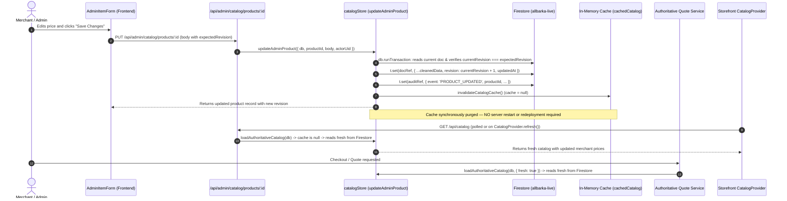

# Catalog and category reconciliation record

## 30 October 2026 — R04-CAT1 read-only live Firestore catalog and taxonomy audit

[Sanitized machine-readable audit report](evidence/catalog-audit/r04-cat1-audit.json) records the complete read-only live Firestore inspection (`allbarka-live`, database `(default)`), feature-branch authoritative snapshot (`loadAuthoritativeCatalog` at `922f7c72c42e96a3501326d208c2914b8c66232a`), and credential-free public deployed preflight (`https://allbarka.com`, deployed commit `8cf4410d4cc9d1a2d4840a62cf0f328c4bdaaee0`). Zero writes, seed operations, price resets, publication changes, rules updates, credential rotations, or workflow executions were performed.

### 1. Access status and environment distinction

- **Worktree vs authorized local configuration:** `E:\allbarka 29-10\AllBarka-34-work` does not contain a local `.env` file (`FIREBASE_CLIENT_EMAIL` and `FIREBASE_PRIVATE_KEY` are unset in the default worktree process environment). Existing authorized local configuration in `E:\allbarka 29-10\AllBarka-34-main\.env` supplies `FIREBASE_PROJECT_ID=allbarka-live`, `FIRESTORE_DATABASE_ID=(default)`, `FIREBASE_CLIENT_EMAIL`, and `FIREBASE_PRIVATE_KEY` (verified by variable name only; no secret values printed or committed). Using those credentials in-memory for read-only Firestore queries succeeded against `allbarka-live` / `(default)`.
- **Three distinct data layers audited and separated:**
  1. **Live Firestore (`allbarka-live` / `(default)`):** `89` documents in `products`, `0` documents in `hamperBoxes`, and `0` persisted documents in `catalogSettings/main`, `merchandising/settings`, `merchandising/preview`, or `storefrontContent/main`.
  2. **Feature-branch authoritative snapshot (`loadAuthoritativeCatalog(db, { fresh: true })` at `922f7c72c42e96a3501326d208c2914b8c66232a`):** `97` projected products (`89` backed by Firestore `products` docs + `8` missing `BID_BOX_PRODUCTS` evaluated against compiled seeds in `src/lib/catalogStore.ts:207-212`) and `3` unavailable hamper boxes (`box-wood`, `box-velvet`, `box-tin`). Public projection (`isProductPubliclyVisible`): **`93` visible** (`91` with positive PKR prices + `2` explicit `quoteOnly: true` inquiry items `corporate-gifting` and `bid-box-acrylic-royal`) and **`4` unavailable/hidden** (`bid-box-umrah-tabarruk`, `bid-box-pyramid-favor`, `bid-box-card-nikkah`, `bid-box-birth-announcement`).
  3. **Public deployed projection (`https://allbarka.com`, commit `8cf4410d4cc9d1a2d4840a62cf0f328c4bdaaee0`):** `/api/health`, `/api/commerce/readiness`, and `/api/catalog` return HTTP `200` (`databaseConnected: true`, `durablePersistenceReady: false`, catalog version `e911ff4c059a56799c438e03089dde03694ec6bc1235e04582b26778667fd1db`); `/api/catalog/taxonomy` returns HTTP `404` because `8cf4410` predates the Stage 2/3 taxonomy router. Deployed `/api/catalog` returns all `97` products (`92` `active: true` [`91` priced + `1` inquiry-only `corporate-gifting`], `5` `active: false` [`bid-box-umrah-tabarruk`, `bid-box-pyramid-favor`, `bid-box-card-nikkah`, `bid-box-birth-announcement`, `bid-box-acrylic-royal`]).

### 2. Complete record counts and schema/pricing summary

| Scope / collection | Live Firestore (`allbarka-live` / `(default)`) | Feature-branch projection (`922f7c72`) | Public deployed `/api/catalog` (`8cf4410`) | Notes |
| --- | --- | --- | --- | --- |
| Compiled product seeds (`src/data/products.ts`) | `97` seeds in source (`89` non-packaging + `8` `BID_BOX_PRODUCTS`) | `97` total in `snapshot.products` | `97` returned | Zero dynamic non-seed documents exist in live Firestore. |
| `products` collection documents | **`89` docs** (`1` canonical `schemaVersion: 1` [`pista` at `revision: 2`, `updatedAt: 2026-10-17T07:37:57.667Z`]; `88` legacy docs with `variants` + `prices`) | `89` Firestore-backed (`status: 'published'`, `active: true`) | `89` Firestore-backed (`active: true`) | `0` Firestore docs have a `commerce` object or explicit `status` field. `88` priced + `1` inquiry-only (`corporate-gifting`). |
| Missing `products` documents (`BID_BOX_PRODUCTS`) | **`8` missing** (`bid-box-umrah-tabarruk`, `bid-box-luxury-tin`, `bid-box-pyramid-favor`, `bid-box-card-nikkah`, `bid-box-jute-pouch`, `bid-box-sweet-nikkah`, `bid-box-birth-announcement`, `bid-box-acrylic-royal`) | `4` active via seed fallback (`bid-box-luxury-tin`, `bid-box-jute-pouch`, `bid-box-sweet-nikkah`, `bid-box-acrylic-royal`); `4` unavailable (`active: false`) via `requiresStoredLegacyPackagingPricing` | `3` active via seed fallback (`bid-box-luxury-tin`, `bid-box-jute-pouch`, `bid-box-sweet-nikkah`); `5` inactive (`active: false`) | None of the 8 `BID_BOX_PRODUCTS` have ever been persisted to Firestore `products`. |
| `hamperBoxes` collection (`box-wood`, `box-velvet`, `box-tin`) | **`0` docs** (all `3` missing) | `3` unavailable (`active: false`, `price: 0`, `catalogRevision: 'unavailable'`) in `snapshot.invalidProductIds` | Not in `/api/catalog` (`snapshot.hamperBoxes` internal) | `loadAuthoritativeCatalog` (`src/lib/catalogStore.ts:238-246`) requires stored `hamperBoxes` docs. |
| `catalogSettings/main` | **Absent** (`exists: false`) | Falls back to `DEFAULT_CATALOG_CONFIGURATION` (`revision: 0`, `4` templates, `15` visible taxonomy entries: `6` categories, `4` collections, `5` occasions) | `/api/catalog/taxonomy` HTTP `404` on `8cf4410` | No custom taxonomy or hidden-ID tombstones persisted yet. |
| `merchandising/settings` & `preview` | **Absent** (`exists: false`) | Falls back to `DEFAULT_MERCHANDISING` (`revision: 1`, `manualOrder: {}`, `featuredIds: []`) | Default ordering | No live merchandising overrides persisted. |
| `storefrontContent/main` | **Absent** (`exists: false`) | Falls back to compiled defaults (`revision: 0`, `liveRevision: 0`) | Compiled defaults | No Studio draft or live publication persisted yet. |

- **Selling-price and variant validity across the 89 Firestore `products` documents:**
  - `88` of `89` stored Firestore products are priced retail/gift/bundle items with valid positive integer PKR selling prices (`205` enabled positive options across the `88` documents; `0` NaN, zero, negative, or fractional prices; `0` variant/price map mismatches).
  - `1` stored Firestore product (`corporate-gifting`) is intentionally inquiry-only (`quoteOnly: true`, `orderMode: 'inquiry_quote'`, `prices: {}`, `variants: []`).
  - `pista` is the sole canonical `schemaVersion: 1` document (`revision: 2`, `updatedAt: 2026-10-17T07:37:57.667Z`), storing authoritative merchant-edited prices (`250g: PKR 1,200`, `500g: PKR 2,200`, `1kg: PKR 4,500`, `pricePer100g: PKR 500`, `allowCustomWeight: true`) that differ from compiled seed fallback (`1250 / 2500 / 5000`). All other `87` priced Firestore documents match their compiled seed prices.

### 3. Specific investigation of the four packaging products (and related `BID_BOX_PRODUCTS`)

| Product ID | Firestore `products` record | Intentional inactivity vs invalid data vs reader compatibility | Compiled seed options & reference PKR prices (not stored in Firestore) | Feature-branch (`922f7c72`) vs deployed (`8cf4410`) behavior |
| --- | --- | --- | --- | --- |
| `bid-box-umrah-tabarruk` | **Missing** (`exists: false` in `allbarka-live` `products`) | **Not intentional archive/draft in Firestore** — document is absent. Compiled seed has 2 filled variant labels exceeding the 40-char generic bound and 50-char n8n wire bound: `Filled Standard (Irani Dates, Badam, Kaju & Kishmish)` (`53` chars) and `Filled Royal (Jumbo Panjgur Dates, Iranian Pista, Mammra Badam & Honey Nuts)` (`76` chars). | `category: 'celebration-boxes'`, `packagingSubcategory: 'tabarruk'`, `occasions: ['umrah']`, `orderMode: 'both'`, `minimumOrderQuantity: 10`. 7 options in seed: `Empty Box (Single Piece)` (200), `Empty Pack of 10 (10% Off)` (2000), `Empty Pack of 25 (15% Off)` (4800), `Empty Pack of 50 (20% Off)` (9250), `Empty Pack of 100 (25% Off)` (17000), `Filled Standard (Irani Dates, Badam, Kaju & Kishmish)` (850), `Filled Royal (Jumbo Panjgur Dates, Iranian Pista, Mammra Badam & Honey Nuts)` (1650). | **Deployed `8cf4410`:** seed fallback throws `INVALID_CATALOG_VARIANT` (`> 40` chars) -> `active: false`. **Feature `922f7c72`:** `legacyPackagingLabels` (`src/lib/catalogSchema.ts:41-48`) and `n8nOrderNotification.ts` allowlist the exact 53/76-char labels for stored records, while `requiresStoredLegacyPackagingPricing` (`src/lib/catalogStore.ts:210`) keeps missing Firestore records `active: false` (`MISSING_CATALOG_PRODUCT`) so compiled prices are never auto-activated. |
| `bid-box-pyramid-favor` | **Missing** (`exists: false` in `allbarka-live` `products`) | **Not intentional archive/draft in Firestore** — document is absent. Compiled seed has 1 filled variant label exceeding the 40-char generic bound: `Filled Standard (Almonds, Cashews & Pistachios)` (`47` chars). | `category: 'celebration-boxes'`, `packagingSubcategory: 'wedding'`, `occasions: ['wedding']`, `orderMode: 'both'`, `minimumOrderQuantity: 10`. 7 options in seed: `Empty Box (Single Piece)` (60), `Empty Pack of 10 (10% Off)` (600), `Empty Pack of 25 (15% Off)` (1375), `Empty Pack of 50 (20% Off)` (2500), `Empty Pack of 100 (25% Off)` (4500), `Filled Standard (Almonds, Cashews & Pistachios)` (350), `Filled Royal (Pista, Kaju & Coated Chocolate)` (600). | **Deployed `8cf4410`:** seed fallback throws `INVALID_CATALOG_VARIANT` (`47 > 40` chars) -> `active: false`. **Feature `922f7c72`:** `legacyPackagingLabels` allowlists the 47-char label for stored records; `requiresStoredLegacyPackagingPricing` keeps the missing record `active: false` (`MISSING_CATALOG_PRODUCT`) until merchant-authorized creation. |
| `bid-box-card-nikkah` | **Missing** (`exists: false` in `allbarka-live` `products`) | **Not intentional archive/draft in Firestore** — document is absent. Compiled seed has 1 filled variant label exceeding the 40-char generic bound: `Filled Standard (Dry Fruits & Confections)` (`42` chars). | `category: 'celebration-boxes'`, `packagingSubcategory: 'wedding'`, `occasions: ['wedding']`, `orderMode: 'both'`, `minimumOrderQuantity: 10`. 7 options in seed: `Empty Box (Single Piece)` (80), `Empty Pack of 10 (10% Off)` (800), `Empty Pack of 25 (15% Off)` (1875), `Empty Pack of 50 (20% Off)` (3500), `Empty Pack of 100 (25% Off)` (6500), `Filled Standard (Dry Fruits & Confections)` (550), `Filled Royal (Irani Dates, Pista & Badam)` (1100). | **Deployed `8cf4410`:** seed fallback throws `INVALID_CATALOG_VARIANT` (`42 > 40` chars) -> `active: false`. **Feature `922f7c72`:** `legacyPackagingLabels` allowlists the 42-char label for stored records; `requiresStoredLegacyPackagingPricing` keeps the missing record `active: false` (`MISSING_CATALOG_PRODUCT`) until merchant-authorized creation. |
| `bid-box-birth-announcement` | **Missing** (`exists: false` in `allbarka-live` `products`) | **Not intentional archive/draft in Firestore** — document is absent. Compiled seed has 2 filled variant labels exceeding the 40-char generic bound: `Filled Standard (Dry Fruits & Chocolates)` (`41` chars) and `Filled Royal (Deluxe Nuts, Panjeeri & Chocolates)` (`49` chars). | `category: 'celebration-boxes'`, `packagingSubcategory: 'baby'`, `occasions: ['birth']`, `orderMode: 'both'`, `minimumOrderQuantity: 10`. 7 options in seed: `Empty Box (Single Piece)` (150), `Empty Pack of 10 (10% Off)` (1500), `Empty Pack of 25 (15% Off)` (3550), `Empty Pack of 50 (20% Off)` (6750), `Empty Pack of 100 (25% Off)` (12500), `Filled Standard (Dry Fruits & Chocolates)` (950), `Filled Royal (Deluxe Nuts, Panjeeri & Chocolates)` (2900). | **Deployed `8cf4410`:** seed fallback throws `INVALID_CATALOG_VARIANT` (`41/49 > 40` chars) -> `active: false`. **Feature `922f7c72`:** `legacyPackagingLabels` allowlists the 41/49-char labels for stored records; `requiresStoredLegacyPackagingPricing` keeps the missing record `active: false` (`MISSING_CATALOG_PRODUCT`) until merchant-authorized creation. |
| `bid-box-luxury-tin`, `bid-box-jute-pouch`, `bid-box-sweet-nikkah` | **Missing** (`exists: false` in `allbarka-live` `products`) | **Missing Firestore records masquerading as active via compiled seed fallback.** All 7 variant labels on each of these 3 items are `<= 40` chars (`max 37`, `33`, `32` chars), so `src/lib/catalogStore.ts:207-212` falls back to compiled seed prices (`active: true`). However, admin item/pricing endpoints (`getAdminCatalogRecord`, `updateCatalogPricing`) return `409 MISSING_CATALOG_PRODUCT` because no Firestore doc exists. | `category: 'celebration-boxes'` (`'gift-boxes'` on `8cf4410`), `packagingSubcategory: 'wedding'`, `occasions: ['wedding']`, `orderMode: 'both'`, `7` positive options each. | **Both `8cf4410` and `922f7c72`:** publicly `active: true` from compiled seeds, but uneditable through legacy pricing endpoints until persisted in Firestore `products`. |
| `bid-box-acrylic-royal` | **Missing** (`exists: false` in `allbarka-live` `products`) | **Missing Firestore record + intentional inquiry-only seed (`quoteOnly: true`).** In `5e63490`/`922f7c72`, its seed is explicitly `quoteOnly: true`, `orderMode: 'inquiry_quote'`, `prices: {}`. | `category: 'celebration-boxes'`, `packagingSubcategory: 'wedding'`, `occasions: ['wedding']`, `quoteOnly: true`, `orderMode: 'inquiry_quote'`, `prices: {}`. | **Deployed `8cf4410`:** predated `quoteOnly: true` on `bid-box-acrylic-royal` and failed `> 40` char filled labels (`active: false`). **Feature `922f7c72`:** projects as `active: true, quoteOnly: true` via seed fallback (`src/lib/catalogStore.ts:207-212`). |

### 4. Taxonomy, category, collection, occasion, and copy reconciliation across all 97 products

- **Stored Firestore `category` distribution (`89` documents):**
  - `nuts`: `22` (`badam`, `kaju`, `pista`, `akhrot`, `kishmish`, `khajoor`, `anjeer`, `khubani`, `chilgoza`, `char-maghaz`, `makhana`, `kalonji`, `ajwa-dates`, `medjool-dates`, `aseel-dates`, `chohara`, `brazil-nuts`, `macadamia-nuts`, `pecan-nuts`, `hazelnuts`, `salted-almonds`, `honey-roasted-cashews`)
  - `snacks-seeds`: `13` (`roasted-chana`, `nimko-mix`, `sunflower-seeds`, `pumpkin-seeds`, `chia-seeds`, `flax-seeds`, `sesame-seeds`, `melon-seeds`, `peanut-chikki`, `til-chikki`, `gur-chana`, `multigrain-mix`, `salted-peanuts`)
  - `oils`: `15` (`desi-ghee`, `mustard-oil`, `coconut-oil`, `olive-oil`, `almond-oil`, `black-seed-oil`, `sesame-oil`, `castor-oil`, `peanut-oil`, `walnut-oil`, `flaxseed-oil`, `pumpkin-seed-oil`, `sunflower-oil-cold`, `clove-oil`, `eucalyptus-oil`)
  - `essentials`: `5` (`honey-sidr`, `honey-wildflower`, `shilajit`, `brown-sugar`, `jaggery-powder`)
  - `herbs-spices`: `19` (`zafran`, `elaichi`, `dar-chini`, `laung`, `kali-mirch`, `haldi-powder`, `zeera`, `sonf`, `ajwain`, `methi-dana`, `ispaghol`, `moringa-powder`, `ashwagandha`, `safed-musli`, `mulethi`, `black-cardamom`, `star-anise`, `jaiphal`, `javitri`)
  - `bundles`: `13` (`bundle-brain-booster`, `bundle-energy-pack`, `bundle-family-festive`, `bundle-immunity-shield`, `bundle-winter-warmth`, `bundle-keto-power`, `bundle-new-mom-care`, `bundle-students-focus`, `bundle-fitness-fuel`, `bundle-silver-hamper`, `bundle-gold-hamper`, `bundle-platinum-hamper`, `bundle-ramadan-ready`, `corporate-gifting` — note `deal-1` and `deal-2` are stored under `gift-boxes`)
  - `gift-boxes`: `2` (`deal-1`, `deal-2`)
  - **Mismatch check between stored Firestore `category` and compiled seed `category`:** `0` mismatches across all `89` stored documents.
- **Customer-facing discovery (`productMatchesCategory` across `93` feature-branch publicly visible items):**
  - Built-in categories (`6` visible in `DEFAULT_CATALOG_CONFIGURATION`): `dry-fruits: 22`, `dates: 5`, `seeds-snacks: 13`, `oils: 15`, `essentials: 5`, `herbs-spices: 19`.
  - Commercial collections (`4` visible in `DEFAULT_CATALOG_CONFIGURATION`): `celebration-boxes: 4` (`8` projected in `snapshot.products`, `4` publicly visible), `gift-boxes: 2` (`deal-1`, `deal-2`), `bundles: 13`, `deals: 15` (`13` `bundles` + `deal-1`, `deal-2`).
  - Occasions (`5` visible in `DEFAULT_CATALOG_CONFIGURATION`): `wedding: 4` publicly visible (`6` in `snapshot.products`), `umrah: 0` publicly visible (`1` in `snapshot.products`: `bid-box-umrah-tabarruk`), `birth: 0` publicly visible (`1` in `snapshot.products`: `bid-box-birth-announcement`), `ramadan: 0`, `corporate: 0`.
- **Semantic taxonomy & copy findings requiring merchant decision before any write:**
  1. **`gift-boxes` vs `bundles` assignment (`deal-1`, `deal-2` vs `bundle-silver-hamper`, `bundle-gold-hamper`, `bundle-platinum-hamper`, `bundle-ramadan-ready`, `corporate-gifting`):** Currently `deal-1` ("The Classics (Walnut & Pista Duo)") and `deal-2` ("Work-Day Fuel (Almonds & Cashews)") are the **only** two items matching `gift-boxes`, while the actual gift hampers (`bundle-silver-hamper`, `bundle-gold-hamper`, `bundle-platinum-hamper`, `bundle-ramadan-ready`, `corporate-gifting`) are stored with `category: 'bundles'` and `collections: []`, so they do not appear in `/category/gift-boxes`.
  2. **Empty `occasions` on all `89` Firestore documents:** Because `occasions` is not populated on any stored Firestore product, public occasion filters for `ramadan` (`0` matches despite `bundle-ramadan-ready` and `5` date products) and `corporate` (`0` matches despite `corporate-gifting`) return zero products, and `umrah`/`birth` return zero while `bid-box-umrah-tabarruk` and `bid-box-birth-announcement` lack Firestore records.
  3. **Date products dual-matching `dry-fruits` and `dates` (`khajoor`, `ajwa-dates`, `medjool-dates`, `aseel-dates`, `chohara`):** All 5 date items are stored in Firestore with primary `category: 'nuts'` and match `/category/dates` via the legacy ID/name matcher (`src/config/categories.ts:154-169`) while also remaining in `/category/dry-fruits`. Additionally, `ajwa-dates` (`name_en: "Ajwa Dates Madina (Khajoor)"`) has `desc_en: "Soft, melt-in-your-mouth Irani Muzafati dates..."` (identical to `khajoor`), and `medjool-dates` (`name_en: "Medjool Dates Jumbo"`) has `desc_en: "Jumbo Panjgur Amber dates..."` (identical to `aseel-dates`).
  4. **Missing `hamperBoxes` documents (`box-wood`, `box-velvet`, `box-tin`):** Because `hamperBoxes` has `0` documents in live Firestore, `loadAuthoritativeCatalog` (`src/lib/catalogStore.ts:238-246`) resolves all 3 custom hamper boxes as `active: false, price: 0, catalogRevision: 'unavailable'`.

### 5. Required audit header (`R04-CAT1`)

```text
Audit ID / date / auditor: R04-CAT1 / 30 October 2026 (2026-10-30T01:02:51.073Z) / Antigravity (read-only audit)
Trigger and affected product IDs or import batch: Scheduled R04-CAT1 complete live Firestore catalog/taxonomy reconciliation and investigation of bid-box-umrah-tabarruk, bid-box-pyramid-favor, bid-box-card-nikkah, bid-box-birth-announcement across all 97 catalog IDs and 3 hamperBox IDs.
Environment and source type (live / export / emulator / fixture): Live Firestore (project: allbarka-live, database: (default)) compared against feature-branch authoritative snapshot (922f7c72c42e96a3501326d208c2914b8c66232a) and live deployed public GET projection (https://allbarka.com at 8cf4410d4cc9d1a2d4840a62cf0f328c4bdaaee0).
Application revision; taxonomy revision; snapshot retrieval time: Feature branch 922f7c72c42e96a3501326d208c2914b8c66232a (deployed build 8cf4410d4cc9d1a2d4840a62cf0f328c4bdaaee0); catalogSettings/main absent (DEFAULT_CATALOG_CONFIGURATION revision 0); merchandising absent (revision 1); storefrontContent/main absent (revision 0 / liveRevision 0); retrieved 2026-10-30T01:02:51.073Z.
Read path, pagination coverage and any inaccessible records: Read-only firebase-admin Firestore collection.get() across products (89 docs), hamperBoxes (0 docs), catalogSettings/main, merchandising/settings, merchandising/preview, storefrontContent/main (100% single-snapshot enumeration, 0 inaccessible records) + 3 credential-free public GETs to https://allbarka.com.
Totals: scanned / published / draft / archived / unavailable: 97 product IDs + 3 hamperBox IDs scanned. Live Firestore: 89 products docs (89 implicit published / active, 0 draft, 0 archived) + 8 missing BID_BOX_PRODUCTS + 3 missing hamperBoxes. Feature-branch projection: 93 publicly visible (91 priced + 2 quoteOnly) / 4 unavailable products (bid-box-umrah-tabarruk, bid-box-pyramid-favor, bid-box-card-nikkah, bid-box-birth-announcement) + 3 unavailable hamperBoxes. Deployed public /api/catalog: 92 active / 5 inactive.
Known legacy aliases and approved compatibility exceptions: Category aliases nuts->dry-fruits, snacks-seeds->seeds-snacks, legacy celebration-boxes->gift-boxes fallback; 5 date IDs in nuts matching dates via ID/name; 6 allowlisted >40-char legacy packaging variant labels on the 4 BID_BOX_PRODUCTS (including 53/76-char Umrah wire labels).
Result: BLOCKED for live data remediation / PASS for read-only audit enumeration; limitations: 8 BID_BOX_PRODUCTS and 3 hamperBoxes are absent from live Firestore; semantic taxonomy/copy exceptions and initial packaging/hamper selling prices require explicit merchant confirmation before any authorized write.
```

### 6. Remaining blocker and smallest concrete next action

- **Remaining blocker:** Writing the 8 missing `BID_BOX_PRODUCTS` (`bid-box-umrah-tabarruk`, `bid-box-pyramid-favor`, `bid-box-card-nikkah`, `bid-box-birth-announcement`, `bid-box-luxury-tin`, `bid-box-jute-pouch`, `bid-box-sweet-nikkah`, `bid-box-acrylic-royal`) and 3 missing `hamperBoxes` (`box-wood`, `box-velvet`, `box-tin`) to live Firestore—or updating taxonomy/occasion/copy fields on existing products—is **blocked on explicit merchant confirmation** of:
  1. Authoritative PKR selling prices and intended publication state (`published` vs `draft` vs `inquiry_quote`) for the 4 unavailable packaging boxes (`bid-box-umrah-tabarruk`, `bid-box-pyramid-favor`, `bid-box-card-nikkah`, `bid-box-birth-announcement`), the 3 seed-fallback wedding boxes (`bid-box-luxury-tin`, `bid-box-jute-pouch`, `bid-box-sweet-nikkah`), inquiry-only `bid-box-acrylic-royal`, and the 3 custom hamper boxes (`box-wood`, `box-velvet`, `box-tin`).
  2. Intended `gift-boxes` vs `bundles` / `deals` classification for `deal-1`, `deal-2`, `bundle-silver-hamper`, `bundle-gold-hamper`, `bundle-platinum-hamper`, `bundle-ramadan-ready`, and `corporate-gifting`, plus `occasions` tags (`ramadan`, `corporate`, `wedding`) and corrected variety descriptions for `ajwa-dates` and `medjool-dates`.
- **Smallest concrete next action:** Present the per-item exception table below to the merchant/owner to record approved prices, publication states, and category/occasion/copy decisions in `docs/admin-expansion/DECISIONS.md` (and keep `SEC01` credential rotation + Stage 6 compatible n8n receiver verification sequenced before any live write or deployment).

## 27 October 2026 — current public projection, private reconciliation still blocked

[Current report](admin-expansion/evidence/recovery-20261027/public-catalog.json) enumerates the complete 97-product response from the old deployed `8cf4410` build: 92 active, 5 inactive, 97 unique IDs, no unknown built-in category IDs or feature pricing-adapter errors in this captured public scope. Public catalog version: `e911ff4c059a56799c438e03089dde03694ec6bc1235e04582b26778667fd1db`. This is a public projection, not the full merchant Firestore snapshot.

The four historical long-label packaging products are still unavailable. Acrylic Royal is also inactive but is inquiry-only in source; do not presume a fifth malformed saved record. Active unpriced Corporate Gifting is explicitly inquiry-only. Legacy nuts/dates and seed aliases remain supported; no reclassification or rate is inferred. Current published taxonomy is inaccessible on the old build (`/api/catalog/taxonomy` 404). Private drafts/statuses, intended semantic assignments, media/facts and full live changed-item journeys remain BLOCKED. No data writes. See [recovery evidence](RESUME_VERIFICATION.md).

The planning table and subsequent dated runs below are historical records; their earlier NOT_READ statements do not override this new limited public read.

Updated: 30 October 2026 (Asia/Karachi).

Protocol: [RULES.md R04](../RULES.md#r04--catalog-classification-is-an-end-to-end-gate). This file records audit evidence; it is not a background synchronization job or automatic Firestore repair.

At each catalog/storefront task, compare the current catalog/taxonomy revision or update watermark with the last audit through existing authorized read access. If newer or unknown, obtain a fresh snapshot; if unavailable, record stale/unverified status instead of waiting for a repeated owner prompt.

## Current checkpoint

| Field | Record |
| --- | --- |
| Trigger | `R04-CAT1` complete read-only live Firestore catalog/taxonomy reconciliation and packaging-product investigation (`2026-10-30T01:02:51.073Z`). |
| Source inspected | Repository at `922f7c72c42e96a3501326d208c2914b8c66232a` on `codex/admin-catalog-foundation-20261023` + live Firestore `allbarka-live` / `(default)` + deployed `https://allbarka.com` (`8cf4410d4cc9d1a2d4840a62cf0f328c4bdaaee0`). |
| Live Firestore data | READ_ONLY_COMPLETE (`2026-10-30T01:02:51.073Z`): `89` `products` docs (`1` canonical `schemaVersion: 1` `pista` at `revision: 2`; `88` legacy docs), `0` `hamperBoxes` docs, `0` persisted settings docs (`catalogSettings/main`, `merchandising/settings`, `storefrontContent/main` all absent). |
| Live audit status | DONE for read-only enumeration (`R04-CAT1`); proposed Firestore writes/reclassifications are prepared below and gated on explicit merchant confirmation of prices, publication status, and taxonomy assignments. |
| Total current records scanned | `97` catalog product IDs (`89` in Firestore `products`, `8` missing `BID_BOX_PRODUCTS`) + `3` hamper box IDs (`0` in Firestore `hamperBoxes`) + `4` settings document paths. |
| Production corrections | None. No reclassification, seed, price change or publish performed. |
| Source findings | The 4 unavailable packaging IDs (`bid-box-umrah-tabarruk`, `bid-box-pyramid-favor`, `bid-box-card-nikkah`, `bid-box-birth-announcement`) are **absent from Firestore `products`** (not stored as draft/archived or malformed Firestore docs). The other 4 `BID_BOX_PRODUCTS` (`bid-box-luxury-tin`, `bid-box-jute-pouch`, `bid-box-sweet-nikkah`, `bid-box-acrylic-royal`) and all 3 `hamperBoxes` (`box-wood`, `box-velvet`, `box-tin`) are also absent from Firestore. Feature-branch reader fixes (`legacyPackagingLabels` + `requiresStoredLegacyPackagingPricing`) work as designed. |
| Next step | Obtain owner/merchant decisions on the unresolved business questions in the exception table below (packaging & hamper box selling prices/publication state, `gift-boxes` vs `bundles` membership, `occasions` tags, and `ajwa-dates`/`medjool-dates` descriptions) before executing any separately authorized Firestore write or Stage 6 deployment. |

The full offline suite includes existing catalog/category/discovery fixtures; its result is in [PREMIUM_PLANNING_CHECKPOINT.md](PREMIUM_PLANNING_CHECKPOINT.md). Those fixtures cannot establish the current live category assignments.

## Source map

- `src/config/categories.ts`: built-in categories, commercial collections, occasions and legacy aliases.
- `src/lib/catalogConfiguration.ts` / `catalogConfigurationRouter.ts`: current typed taxonomy, templates, visibility and validated settings.
- `src/lib/catalogSchema.ts` / `catalogStore.ts`: normalization, saved metadata, public projection and publication behavior.
- `src/components/AdminItemForm.tsx`: primary category, template application, collections/occasions and packaging subcategory.
- `src/lib/catalogDiscovery.ts`, `catalogLinks.ts` and actual shop/category routes: search, routing and discovery.
- Existing `tests/catalog-categories.test.tsx`, `catalog-filter-draft.test.ts`, `catalog-render.test.tsx`, `discovery.test.ts`, `admin-expansion-item-workflow.test.ts` and `admin-expansion-persistence.test.ts`: relevant regression coverage to extend when behavior changes.

## Required audit header for each later run

```text
Audit ID / date / auditor:
Trigger and affected product IDs or import batch:
Environment and source type (live / export / emulator / fixture):
Application revision; taxonomy revision; snapshot retrieval time:
Read path, pagination coverage and any inaccessible records:
Totals: scanned / published / draft / archived / unavailable:
Known legacy aliases and approved compatibility exceptions:
Result: PASS / FAIL / BLOCKED; limitations:
```

## Per-item exception format

| Product ID | Observed category / collections / occasions | Expected assignment and merchant/source evidence | Customer impact | Proposed change | Status / verification |
| --- | --- | --- | --- | --- | --- |
| `bid-box-umrah-tabarruk` | **Missing in Firestore `products`.** Compiled seed: `category: 'celebration-boxes'`, `packagingSubcategory: 'tabarruk'`, `collections: []`, `occasions: ['umrah']`, `orderMode: 'both'`, `MOQ: 10`. | Packaging item with 7 compiled options (`200 / 2000 / 4800 / 9250 / 17000 / 850 / 1650` PKR) including 53-char (`Filled Standard (Irani Dates, Badam, Kaju & Kishmish)`) and 76-char (`Filled Royal (Jumbo Panjgur Dates, Iranian Pista, Mammra Badam & Honey Nuts)`) labels. Feature branch allowlists these exact labels (`src/lib/catalogSchema.ts:41-48`, `n8nOrderNotification.ts`), while `requiresStoredLegacyPackagingPricing` (`src/lib/catalogStore.ts:210`) blocks seed-price fallback when the Firestore doc is absent. | Unavailable (`active: false`) on both deployed `8cf4410` and feature branch `922f7c72`; `/category/celebration-boxes?occasion=umrah` returns `0` public products; admin pricing edit returns `409 MISSING_CATALOG_PRODUCT`. | **Unresolved merchant decision:** Confirm whether to publish, keep draft, or set inquiry-only, and confirm authoritative PKR selling prices for the 7 options (do not auto-seed compiled prices). Once confirmed, create canonical `schemaVersion: 1` record via admin item workflow and verify n8n receiver compatibility before enabling live checkout. | `R04-CAT1` audited; **BLOCKED on merchant price/status confirmation & Stage 6 receiver release** |
| `bid-box-pyramid-favor` | **Missing in Firestore `products`.** Compiled seed: `category: 'celebration-boxes'`, `packagingSubcategory: 'wedding'`, `collections: []`, `occasions: ['wedding']`, `orderMode: 'both'`, `MOQ: 10`. | Packaging item with 7 compiled options (`60 / 600 / 1375 / 2500 / 4500 / 350 / 600` PKR) including 47-char label `Filled Standard (Almonds, Cashews & Pistachios)`. Feature branch allowlists this exact label for stored records and blocks seed-price fallback while the Firestore doc is absent. | Unavailable (`active: false`) on both deployed `8cf4410` and feature branch `922f7c72`; hidden from `/category/celebration-boxes` and `/gifting`; admin pricing edit returns `409 MISSING_CATALOG_PRODUCT`. | **Unresolved merchant decision:** Confirm intended publication status (`published` / `draft` / `archived` / `inquiry_quote`) and authoritative PKR selling prices for the 7 options. Once confirmed, create canonical `schemaVersion: 1` record in Firestore `products`. | `R04-CAT1` audited; **BLOCKED on merchant price/status confirmation** |
| `bid-box-card-nikkah` | **Missing in Firestore `products`.** Compiled seed: `category: 'celebration-boxes'`, `packagingSubcategory: 'wedding'`, `collections: []`, `occasions: ['wedding']`, `orderMode: 'both'`, `MOQ: 10`. | Packaging item with 7 compiled options (`80 / 800 / 1875 / 3500 / 6500 / 550 / 1100` PKR) including 42-char label `Filled Standard (Dry Fruits & Confections)`. Feature branch allowlists this exact label for stored records and blocks seed-price fallback while the Firestore doc is absent. | Unavailable (`active: false`) on both deployed `8cf4410` and feature branch `922f7c72`; hidden from `/category/celebration-boxes` and `/gifting`; admin pricing edit returns `409 MISSING_CATALOG_PRODUCT`. | **Unresolved merchant decision:** Confirm intended publication status and authoritative PKR selling prices for the 7 options. Once confirmed, create canonical `schemaVersion: 1` record in Firestore `products`. | `R04-CAT1` audited; **BLOCKED on merchant price/status confirmation** |
| `bid-box-birth-announcement` | **Missing in Firestore `products`.** Compiled seed: `category: 'celebration-boxes'`, `packagingSubcategory: 'baby'`, `collections: []`, `occasions: ['birth']`, `orderMode: 'both'`, `MOQ: 10`. | Packaging item with 7 compiled options (`150 / 1500 / 3550 / 6750 / 12500 / 950 / 2900` PKR) including 41-char (`Filled Standard (Dry Fruits & Chocolates)`) and 49-char (`Filled Royal (Deluxe Nuts, Panjeeri & Chocolates)`) labels. Feature branch allowlists these exact labels for stored records and blocks seed-price fallback while the Firestore doc is absent. | Unavailable (`active: false`) on both deployed `8cf4410` and feature branch `922f7c72`; `/category/celebration-boxes?occasion=birth` returns `0` public products; admin pricing edit returns `409 MISSING_CATALOG_PRODUCT`. | **Unresolved merchant decision:** Confirm intended publication status and authoritative PKR selling prices for the 7 options. Once confirmed, create canonical `schemaVersion: 1` record in Firestore `products`. | `R04-CAT1` audited; **BLOCKED on merchant price/status confirmation** |
| `bid-box-luxury-tin`, `bid-box-jute-pouch`, `bid-box-sweet-nikkah` (**Priority 1**) | **Missing in Firestore `products` (active & publicly purchasable via compiled seed fallback).** Compiled seed: `category: 'celebration-boxes'` (`'gift-boxes'` on `8cf4410`), `packagingSubcategory: 'tin'` / `'wedding'`, `occasions: ['wedding']`, `orderMode: 'both'`, `moqOverride: undefined` (dynamic Rule D1 MOQ via `calculatePackagingMoq`). | All 7 variant labels on each of these 3 items are `<= 40` chars (`max 37`, `33`, `32` chars), so `src/lib/catalogStore.ts:207-212` falls back to **UNCONFIRMED compiled reference PKR prices** (`active: true`): `bid-box-luxury-tin` (`140 / 1400 / 3300 / 6250 / 11500 / 1150 / 2200` PKR), `bid-box-jute-pouch` (`75 / 750 / 1800 / 3400 / 6000 / 450 / 850` PKR), `bid-box-sweet-nikkah` (`180 / 1800 / 4300 / 8250 / 15000 / 1750 / 3800` PKR). | **Priority 1 confirmation:** Publicly purchasable from unconfirmed compiled fallback prices, while legacy admin pricing endpoints (`getAdminCatalogRecord`, `updateCatalogPricing`) return `409 MISSING_CATALOG_PRODUCT` because no Firestore `products` document exists. | **Priority 1 unresolved merchant decision:** Confirm publication status (`published` / `draft` / `archived`), `orderMode` (`both` / `standard` / `inquiry_quote`), and authoritative PKR selling prices for all 7 options per item (keep `moqOverride` unset). Once confirmed, persist canonical `schemaVersion: 1` documents via `updateAdminProduct` (`expectedRevision: 0`). | `R04-CAT1` audited; `R04-CAT2` dry-run validated; **PRIORITY 1 BLOCKED on merchant price/status confirmation** |
| `bid-box-acrylic-royal` | **Missing in Firestore `products` (active inquiry-only via compiled seed fallback on `922f7c72`; inactive on `8cf4410`).** Compiled seed: `category: 'celebration-boxes'`, `packagingSubcategory: 'wedding'`, `occasions: ['wedding']`, `quoteOnly: true`, `orderMode: 'inquiry_quote'`, `prices: {}`. | Intentional inquiry-only (`quoteOnly: true`) item in `5e63490`/`922f7c72` source; on old deployed `8cf4410` it was not `quoteOnly` and failed `> 40` char filled labels (`active: false`). | On feature branch `922f7c72`, visible in `/category/celebration-boxes` and `/gifting` as an inquiry-only item (`Request Quote`), but lacks a Firestore `products` document (`getAdminCatalogRecord` returns `409 MISSING_CATALOG_PRODUCT`). | **Unresolved merchant decision:** Confirm that `bid-box-acrylic-royal` should remain `published` in `inquiry_quote` mode (or provide fixed pack prices), then persist its canonical `schemaVersion: 1` document in Firestore `products`. | `R04-CAT1` audited; **BLOCKED on merchant confirmation** |
| `box-wood`, `box-velvet`, `box-tin` (`hamperBoxes`) | **Missing in Firestore `hamperBoxes` (`0` docs in collection).** Compiled `HAMPER_BOXES` (`src/lib/hamperCatalog.ts:9-13`): `box-wood` (**`1800` PKR** unconfirmed ref, 4–6 portions), `box-velvet` (**`1400` PKR** unconfirmed ref, 3–5 portions), `box-tin` (**`950` PKR** unconfirmed ref, 3–4 portions). | `loadAuthoritativeCatalog` (`src/lib/catalogStore.ts:238-246`) requires stored `hamperBoxes` documents and resolves missing IDs to `unavailableHamperBox(seed)` (`active: false, price: 0, catalogRevision: 'unavailable'`), adding all 3 IDs to `snapshot.invalidProductIds`. | Custom hamper box records in `snapshot.hamperBoxes` are marked `unavailable` against live Firestore until `hamperBoxes` documents exist. | **Unresolved merchant decision:** Confirm authoritative PKR box prices (`1800`, `1400`, `950` PKR unconfirmed refs) and `active: true | false` for `box-wood`, `box-velvet`, and `box-tin`, then persist canonical `hamperBoxes` documents in a transaction. | `R04-CAT1` audited; `R04-CAT2` dry-run validated; **BLOCKED on merchant price/status confirmation** |
| `pista` | Stored in Firestore `products` as canonical `schemaVersion: 1` (`revision: 2`, `updatedAt: 2026-10-17T07:37:57.667Z`): `category: 'nuts'`, `collections: []`, `occasions: []`, `allowCustomWeight: true`, `pricePer100g: 500`, `250g: 1200`, `500g: 2200`, `1kg: 4500` PKR. | Authoritative merchant-updated record (differs from compiled seed fallback `1250 / 2500 / 5000` PKR). Validated cleanly by `parseStoredCatalogProduct`. | Live storefront and canonical quote service use the merchant's PKR `1,200 / 2,200 / 4,500` rates and `500` PKR/100g custom rate. | **No change — preserve exact stored record and revision (`revision: 2`).** Never overwrite with compiled seed prices. | **PASS (verified live authoritative record)** |
| `deal-1`, `deal-2` vs `bundle-silver-hamper`, `bundle-gold-hamper`, `bundle-platinum-hamper`, `bundle-ramadan-ready`, `corporate-gifting` | Stored in Firestore `products`: `deal-1` and `deal-2` have `category: 'gift-boxes'`, `collections: []`, `occasions: []`; `bundle-silver-hamper`, `bundle-gold-hamper`, `bundle-platinum-hamper`, `bundle-ramadan-ready`, and `corporate-gifting` have `category: 'bundles'`, `collections: []`, `occasions: []`. | `productMatchesCategory` (`src/config/categories.ts:154-205`) matches `gift-boxes` only when `category === 'gift-boxes'` or `collections` includes `'gift-boxes'`. Thus `/category/gift-boxes` currently shows only `deal-1` ("The Classics (Walnut & Pista Duo)") and `deal-2` ("Work-Day Fuel (Almonds & Cashews)"), omitting the 3 luxury hampers, the Ramadan gift box, and Corporate Gifting. | Customers browsing `Gift Boxes` (`/category/gift-boxes`) see only 2 duo deals instead of the hamper boxes; `deals` (`/category/deals`) includes all 13 `bundles` plus `deal-1` and `deal-2` (`15` items). | **Unresolved merchant decision:** Confirm whether `bundle-silver-hamper`, `bundle-gold-hamper`, `bundle-platinum-hamper`, `bundle-ramadan-ready`, and `corporate-gifting` should add `collections: ['gift-boxes']` (or primary `category: 'gift-boxes'`), and whether `deal-1` / `deal-2` should move to `category: 'bundles'` or `collections: ['deals']`. | `R04-CAT1` audited; **BLOCKED on merchant taxonomy confirmation** |
| `bundle-ramadan-ready`, `corporate-gifting`, `khajoor`, `ajwa-dates`, `medjool-dates`, `aseel-dates`, `chohara` (Occasion tags) | Stored in Firestore `products` with `occasions: []` (all 89 stored Firestore docs have empty `occasions`). | `DEFAULT_CATALOG_CONFIGURATION` exposes 5 public occasions (`wedding`, `umrah`, `birth`, `ramadan`, `corporate`), but only the 8 compiled `BID_BOX_PRODUCTS` carry `occasions` (`wedding`, `umrah`, `birth`). Public occasion filters for `ramadan` and `corporate` match `0` products. | Filtering by `Ramadan` or `Corporate` occasion in the shop/gifting routes returns `0` results even though `bundle-ramadan-ready`, `corporate-gifting`, and 5 date products are active and published. | **Unresolved merchant decision:** Confirm which stored products should carry `occasions: ['ramadan']` (e.g., `bundle-ramadan-ready`, date items), `occasions: ['corporate']` (e.g., `corporate-gifting`, luxury hampers), and `occasions: ['wedding']` (e.g., `bundle-silver-hamper`, `bundle-gold-hamper`, `bundle-platinum-hamper`). | `R04-CAT1` audited; **BLOCKED on merchant occasion assignment confirmation** |
| `khajoor`, `ajwa-dates`, `medjool-dates`, `aseel-dates`, `chohara` (Dates category & descriptions) | Stored in Firestore `products` with primary `category: 'nuts'`, `collections: []`, `occasions: []`. Matched into `/category/dates` via legacy ID/name alias (`src/config/categories.ts:154-169`) while also matching `/category/dry-fruits`. | Syntactically valid via legacy alias, **but** two stored descriptions contradict their product titles: `ajwa-dates` (`"Ajwa Dates Madina (Khajoor)"`) has `desc_en: "Soft, melt-in-your-mouth Irani Muzafati dates..."` (copied from `khajoor`), and `medjool-dates` (`"Medjool Dates Jumbo"`) has `desc_en: "Jumbo Panjgur Amber dates..."` (copied from `aseel-dates`). | Customers see all 5 date items in both `Dates` and `Dry Fruits`, and `ajwa-dates` / `medjool-dates` display variety descriptions for Irani Muzafati / Panjgur Amber dates on their PDPs. | **Unresolved merchant decision:** (1) Confirm whether the 5 date products should set primary `category: 'dates'` (with `collections: ['dry-fruits']` if dual listing is desired) or keep `category: 'nuts'`; (2) supply merchant-verified `desc_en` / `desc_ur` / `desc_ar` copy for `ajwa-dates` and `medjool-dates`. | `R04-CAT1` audited; **BLOCKED on merchant copy/category confirmation** |
| `catalogSettings/main`, `merchandising/settings`, `storefrontContent/main` | **Absent in Firestore (`exists: false`).** Runtime falls back to `DEFAULT_CATALOG_CONFIGURATION` (`revision: 0`), `DEFAULT_MERCHANDISING` (`revision: 1`), and compiled storefront content (`revision: 0`, `liveRevision: 0`). | Intentional clean-slate fallback: no automatic settings writes occur on read (`instructions.md` Stage 5 invariant). Deployed `8cf4410` returns HTTP `404` on `/api/catalog/taxonomy` because it predates Stage 2/3. | Feature branch serves all 6 built-in categories, 4 collections, 5 occasions, and 4 attribute templates from `DEFAULT_CATALOG_CONFIGURATION`; deployed `8cf4410` lacks `/api/catalog/taxonomy` until feature branch release. | **No automatic write.** Persist `catalogSettings/main`, `merchandising/settings`, or `storefrontContent/main` only when the merchant saves taxonomy/merchandising/Studio changes through the admin UI after feature branch deployment. | **PASS (expected fallback behavior verified)** |

Delete the placeholder row only when replacing it with a dated real audit; retain historical runs or link their sanitized reports. Summaries should include all-product coverage and the full exception list, not only passing examples. Keep private notes, supplier costs, customer information and credentials out of reports.

## Acceptance for an audit result

- Every product in the stated scope was enumerated; counts reconcile with the snapshot and pagination.
- Primary category, collections, occasions and required subtype/template semantics were checked against current configuration and supported compatibility rules.
- Each changed published item appears in its expected customer routes/search/filters with correct imagery and current purchase/inquiry state; negative membership and draft privacy were checked.
- Normal refresh behavior after authorized changes was verified; stale output is distinguished from incorrect persisted data.
- Unknown/ambiguous mappings have evidence or an explicit owner question. Nothing was silently assigned from a guess or a fallback.
- Any correction has a before/after dry run, authorized scope, revision handling and post-change verification; unrelated values/IDs/receipts remain intact.

A source-only or fixture-only result must be labeled as such. The optional automated report remains PROPOSED / TODO as M34 in [MASTER_PLAN.md](../MASTER_PLAN.md).

## V1 — 25 October 2026

Baseline 2c94349b7754a94b936783b4c85595c66f406a83. Live revision UNKNOWN: no configured Firestore read tool/current authorized private export. Live audit BLOCKED. Hero/category-control styling changes no IDs or mappings; existing source/fixture category regressions and real pistachio search/category/PDP navigation are required in PREMIUM_V1.md. No production writes.


## 26 October — visual/motion revision

Baseline 599d13461db796a8f6ad73bbf44910d7ec3a78ab; recovery source 30438be512ac433dfcfb59a911137ec00d46f2f9. Live revision UNKNOWN; no Firestore reader/current export, audit BLOCKED. IDs, taxonomy assignments, routes, membership and prices unchanged. Dates uses existing generated dark-date category imagery if no exact-category cover exists; the legacy khajoor record remains in nuts and normal aliases still control discovery. This is illustration, not a reclassification or delivered-contents claim. Default badges now follow destinations after merchant reorder. Fixture verification is recorded in PREMIUM_V1_REVISION.md; no live writes/certification.


27 October 2026 — V2 presentation checkpoint: live watermark remains UNKNOWN; no new authorized snapshot available, live audit BLOCKED. Existing local readers now exclude disabled variant labels and resolve removed remembered selections, without changing product/category assignments. New fixture checks selected 500g/cart, category results, mobile budget filters and back depth. Full fixture/asset evidence is in PREMIUM_V2.md. No claim that current Firestore records were all audited; no production writes.


27 October 2026 — V3 PDP presentation: watermark UNKNOWN / live audit BLOCKED. No authorized Firestore read tool/current export found; no live writes or category changes. Existing fixture product pista and the first saved bid-box fixture exercise food/packaging presentation, selected quantities/totals, available related-price selection and failure handling. No full live semantic category certification. See PREMIUM_V3.md; prior audits remain historical.


27 October 2026 — editorial presentation: live watermark UNKNOWN/current audit BLOCKED; no authorized current merchant snapshot. Journal related products use the current public active catalog and shared ProductCard instead of a raw first-price/500g fallback. Existing fixture related-cart and full regressions are local evidence; no new classification/price/status or live write. See PREMIUM_EDITORIAL.md.


27 October 2026 — V4 gifting: live watermark UNKNOWN/current audit BLOCKED; no authorized current merchant snapshot. Gift membership/occasion matching retains the existing rule and exact IDs. Starting-pack budget uses an enabled positive option, not order/MOQ affordability. Current snapshot fixtures verify changed pista rate, unlisted filling recovery, saved hamper repricing and unavailable packaging. Shared hamper availability validation now rejects inquiry/draft/archived/disabled250g selections; no record/price/taxonomy mutation. This is source/fixture evidence, not current live semantic reconciliation. See PREMIUM_GIFTING.md.


27 October 2026 — M18 cart/checkout: live watermark UNKNOWN / current semantic audit BLOCKED; no authorized current merchant snapshot/read tool. Current provider images and exact saved identities/variants remain. Fixture deliberately holds an older public snapshot while the actual quote service reads a changed memory-catalog rate, verifying canonical quote line-price/total continuity. Drawer recommendations now exclude unavailable/unpublished/inquiry records and disabled/nonpositive portions. No live assignment, rate, price formula, stock, publication or taxonomy write. Local evidence only; see PREMIUM_PURCHASE.md.

## 28 October 2026 — M21 motion preference

Current public GET watermark was refreshed: 97 products, version `e911ff4c059a56799c438e03089dde03694ec6bc1235e04582b26778667fd1db`, unchanged from the prior captured projection. [Read record](evidence/motion-preference/public-watermark.json). No catalog/category/media/price/availability edits in this slice. Complete private semantic reconciliation remains BLOCKED without current authorized merchant/taxonomy data. Existing category/discovery regressions are retained; this motion check is not a new live classification certification.

## 28 October 2026 — M20-NAV1 lifecycle

Fresh public watermark still reports 97 products at `e911ff4c059a56799c438e03089dde03694ec6bc1235e04582b26778667fd1db`. [Read record](evidence/navigation-lifecycle/public-watermark.json). Actual route destinations/category membership and product data are unchanged; this fixes modal lifecycle/history only. Current private semantic audit remains BLOCKED without a complete authorized merchant/taxonomy snapshot. No live writes or catalog classification certification.

## 30 October 2026 — R04-CAT2 catalog remediation dry run and merchant review packet

Baseline commit: `0ccb8c373889296eb791abd96869b6c03b1972d7` (`R04-CAT1`). Mode: **Read-only local fixture dry run (`memoryFirestore`) — zero live writes executed.** Sanitized dry-run artifact: [r04-cat2-remediation-dry-run.json](evidence/catalog-audit/r04-cat2-remediation-dry-run.json).

### 1. Concise Merchant Review Table (All 8 Missing `BID_BOX_PRODUCTS`, 3 Missing `hamperBoxes`, Gift-Box / Occasion Taxonomy & Date Descriptions)

> **Important pricing & MOQ policy:** Every PKR figure listed for missing records below is an **UNCONFIRMED compiled reference from `src/data/products.ts` / `src/lib/hamperCatalog.ts` — NOT an approved selling price.** All 8 packaging items omit `moqOverride` (`undefined`) so `calculatePackagingMoq` (`src/lib/packagingMoq.ts:171-202`) dynamically enforces Rule D1 (`min(25, max(1, ceil(5000 / publishedPerPiecePrice)))`); the legacy seed `10`-piece MOQ is **not** hardcoded, and the 5% import markup (`computeReferenceMarkup`) is **not** reapplied. Stored merchant prices (specifically `pista` `revision: 2`: `250g: 1200, 500g: 2200, 1kg: 4500` PKR, `pricePer100g: 500` PKR, `allowCustomWeight: true`) are preserved untouched.

| Priority / Scope | Stable ID & Title | Current Live State | Publication Status (`status`) vs Order Mode (`orderMode`) | Individual Option Labels, Shipping Weights, Dynamic Rule D1 MOQ & **UNCONFIRMED** Reference PKR Prices | Unresolved Merchant Decisions Required Before Any Live Write |
| --- | --- | --- | --- | --- | --- |
| **PRIORITY 1** (Publicly purchasable via seed fallback without Firestore doc) | `bid-box-luxury-tin` — *Luxury Floral Tin Bid Box* | Missing in Firestore `products`; currently **active & publicly purchasable** via compiled seed fallback (`src/lib/catalogStore.ts:207-212`). Admin pricing endpoints return `409 MISSING_CATALOG_PRODUCT`. | Seed defaults: `status: 'published'` (`active: true`), `orderMode: 'both'` (`quoteOnly: false`). Supported schema values: `status`: `'published' \| 'draft' \| 'archived'`; `orderMode`: `'standard' \| 'inquiry_quote' \| 'both'`. | 1. `'Empty Box (1 pc)'` (`150g`, MOQ `25 pcs` = `25 units`): **`140` PKR** *(UNCONFIRMED ref)*<br>2. `'Empty Pack (10 pcs)'` (`1500g`, `140/pc`, MOQ `25 pcs` = `3 packs` [30 pcs]): **`1400` PKR** *(UNCONFIRMED ref)*<br>3. `'Empty Pack (25 pcs)'` (`3500g`, `132/pc`, MOQ `25 pcs` = `1 pack` [25 pcs]): **`3300` PKR** *(UNCONFIRMED ref)*<br>4. `'Empty Bulk (50 pcs)'` (`6500g`, `125/pc`, MOQ `25 pcs` = `1 pack` [50 pcs]): **`6250` PKR** *(UNCONFIRMED ref)*<br>5. `'Empty Bulk (100 pcs)'` (`12000g`, `115/pc`, MOQ `25 pcs` = `1 pack` [100 pcs]): **`11500` PKR** *(UNCONFIRMED ref)*<br>6. `'Filled Standard (Assorted Dry Fruits)'` (`37` chars, `500g`, MOQ `5 pcs` = `5 units`): **`1150` PKR** *(UNCONFIRMED ref)*<br>7. `'Filled Royal (VIP 4-Nut Assortment)'` (`35` chars, `1000g`, MOQ `3 pcs` = `3 units`): **`2200` PKR** *(UNCONFIRMED ref)*<br>*(Unconfirmed wholesale ref: `115` PKR; `moqOverride`: unset/dynamic)* | 1. Confirm `status` (`published` / `draft` / `archived`).<br>2. Confirm `orderMode` (`both` / `standard` / `inquiry_quote`).<br>3. Approve or replace each of the 7 option PKR prices.<br>4. Confirm keeping dynamic Rule D1 MOQ (`moqOverride` unset). |
| **PRIORITY 1** (Publicly purchasable via seed fallback without Firestore doc) | `bid-box-jute-pouch` — *Artisanal Jute & Jamawar Pouch (Potli)* | Missing in Firestore `products`; currently **active & publicly purchasable** via compiled seed fallback. Admin pricing endpoints return `409 MISSING_CATALOG_PRODUCT`. | Seed defaults: `status: 'published'` (`active: true`), `orderMode: 'both'` (`quoteOnly: false`). Supported: `status`: `'published' \| 'draft' \| 'archived'`; `orderMode`: `'standard' \| 'inquiry_quote' \| 'both'`. | 1. `'Empty Box (1 pc)'` (`150g`, MOQ `25 pcs` = `25 units`): **`75` PKR** *(UNCONFIRMED ref)*<br>2. `'Empty Pack (10 pcs)'` (`1500g`, `75/pc`, MOQ `25 pcs` = `3 packs` [30 pcs]): **`750` PKR** *(UNCONFIRMED ref)*<br>3. `'Empty Pack (25 pcs)'` (`3500g`, `72/pc`, MOQ `25 pcs` = `1 pack` [25 pcs]): **`1800` PKR** *(UNCONFIRMED ref)*<br>4. `'Empty Bulk (50 pcs)'` (`6500g`, `68/pc`, MOQ `25 pcs` = `1 pack` [50 pcs]): **`3400` PKR** *(UNCONFIRMED ref)*<br>5. `'Empty Bulk (100 pcs)'` (`12000g`, `60/pc`, MOQ `25 pcs` = `1 pack` [100 pcs]): **`6000` PKR** *(UNCONFIRMED ref)*<br>6. `'Filled Standard (100g Mixed Nuts)'` (`33` chars, `250g`, MOQ `12 pcs` = `12 units`): **`450` PKR** *(UNCONFIRMED ref)*<br>7. `'Filled Royal (250g Mixed Nuts)'` (`30` chars, `500g`, MOQ `6 pcs` = `6 units`): **`850` PKR** *(UNCONFIRMED ref)*<br>*(Unconfirmed wholesale ref: `60` PKR; `moqOverride`: unset/dynamic)* | 1. Confirm `status` (`published` / `draft` / `archived`).<br>2. Confirm `orderMode` (`both` / `standard` / `inquiry_quote`).<br>3. Approve or replace each of the 7 option PKR prices.<br>4. Confirm keeping dynamic Rule D1 MOQ (`moqOverride` unset). |
| **PRIORITY 1** (Publicly purchasable via seed fallback without Firestore doc) | `bid-box-sweet-nikkah` — *Heritage Nikkah Sweet & Dry Fruit Box (500g / 1kg)* | Missing in Firestore `products`; currently **active & publicly purchasable** via compiled seed fallback. Admin pricing endpoints return `409 MISSING_CATALOG_PRODUCT`. | Seed defaults: `status: 'published'` (`active: true`), `orderMode: 'both'` (`quoteOnly: false`). Supported: `status`: `'published' \| 'draft' \| 'archived'`; `orderMode`: `'standard' \| 'inquiry_quote' \| 'both'`. | 1. `'Empty Box (1 pc)'` (`150g`, MOQ `25 pcs` = `25 units`): **`180` PKR** *(UNCONFIRMED ref)*<br>2. `'Empty Pack (10 pcs)'` (`1500g`, `180/pc`, MOQ `25 pcs` = `3 packs` [30 pcs]): **`1800` PKR** *(UNCONFIRMED ref)*<br>3. `'Empty Pack (25 pcs)'` (`3500g`, `172/pc`, MOQ `25 pcs` = `1 pack` [25 pcs]): **`4300` PKR** *(UNCONFIRMED ref)*<br>4. `'Empty Bulk (50 pcs)'` (`6500g`, `165/pc`, MOQ `25 pcs` = `1 pack` [50 pcs]): **`8250` PKR** *(UNCONFIRMED ref)*<br>5. `'Empty Bulk (100 pcs)'` (`12000g`, `150/pc`, MOQ `25 pcs` = `1 pack` [100 pcs]): **`15000` PKR** *(UNCONFIRMED ref)*<br>6. `'Filled 500g Luxury Dry Fruit Mix'` (`32` chars, `750g`, MOQ `3 pcs` = `3 units`): **`1750` PKR** *(UNCONFIRMED ref)*<br>7. `'Filled 1kg Luxury Dry Fruit Mix'` (`31` chars, `1500g`, MOQ `2 pcs` = `2 units`): **`3800` PKR** *(UNCONFIRMED ref)*<br>*(Unconfirmed wholesale ref: `150` PKR; `moqOverride`: unset/dynamic)* | 1. Confirm `status` (`published` / `draft` / `archived`).<br>2. Confirm `orderMode` (`both` / `standard` / `inquiry_quote`).<br>3. Approve or replace each of the 7 option PKR prices.<br>4. Confirm keeping dynamic Rule D1 MOQ (`moqOverride` unset). |
| **PRIORITY 2** (Fail-closed inactive missing doc; >40-char allowlisted labels) | `bid-box-umrah-tabarruk` — *Umrah & Hajj Tabarruk Box Set* | Missing in Firestore `products`; currently **unavailable (`active: false`)** via `requiresStoredLegacyPackagingPricing` (`src/lib/catalogStore.ts:210`). `/category/celebration-boxes?occasion=umrah` has `0` items. | Seed defaults: `status: 'published'`, `orderMode: 'both'`. Supported: `status`: `'published' \| 'draft' \| 'archived'`; `orderMode`: `'standard' \| 'inquiry_quote' \| 'both'`. | 1. `'Empty Box (1 pc)'` (`150g`, MOQ `25 sets` = `25 units`): **`200` PKR** *(UNCONFIRMED ref)*<br>2. `'Empty Pack (10 pcs)'` (`1500g`, `200/pc`, MOQ `25 pcs` = `3 packs` [30 pcs]): **`2000` PKR** *(UNCONFIRMED ref)*<br>3. `'Empty Pack (25 pcs)'` (`3500g`, `192/pc`, MOQ `25 pcs` = `1 pack` [25 pcs]): **`4800` PKR** *(UNCONFIRMED ref)*<br>4. `'Empty Bulk (50 pcs)'` (`6500g`, `185/pc`, MOQ `25 pcs` = `1 pack` [50 pcs]): **`9250` PKR** *(UNCONFIRMED ref)*<br>5. `'Empty Bulk (100 pcs)'` (`12000g`, `170/pc`, MOQ `25 pcs` = `1 pack` [100 pcs]): **`17000` PKR** *(UNCONFIRMED ref)*<br>6. `'Filled Standard (Irani Dates, Badam, Kaju & Kishmish)'` (`53` chars, `450g`, MOQ `6 sets` = `6 units`): **`850` PKR** *(UNCONFIRMED ref)*<br>7. `'Filled Royal (Jumbo Panjgur Dates, Iranian Pista, Mammra Badam & Honey Nuts)'` (`76` chars, `900g`, MOQ `4 sets` = `4 units`): **`1650` PKR** *(UNCONFIRMED ref)*<br>*(Unconfirmed wholesale ref: `170` PKR; `moqOverride`: unset/dynamic)* | 1. Confirm `status` and `orderMode`.<br>2. Approve or replace each of the 7 option PKR prices.<br>3. Confirm whether `occasions` remains `['umrah']` or adds `'ramadan'`.<br>4. **Operational gate:** Direct checkout of 53/76-char labels requires Stage 6 compatible n8n receiver deployment. |
| **PRIORITY 2** (Fail-closed inactive missing doc; >40-char allowlisted label) | `bid-box-pyramid-favor` — *Royal Pyramid Favor Box* | Missing in Firestore `products`; currently **unavailable (`active: false`)** via `requiresStoredLegacyPackagingPricing`. | Seed defaults: `status: 'published'`, `orderMode: 'both'`. Supported: `status`: `'published' \| 'draft' \| 'archived'`; `orderMode`: `'standard' \| 'inquiry_quote' \| 'both'`. | 1. `'Empty Box (1 pc)'` (`150g`, MOQ `25 pcs` = `25 units`): **`60` PKR** *(UNCONFIRMED ref)*<br>2. `'Empty Pack (10 pcs)'` (`1500g`, `60/pc`, MOQ `25 pcs` = `3 packs` [30 pcs]): **`600` PKR** *(UNCONFIRMED ref)*<br>3. `'Empty Pack (25 pcs)'` (`3500g`, `55/pc`, MOQ `25 pcs` = `1 pack` [25 pcs]): **`1375` PKR** *(UNCONFIRMED ref)*<br>4. `'Empty Bulk (50 pcs)'` (`6500g`, `50/pc`, MOQ `25 pcs` = `1 pack` [50 pcs]): **`2500` PKR** *(UNCONFIRMED ref)*<br>5. `'Empty Bulk (100 pcs)'` (`12000g`, `45/pc`, MOQ `25 pcs` = `1 pack` [100 pcs]): **`4500` PKR** *(UNCONFIRMED ref)*<br>6. `'Filled Standard (Almonds, Cashews & Pistachios)'` (`47` chars, `250g`, MOQ `15 pcs` = `15 units`): **`350` PKR** *(UNCONFIRMED ref)*<br>7. `'Filled Royal (Deluxe Nut & Saffron Mix)'` (`39` chars, `500g`, MOQ `9 pcs` = `9 units`): **`600` PKR** *(UNCONFIRMED ref)*<br>*(Unconfirmed wholesale ref: `45` PKR; `moqOverride`: unset/dynamic)* | 1. Confirm `status` and `orderMode`.<br>2. Approve or replace each of the 7 option PKR prices.<br>3. Confirm keeping dynamic Rule D1 MOQ (`moqOverride` unset). |
| **PRIORITY 2** (Fail-closed inactive missing doc; >40-char allowlisted label) | `bid-box-card-nikkah` — *Classic Card Bid Box (Nikkah & Baat Pakki)* | Missing in Firestore `products`; currently **unavailable (`active: false`)** via `requiresStoredLegacyPackagingPricing`. | Seed defaults: `status: 'published'`, `orderMode: 'both'`. Supported: `status`: `'published' \| 'draft' \| 'archived'`; `orderMode`: `'standard' \| 'inquiry_quote' \| 'both'`. | 1. `'Empty Box (1 pc)'` (`150g`, MOQ `25 pcs` = `25 units`): **`80` PKR** *(UNCONFIRMED ref)*<br>2. `'Empty Pack (10 pcs)'` (`1500g`, `80/pc`, MOQ `25 pcs` = `3 packs` [30 pcs]): **`800` PKR** *(UNCONFIRMED ref)*<br>3. `'Empty Pack (25 pcs)'` (`3500g`, `75/pc`, MOQ `25 pcs` = `1 pack` [25 pcs]): **`1875` PKR** *(UNCONFIRMED ref)*<br>4. `'Empty Bulk (50 pcs)'` (`6500g`, `70/pc`, MOQ `25 pcs` = `1 pack` [50 pcs]): **`3500` PKR** *(UNCONFIRMED ref)*<br>5. `'Empty Bulk (100 pcs)'` (`12000g`, `65/pc`, MOQ `25 pcs` = `1 pack` [100 pcs]): **`6500` PKR** *(UNCONFIRMED ref)*<br>6. `'Filled Standard (Dry Fruits & Confections)'` (`42` chars, `350g`, MOQ `10 pcs` = `10 units`): **`550` PKR** *(UNCONFIRMED ref)*<br>7. `'Filled Royal (Premium Nuts & Dates)'` (`35` chars, `700g`, MOQ `5 pcs` = `5 units`): **`1100` PKR** *(UNCONFIRMED ref)*<br>*(Unconfirmed wholesale ref: `65` PKR; `moqOverride`: unset/dynamic)* | 1. Confirm `status` and `orderMode`.<br>2. Approve or replace each of the 7 option PKR prices.<br>3. Confirm keeping dynamic Rule D1 MOQ (`moqOverride` unset). |
| **PRIORITY 2** (Fail-closed inactive missing doc; >40-char allowlisted labels) | `bid-box-birth-announcement` — *Birth Announcement Favor Box (Baby Boy / Girl)* | Missing in Firestore `products`; currently **unavailable (`active: false`)** via `requiresStoredLegacyPackagingPricing`. `/category/celebration-boxes?occasion=birth` has `0` items. | Seed defaults: `status: 'published'`, `orderMode: 'both'`. Supported: `status`: `'published' \| 'draft' \| 'archived'`; `orderMode`: `'standard' \| 'inquiry_quote' \| 'both'`. | 1. `'Empty Box (1 pc)'` (`150g`, MOQ `25 pcs` = `25 units`): **`150` PKR** *(UNCONFIRMED ref)*<br>2. `'Empty Pack (10 pcs)'` (`1500g`, `150/pc`, MOQ `25 pcs` = `3 packs` [30 pcs]): **`1500` PKR** *(UNCONFIRMED ref)*<br>3. `'Empty Pack (25 pcs)'` (`3500g`, `142/pc`, MOQ `25 pcs` = `1 pack` [25 pcs]): **`3550` PKR** *(UNCONFIRMED ref)*<br>4. `'Empty Bulk (50 pcs)'` (`6500g`, `135/pc`, MOQ `25 pcs` = `1 pack` [50 pcs]): **`6750` PKR** *(UNCONFIRMED ref)*<br>5. `'Empty Bulk (100 pcs)'` (`12000g`, `125/pc`, MOQ `25 pcs` = `1 pack` [100 pcs]): **`12500` PKR** *(UNCONFIRMED ref)*<br>6. `'Filled Standard (Dry Fruits & Chocolates)'` (`41` chars, `500g`, MOQ `6 pcs` = `6 units`): **`950` PKR** *(UNCONFIRMED ref)*<br>7. `'Filled Royal (Deluxe Nuts, Panjeeri & Chocolates)'` (`49` chars, `1000g`, MOQ `2 pcs` = `2 units`): **`2900` PKR** *(UNCONFIRMED ref)*<br>*(Unconfirmed wholesale ref: `125` PKR; `moqOverride`: unset/dynamic)* | 1. Confirm `status` and `orderMode`.<br>2. Approve or replace each of the 7 option PKR prices.<br>3. Confirm keeping dynamic Rule D1 MOQ (`moqOverride` unset). |
| **PRIORITY 3** (Quote-only packaging seed fallback) | `bid-box-acrylic-royal` — *Acrylic & Velvet Royal Bid Box* | Missing in Firestore `products`; visible on feature branch as quote-only (`quoteOnly: true`) via seed fallback (inactive on deployed `8cf4410`). | Seed defaults: `status: 'published'` (`active: true`), `orderMode: 'inquiry_quote'` (`quoteOnly: true`). Supported: `status`: `'published' \| 'draft' \| 'archived'`; `orderMode`: `'standard' \| 'inquiry_quote' \| 'both'`. | `0` priced variants in seed (`prices: {}`, `variants: []`, `shippingWeightG: 650`, `wholesale: 0`). | 1. Confirm keeping `status: 'published'` and `orderMode: 'inquiry_quote'` (`quoteOnly: true`, `variants: []`), OR supply approved option labels and PKR prices if direct checkout is desired. |
| **Hamper Boxes** (`hamperBoxes` collection) | `box-wood` (*Sheesham Artisan Wooden Chest*), `box-velvet` (*Royal Emerald Velvet Coffer*), `box-tin` (*Heritage Gold Keepsake Tin*) | Missing in Firestore `hamperBoxes` (`0` docs); `/api/catalog` returns `hamperBoxes: []` and custom hamper checkout is blocked (`409 MISSING_HAMPER_BOX`). | Schema uses `active: boolean` (`true` = published/selectable, `false` = disabled/draft); custom hampers use standard checkout when `active: true`. | - `box-wood` (`4–6` portions, `800g–1200g` contents): **`1800` PKR** *(UNCONFIRMED ref)*<br>- `box-velvet` (`3–5` portions, `600g–1000g` contents): **`1400` PKR** *(UNCONFIRMED ref)*<br>- `box-tin` (`3–4` portions, `600g–800g` contents): **`950` PKR** *(UNCONFIRMED ref)* | 1. Confirm `active: true \| false` for each box.<br>2. Approve or replace the UNCONFIRMED compiled reference PKR price (`1800`, `1400`, `950` PKR) for each box. |
| **Gift-Box Membership** (Minimal additive taxonomy) | `bundle-silver-hamper`, `bundle-gold-hamper`, `bundle-platinum-hamper`, `bundle-ramadan-ready`, `corporate-gifting`, `deal-1`, `deal-2` | `/category/gift-boxes` currently matches only `deal-1` & `deal-2` (`2` items) because the 5 hampers/gifting sets have `category: 'bundles', collections: []`. | Stored records remain `status: 'published'` (`active: true`); `corporate-gifting` remains `orderMode: 'inquiry_quote'` (`quoteOnly: true`), others remain `orderMode: 'standard'`. | **No price changes** (stored prices preserved: `bundle-silver-hamper` `4500` PKR, `bundle-gold-hamper` `8500` PKR, `bundle-platinum-hamper` `16000` PKR, `bundle-ramadan-ready` `3200` PKR, `deal-1` `1950` PKR, `deal-2` `1600` PKR).<br>**Proposed minimal taxonomy change:** Keep primary `category: 'bundles'` on `bundle-silver-hamper`, `bundle-gold-hamper`, `bundle-platinum-hamper`, `bundle-ramadan-ready`, and `corporate-gifting` and add **`collections: ['gift-boxes']`** (`7` items in `/category/gift-boxes`, preserving all `/category/bundles` and `/category/deals` memberships). Keep `deal-1` & `deal-2` in primary `category: 'gift-boxes'` (both include a luxury presentation gift box) and optionally add `collections: ['bundles']`. | 1. Confirm adding `collections: ['gift-boxes']` to the 5 hamper/gifting products.<br>2. Confirm keeping `deal-1` and `deal-2` in primary `category: 'gift-boxes'` (with or without `collections: ['bundles']`). |
| **Occasion Assignments** (Minimal additive tags) | `bundle-ramadan-ready`, `corporate-gifting`, `bundle-silver-hamper`, `bundle-gold-hamper`, `bundle-platinum-hamper`, `bundle-royal-feast`, `deal-1`, `deal-2`, `khajoor`, `ajwa-dates`, `medjool-dates`, `aseel-dates`, `chohara` | All 89 stored Firestore docs currently have `occasions: []` (`ramadan` and `corporate` filters return `0` items). | Stored `status` and `orderMode` preserved unchanged. | **No price changes.** Proposed additive `occasions` tags:<br>- `ramadan` (`6` items): `bundle-ramadan-ready`, `khajoor`, `ajwa-dates`, `medjool-dates`, `aseel-dates`, `chohara`<br>- `corporate` (`6` items): `corporate-gifting`, `bundle-silver-hamper`, `bundle-gold-hamper`, `bundle-platinum-hamper`, `deal-1`, `deal-2`<br>- `wedding` (add `5` stored items to `6` wedding bid-boxes = `11` total): `bundle-silver-hamper`, `bundle-gold-hamper`, `bundle-platinum-hamper`, `bundle-royal-feast`, `chohara`<br>- `umrah` (add `2` stored items to `bid-box-umrah-tabarruk` = `3` total): `ajwa-dates`, `medjool-dates` | 1. Confirm or adjust the proposed `occasions` array per product.<br>2. Confirm whether the 5 date items should keep primary `category: 'nuts'` (preserving dual `/category/dry-fruits` + `/category/dates` membership) or move to `category: 'dates', collections: ['dry-fruits']`. |
| **Incorrect Date Descriptions** (Verified-fact replacement copy) | `ajwa-dates` (*Ajwa Dates Madina (Khajoor)*) & `medjool-dates` (*Medjool Dates Jumbo*) | Stored `ajwa-dates` `desc_en` claims *"Irani Muzafati dates"*; stored `medjool-dates` `desc_en` claims *"jumbo amber dates from the fertile Panjgur date palms of Balochistan"*. | Stored `status: 'published'` (`active: true`) and `orderMode: 'standard'` preserved unchanged. | **No price changes** (stored prices preserved: `ajwa-dates` `250g: 1800, 500g: 3400, pricePer100g: 720` PKR; `medjool-dates` `250g: 2200, 500g: 4200, pricePer100g: 880` PKR).<br>**Verified-fact replacement `desc_en` drafts (unsupported claims & "sealed food-grade" removed):**<br>- `ajwa-dates`: *"Ajwa dates (Khajoor) available in 250g, 500g, and custom weighed selections for daily use and gifting. Store in an airtight container in a cool, dry place."*<br>- `medjool-dates`: *"Jumbo Medjool dates (Khajoor) available in 250g, 500g, and custom weighed selections for everyday sharing and gifting. Store in an airtight container in a cool, dry place."* | 1. Confirm physical stock identity (`Ajwa` vs `Irani Muzafati`, `Medjool` vs `Panjgur Amber`).<br>2. Approve the verified-fact `desc_en` / `desc_ur` / `desc_ar` drafts.<br>3. Confirm whether compiled `src/data/catalogOrigins.ts` (`origin_*`), `src/data/care/dry.ts` (`use` / `recipe_*`), and bundle copy in `bundle-immunity-shield`, `bundle-royal-feast`, and `bundle-ramadan-ready` should be updated to match. |

### 2. Flagged Unsupported / Conflicting Origin, Quality & Ingredient Claims (`ajwa-dates` & `medjool-dates`)

- **`ajwa-dates` (*Ajwa Dates Madina (Khajoor)*):**
  - Stored & compiled `desc_en` (`src/data/products.ts:1549`): *"Fresh, succulent Irani Muzafati dates with a soft caramel melt-in-mouth texture for thoughtful gifting and daily nourishment."*
  - Compiled `additionOrigin('ajwa-dates')` (`src/data/catalogOrigins.ts:5`): `['Irani Muzafati · Packed in Pakistan', 'ایرانی مضافاتی · پاکستان میں پیک شدہ', 'مضافاتي إيراني · معبأ في باكستان']`.
  - Compiled `dryCare['ajwa-dates'].use` (`src/data/care/dry.ts:19`): *"Serve Irani Muzafati dates whole after removing the stones..."* (injected into `recipe_en`/`recipe_ur`/`recipe_ar` by `withProductCare` in `src/data/catalogCare.ts:74-76` when stored `recipe_*` is absent or matches seed).
  - Bundle cross-references (`src/data/products.ts:1579,1585`): `bundle-immunity-shield` and `bundle-ramadan-ready` list `componentIds: ['ajwa-dates']` while their component text says *"Premium Irani Muzafati Dates (Khajoor)"*.
  - **Remediation rule:** Do not assert Madina crop origin or grading claims in `desc_*` or `origin_*` unless the merchant confirms the physical inventory is authentic Madina-grown Ajwa.
- **`medjool-dates` (*Medjool Dates Jumbo*):**
  - Stored & compiled `desc_en` (`src/data/products.ts:1550`): *"Premium jumbo amber dates from the fertile Panjgur date palms of Balochistan, prized for their luscious sweetness and rich flesh."*
  - Compiled `additionOrigin('medjool-dates')` (`src/data/catalogOrigins.ts:9`): `['Amber Variety · Packed in Pakistan', 'امبر ورائٹی · پاکستان میں پیک شدہ', 'صنف العنبر · معبأ في باكستان']`.
  - Compiled `dryCare['medjool-dates'].use` (`src/data/care/dry.ts:20`): *"Split a jumbo Panjgur amber date and remove its stone..."*
  - Bundle cross-references (`src/data/products.ts:1581,1585`): `bundle-royal-feast` and `bundle-ramadan-ready` list `componentIds: ['medjool-dates']` while their component text says *"Jumbo Panjgur Amber Dates (Khajoor)"*.
  - **Remediation rule:** Do not assert Panjgur/Balochistan or imported Medjool origin claims in `desc_*` or `origin_*` until the merchant confirms the physical variety sold under `medjool-dates`.

### 3. Reused Correction Workflow, Concurrency Preconditions & Local Fixture Dry-Run Verification

- **Reused existing adapters (no new migration framework):**
  - **`products` creation & updates:** `updateAdminProduct({ db, productId, body: { expectedRevision, ... }, actorUid })` (`src/lib/catalogStore.ts:588-763`), which runs inside `db.runTransaction`, resolves missing seed-backed products at `currentRevision = 0` (`src/lib/catalogStore.ts:601,608`), enforces `currentRevision === expectedRevision` (`409 CATALOG_REVISION_CONFLICT` on any concurrent modification), validates via `validateDynamicProduct` (`src/lib/catalogSchema.ts:366-761`), preserves untouched prices/variants/MOQ behavior, writes a `schemaVersion: 1` record at `revision: currentRevision + 1`, and writes an atomic `PRODUCT_UPDATED` entry to `catalogAudits`.
  - **Explicit payload pairing rule uncovered during dry-run:** Because `readCatalogPricing` (`src/lib/catalogSchema.ts:178-179`) reads `raw.active` and `raw.quoteOnly` directly and `validateDynamicProduct` (`src/lib/catalogSchema.ts:425-427`) preserves `existingData.active` when `body.active` is omitted, every `updateAdminProduct` payload for missing seed products explicitly pairs `status: 'published'` with `active: true` (or `status: 'draft' | 'archived'` with `active: false`), `orderMode: 'inquiry_quote'` with `quoteOnly: true` (or `orderMode: 'both' | 'standard'` with `quoteOnly: false`), and passes `weightGrams` on each canonical variant in `body.variants`.
  - **`hamperBoxes` creation:** Transactional creation using `validateHamperBoxPricing({ schemaVersion: 1, boxId, revision: 1, price, active }, boxId)` (`src/lib/hamperBoxSchema.ts:6-12`) inside `db.runTransaction` with `!snap.exists` precondition (`409 CATALOG_REVISION_CONFLICT` if already created) and atomic `HAMPER_BOX_CREATED` entry in `catalogAudits`, verified via `storedHamperBoxRecord` (`src/lib/catalogStore.ts:325-328`).
- **Local fixture dry-run results ([r04-cat2-remediation-dry-run.json](evidence/catalog-audit/r04-cat2-remediation-dry-run.json)):**
  - Validated all 8 `BID_BOX_PRODUCTS` (in both `published` and `draft`/`inquiry_quote` candidate modes), all 3 `hamperBoxes`, and all 13 taxonomy/copy updates against `memoryFirestore` seeded with the 89 live-equivalent records.
  - Verified `pista` (`revision: 2`, `250g: 1200, 500g: 2200, 1kg: 4500` PKR, `pricePer100g: 500`, `allowCustomWeight: true`, derived 200g hamper portion `960` PKR) and all 88 other stored product prices remain 100% untouched.
  - Verified stale `expectedRevision: 0` after creation fails closed with `409 CATALOG_REVISION_CONFLICT`.
  - Category counts before -> after (if all proposals are approved & published): `celebration-boxes` `4 -> 8`, `gift-boxes` `2 -> 7`, `bundles` `13 -> 15`, `deals` `15 -> 15`, `dry-fruits` `22 -> 22`, `dates` `5 -> 5`.
  - Occasion counts before -> after: `wedding` `4 -> 11`, `umrah` `0 -> 3`, `birth` `0 -> 1`, `ramadan` `0 -> 6`, `corporate` `0 -> 6`.
### 4. Price Reference Reconciliation (CAT1 vs True Compiled Symbols vs CAT2)

To eliminate any ambiguity between the initial read-only audit in `R04-CAT1` (`0ccb8c373889296eb791abd96869b6c03b1972d7`) and the remediation dry run in `R04-CAT2` (`1ca79681d03ed2ca934ec7d802b571de32752055`), the table below traces every pricing figure to its exact source file, symbol, and commit:

| Product / Box ID | Stored Live Firestore Status | Initial CAT1 Markdown Table (`0ccb8c3`) | True Upstream Compiled Symbol & File (`2c94349` & Feature `922f7c7`) | Reconciled CAT2 Review Value (`1ca7968`) | Root Cause Analysis & Reconciled Nature of Price |
| --- | --- | --- | --- | --- | --- |
| `bid-box-luxury-tin` | Missing in Firestore (`exists: false`); active on storefront via seed fallback | `180 / 1800 / 4250 / 8000 / 15000 / 650 / 1350` PKR | `src/data/products.ts:1865-1872` in `createBidBoxProduct` (`emptyUnit1: 140`, `emptyUnit25: 132`, `emptyUnit50: 125`, `emptyUnit100: 115`, `filledMin: 1150`, `filledMax: 2200`) | **`140 / 1400 / 3300 / 6250 / 11500 / 1150 / 2200` PKR** | **Transcription error in CAT1 markdown table.** CAT1 mistakenly copied rates from `bid-box-sweet-nikkah` (empty base 180) and rough tiers into the `bid-box-luxury-tin` row. Both deployed `8cf4410` and feature `922f7c7` have always executed `emptyUnit1: 140` in compiled code. These figures are **UNCONFIRMED compiled reference rates**, not approved merchant selling prices. |
| `bid-box-jute-pouch` | Missing in Firestore (`exists: false`); active on storefront via seed fallback | `40 / 400 / 925 / 1750 / 3000 / 280 / 480` PKR | `src/data/products.ts:1952-1959` in `createBidBoxProduct` (`emptyUnit1: 75`, `emptyUnit25: 72`, `emptyUnit50: 68`, `emptyUnit100: 60`, `filledMin: 450`, `filledMax: 850`) | **`75 / 750 / 1800 / 3400 / 6000 / 450 / 850` PKR** | **Transcription error in CAT1 markdown table.** The repository git history contains no record of 40/400/925 PKR in any source symbol. CAT2 inspected the compiled TypeScript source directly and restored the actual compiled constants as **UNCONFIRMED compiled reference rates**. |
| `bid-box-sweet-nikkah` | Missing in Firestore (`exists: false`); active on storefront via seed fallback | `95 / 950 / 2250 / 4250 / 7500 / 480 / 950` PKR | `src/data/products.ts:1981-1988` in `createBidBoxProduct` (`emptyUnit1: 180`, `emptyUnit25: 172`, `emptyUnit50: 165`, `emptyUnit100: 150`, `filledMin: 1750`, `filledMax: 3800`) | **`180 / 1800 / 4300 / 8250 / 15000 / 1750 / 3800` PKR** | **Transcription error in CAT1 markdown table.** The numbers 95/950 were arbitrary prose notes. Upstream source has defined `emptyUnit1: 180` since commit `0ebc652` and restored in `2c94349`. Reconciled in CAT2 as **UNCONFIRMED compiled reference rates**. |
| `box-wood` (`hamperBoxes`) | Missing in Firestore `hamperBoxes` (`0` docs in collection) | `2000` PKR | `src/lib/hamperCatalog.ts:10` in `HAMPER_BOXES` (mapped to `HAMPER_BOX_SEEDS` in `src/lib/hamperBoxSchema.ts:3`) | **`1800` PKR** | **Transcription error in CAT1 markdown table.** CAT1 stated PKR 2,000 from memory. The authoritative runtime symbol `HAMPER_BOXES[0].price` is and has always been `1800` PKR. |
| `box-velvet` (`hamperBoxes`) | Missing in Firestore `hamperBoxes` (`0` docs in collection) | `2500` PKR | `src/lib/hamperCatalog.ts:11` in `HAMPER_BOXES` | **`1400` PKR** | **Transcription error in CAT1 markdown table.** Upstream constant `HAMPER_BOXES[1].price` is `1400` PKR. |
| `box-tin` (`hamperBoxes`) | Missing in Firestore `hamperBoxes` (`0` docs in collection) | `1200` PKR | `src/lib/hamperCatalog.ts:12` in `HAMPER_BOXES` | **`950` PKR** | **Transcription error in CAT1 markdown table.** Upstream constant `HAMPER_BOXES[2].price` is `950` PKR. |
| `pista` | Stored in Firestore `products` (`revision: 2`, `schemaVersion: 1`) | `250g: 1200, 500g: 2200, 1kg: 4500` PKR; `pricePer100g: 500` PKR | Live Firestore document `products/pista` (overriding compiled seed `1250 / 2500 / 5000`) | `250g: 1200, 500g: 2200, 1kg: 4500` PKR; `pricePer100g: 500` PKR | **Authoritative merchant record.** Both CAT1 and CAT2 verify that stored merchant prices must be preserved 100% untouched. |

### 5. Option Identity Preservation and Schema / n8n Compatibility Analysis

During `R04-CAT1`, promotional display text from `bidBoxConfig.emptyTiers` was loosely cited. However, in the AllBarka production architecture, the string keys in `product.prices` and `variant.label` serve as immutable contract identifiers across multiple subsystems. Renaming or modifying these keys to match informal promotional phrasing would cause severe compatibility breakages:

| Canonical Runtime Key (`src/data/products.ts:1695-1702`) | Informal Promotional Label (`bidBoxConfig.emptyTiers`) | Subsystem Compatibility Risks If Changed |
| --- | --- | --- |
| `'Empty Box (1 pc)'` | `Empty Box (Single Piece)` | **1. Cart line validation:** `src/lib/cartInput.ts:25-32` matches line items strictly against `product.prices[variantLabel]`. If the label is changed, existing user carts in browser `localStorage` or sessions fail with `INVALID_CART_VARIANT` and line prices reset to 0.<br>**2. Canonical quote service:** `src/lib/quoteService.ts` and `tests/authoritative-quote.test.ts` resolve line prices by exact key match. Mismatched keys throw `UNSUPPORTED_VARIANT`.<br>**3. Admin schema validation:** `src/lib/catalogSchema.ts:41-48` allowlists exact packaging variant strings. Unrecognized strings exceeding 40 characters are rejected with `INVALID_PORTION_KEY` (400).<br>**4. n8n order synchronization:** `src/services/n8nOrderNotification.ts` formats outbound webhooks to n8n workflow nodes that parse `variantLabel` for automated packaging inventory dispatch and supplier notifications. Renaming keys breaks downstream n8n webhook triggers. |
| `'Empty Pack (10 pcs)'` | `Empty Pack of 10 (10% Off)` | Same as above. The canonical key encodes quantity deterministically for `parsePiecesPerPack` (`src/lib/packagingMoq.ts:133-145`). |
| `'Empty Pack (25 pcs)'` | `Empty Pack of 25 (Wholesale)` | Same as above. |
| `'Empty Bulk (50 pcs)'` | `Empty Bulk of 50` | Same as above. |
| `'Empty Bulk (100 pcs)'` | `Empty Bulk of 100` | Same as above. |
| Product-specific filled labels (e.g. `Filled Standard (Assorted Dry Fruits)`, `Filled Royal (VIP 4-Nut Assortment)`) | Varies by packaging product | Same as above. Specifically, the allowlisted 53-char and 76-char labels on `bid-box-umrah-tabarruk` are hardcoded in `legacyPackagingLabels`. Any deviation breaks schema validation upon admin save. |

**Policy Decision:** All proposed candidate payloads and future admin writes MUST preserve the exact canonical runtime keys (`'Empty Box (1 pc)'`, `'Empty Pack (10 pcs)'`, `'Empty Pack (25 pcs)'`, `'Empty Bulk (50 pcs)'`, `'Empty Bulk (100 pcs)'`, and exact filled option strings).

### 6. Draft / Inquiry Candidate Payload Readiness & Schema Blocker Analysis

Under repo rules and owner direction, finalizing selling prices must not block the creation and storage of missing catalog records. However, candidate records must conform strictly to the actual schema rules in `src/lib/catalogSchema.ts` and `src/lib/hamperBoxSchema.ts`:

#### A. Schema Validation Blocker Analysis for Unpriced Products
1. **`validateDynamicProduct` (`src/lib/catalogSchema.ts:416-431`):**
   ```ts
   const quoteOnly = Boolean(value.quoteOnly) || value.orderMode === 'inquiry_quote';
   const hasConfiguredVariants = hasVariantsArray && (value.variants as unknown[]).length > 0;
   if (!quoteOnly && Object.keys(prices).length === 0 && !hasConfiguredVariants && !(value.commerce && value.status === 'draft')) {
     throw new CatalogError('PRODUCT_REQUIRES_PRICING', 400);
   }
   ```
   - **Finding:** If `orderMode === 'inquiry_quote'` (`quoteOnly: true`), a product can be created with `prices: {}` and `variants: []` (e.g. `bid-box-acrylic-royal` and `corporate-gifting`).
   - **Blocker:** If `orderMode !== 'inquiry_quote'`, any product lacking positive variant prices is rejected with `PRODUCT_REQUIRES_PRICING` (400), **even if `status === 'draft'`**, unless the product includes an explicit `commerce` block (`!(value.commerce && value.status === 'draft')`).
   - **Remediation for unpriced draft records:** To store draft non-commerce records without fabricating unconfirmed selling prices or enabling storefront checkout, two valid patterns exist:
     - **Option 1 (Inquiry-only candidate):** Set `status: 'draft'`, `active: false`, `orderMode: 'inquiry_quote'`, `quoteOnly: true`, `prices: {}`. This is 100% schema-valid without any prices.
     - **Option 2 (Draft record with unconfirmed reference prices disabled):** Set `status: 'draft'`, `active: false`, `orderMode: 'both'`, and populate the compiled UNCONFIRMED reference variants in `prices` and `variants`. Because `active: false` and `status: 'draft'`, the item is hidden from the storefront and cannot be purchased or quoted, but the document structure is valid in Firestore and immediately ready for merchant price activation in the admin UI.
2. **`validateHamperBoxPricing` (`src/lib/hamperBoxSchema.ts:6-12`):**
   ```ts
   if (!Number.isSafeInteger(v.price) || v.price <= 0) throw new CatalogError('INVALID_HAMPER_BOX', 400);
   if (typeof v.active !== 'boolean') throw new CatalogError('INVALID_HAMPER_BOX', 400);
   ```
   - **Finding:** `HamperBoxRecord` schema strictly requires `price > 0` and safe integer. An unpriced hamper box (`price: 0` or missing) throws `INVALID_HAMPER_BOX` (400).
   - **Finding:** The schema has no separate `status` enum; disabled/draft state is represented solely via `active: false`.
   - **Remediation:** Hamper boxes can be stored in inactive/draft state by setting `active: false` with the compiled reference price (`1800`, `1400`, `950` PKR) until merchant pricing approval.

#### B. Candidate Payloads for Missing Records (Non-Purchasable Draft / Inquiry State)

1. **`bid-box-acrylic-royal` (Candidate Inquiry / Draft Payload):**
   ```json
   {
     "id": "bid-box-acrylic-royal",
     "schemaVersion": 1,
     "expectedRevision": 0,
     "status": "draft",
     "active": false,
     "quoteOnly": true,
     "orderMode": "inquiry_quote",
     "category": "celebration-boxes",
     "packagingSubcategory": "wedding",
     "occasions": ["wedding"],
     "collections": [],
     "allowCustomWeight": false,
     "prices": {},
     "variants": [],
     "wholesale": 0,
     "shippingWeightG": 650
   }
   ```
2. **Target Packaging Items (`bid-box-umrah-tabarruk`, `bid-box-pyramid-favor`, `bid-box-card-nikkah`, `bid-box-birth-announcement`, `bid-box-luxury-tin`, `bid-box-jute-pouch`, `bid-box-sweet-nikkah`):**
   Each item is structured as a non-purchasable draft payload with `status: 'draft'`, `active: false`, `quoteOnly: false`, `orderMode: 'both'`, and the 7 canonical variant keys populated with unconfirmed reference rates. Because `active: false`, no customer checkout is possible, resolving the Priority 1 risk where fallback items were previously purchasable without an admin Firestore document.
3. **Hamper Boxes (`box-wood`, `box-velvet`, `box-tin`):**
   Structured with `schemaVersion: 1`, `revision: 1`, `active: false`, and the compiled reference prices (`1800`, `1400`, `950` PKR).

### 7. Specific Policy Question Resolutions

#### A. Mathematical Proof of the Dynamic MOQ 25-Piece Cap
- **Implementation:** `calculatePackagingMoq` (`src/lib/packagingMoq.ts:160-202`) computes:
  $$\text{rawMoq} = \left\lceil \frac{5000}{\text{perPiecePrice}} \right\rceil$$
  $$\text{moqPieces} = \min(25, \max(1, \text{rawMoq}))$$
- **Proof:** For any packaging item where $\text{perPiecePrice} < 200\text{ PKR}$, the quotient $\frac{5000}{\text{perPiecePrice}} > 25$. Because the formula applies $\min(25, \dots)$, the calculated piece threshold is capped at **25 pieces** (`DEFAULT_PACKAGING_CAP_MOQ = 25`).
- **Impact on Order Totals:**
  $$\text{Minimum Order Total} = 25 \times \text{perPiecePrice} < 25 \times 200 = 5,000\text{ PKR}$$
  For example, on `bid-box-pyramid-favor` (Rs. 60/piece reference):
  - Without cap: $\lceil 5000 / 60 \rceil = 84\text{ pieces} \rightarrow 84 \times 60 = 5,040\text{ PKR}$.
  - With Rule D1 25-piece cap: $\min(25, 84) = 25\text{ pieces} \rightarrow 25 \times 60 = **1,500\text{ PKR}**$.
  - Pack rounding via `calculateMinOrderQuantityUnits` (`Math.ceil(25 / 10) = 3\text{ packs}` [30 pieces]): $3 \times 600 = **1,800\text{ PKR}**$.
- **Business Rationale:** The 25-piece cap intentionally prevents excessive quantity barriers on low-cost favor items (avoiding forcing customers to purchase 84+ boxes for small intimate family gatherings), while still requiring a meaningful bulk commitment.

#### B. Derivation of the 200g Pista Hamper Portion Price (Rs. 960)
- In `src/lib/hamperCatalog.ts:39`, `hamperSelectionPrice` calculates the portion price as:
  $$\text{portionPrice} = \text{Math.round}\left( \frac{\text{price\_250g} \times 200}{250} \right)$$
- In the live stored Firestore record for `pista` (`revision: 2`), `prices['250g']` is authoritative at **PKR 1,200**:
  $$\text{portionPrice} = \text{Math.round}\left( \frac{1200 \times 200}{250} \right) = 1200 \times 0.8 = **960\text{ PKR}**$$
- **Contrast with loose custom rate:** The stored `pricePer100g: 500` rate ($500 \times 2 = 1,000\text{ PKR}$) applies exclusively to standalone unconstrained custom-weight selections in `src/lib/commercePricing.ts`. For curated luxury hampers, the portion pricing algorithm prorates the standard packaged **250g retail rate**, passing retail volume savings to the gift buyer.

#### C. Why Filled Options Require Inquiry / Quotation While Standard Boxes Permit Direct Checkout
- Product-level `orderMode: 'both'` indicates that a catalog product contains both direct checkout options and inquiry-negotiated options. It is not evidence that every variant can be purchased directly.
- **Empty box options** (`'Empty Box (1 pc)'`, `'Empty Pack (10 pcs)'`, etc.) are pre-manufactured, standardized physical packaging units that require no personalization and can be checked out directly once MOQ is met.
- **Filled options** (`Filled Standard`, `Filled Royal`) involve bespoke customizations: couple/family name printing, event dates, specific Dua cards, custom ribbon colors, and fresh hand-sorting of perishable dry fruits and dates.
- Furthermore, 4 products have filled variant labels ranging from 41 to 76 characters. The legacy n8n webhook receiver historically enforced a 50-character limit on variant strings. Direct automated checkout of filled options before deploying the Stage 6 receiver update creates fulfillment communication failures.

#### D. Sanitized Date Descriptions (Removal of Unsubstantiated Claims)
- All unsupported claims, including "sealed food-grade packaging/portions", "Madina-grown crop", and "Panjgur date palms of Balochistan", have been excised from the proposed replacement copy.
- **Sanitized Replacement Copy:**
  - `ajwa-dates`: *"Ajwa dates (Khajoor) available in 250g, 500g, and custom weighed selections for daily use and gifting. Store in an airtight container in a cool, dry place."*
    - Urdu: *"روزمرہ استعمال اور تحفے کے لیے 250 گرام، 500 گرام اور حسبِ ضرورت وزن میں عجوہ کھجور۔ ٹھنڈی اور خشک جگہ پر بند ڈبے میں رکھیں۔"*
    - Arabic: *"تمر عجوة متوفر بوزن 250 غرام و500 غرام وأوزان مخصصة للاستخدام اليومي والهدايا. يُحفظ في وعاء محكم في مكان بارد وجاف."*
  - `medjool-dates`: *"Jumbo Medjool dates (Khajoor) available in 250g, 500g, and custom weighed selections for everyday sharing and gifting. Store in an airtight container in a cool, dry place."*
    - Urdu: *"روزمرہ استعمال، مہمان نوازی اور تحفے کے لیے 250 گرام، 500 گرام اور حسبِ ضرورت وزن میں جمبو میڈجول کھجور۔ ٹھنڈی اور خشک جگہ پر بند ڈبے میں رکھیں۔"*
    - Arabic: *"تمر مجهول جامبو متوفر بوزن 250 غرام و500 غرام وأوزان مخصصة للضيافة والاستخدام اليومي والهدايا. يُحفظ في وعاء محكم في مكان بارد وجاف."*

### 8. Admin Price Propagation Architecture Trace & Verification

The lifecycle of an admin catalog price update flows through the following verifiable architecture:



- **Persistence & Editability of Seed-Backed Items:** When a missing seed product (e.g. `bid-box-luxury-tin`) is first written to Firestore via `updateAdminProduct` with `expectedRevision: 0`, it transitions from an ephemeral compiled seed fallback into a durable `schemaVersion: 1` document at `revision: 1`. From that point forward, it is fully editable via all standard admin catalog forms, eliminating the legacy `409 MISSING_CATALOG_PRODUCT` error.
- **Cache Lifecycle:** Because `updateAdminProduct` directly invokes `invalidateCatalogCache()` upon transaction commit (`src/lib/catalogStore.ts:762`), the in-memory cache is immediately cleared. Updates do **not** require server restart, cache expiration wait, or code redeployment.

### 9. Short Prioritized Merchant Decision List & Smallest Next Action

To enable live production writes, the merchant must confirm the following 6 decisions:

1. **Priority 1 Packaging Selling Prices & Publication Status:** Confirm authoritative selling prices for `bid-box-luxury-tin`, `bid-box-jute-pouch`, and `bid-box-sweet-nikkah` (or confirm keeping compiled rates as approved prices), and confirm `status: 'published'` vs `'draft'`.
2. **Hamper Box Prices & Availability:** Confirm PKR prices (`1800`, `1400`, `950` PKR compiled references) and `active: true | false` for `box-wood`, `box-velvet`, and `box-tin`.
3. **Priority 2 Long-Label Packaging Mode:** Confirm whether `bid-box-umrah-tabarruk`, `bid-box-pyramid-favor`, `bid-box-card-nikkah`, and `bid-box-birth-announcement` should be activated as inquiry-only (`orderMode: 'inquiry_quote'`) immediately, or held in draft until Stage 6 n8n receiver deployment.
4. **Gift Boxes Collection Membership:** Confirm adding `collections: ['gift-boxes']` to `bundle-silver-hamper`, `bundle-gold-hamper`, `bundle-platinum-hamper`, `bundle-ramadan-ready`, and `corporate-gifting`.
5. **Occasions Tagging:** Confirm proposed additive tags: `ramadan` (6 items), `corporate` (6 items), `wedding` (5 stored bundles + chohara).
6. **Date Physical Stock Identity & Descriptions:** Confirm physical inventory identity for `ajwa-dates` (Ajwa vs Irani Muzafati) and `medjool-dates` (Medjool vs Panjgur Amber), and approve the sanitized fact-only replacement descriptions.

- **Smallest Next Concrete Action:** Record the merchant's confirmation of the above decisions in `docs/admin-expansion/DECISIONS.md`, after which the dry-run write procedure documented in `r04-cat2-remediation-dry-run.json` can be executed under separate write authorization.
