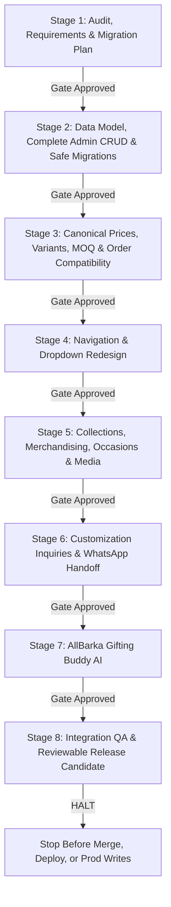

# AllBarka Luxury Boutique — Renovation Plan v2.1
**Comprehensive Architecture Audit, Migration Mapping & 8-Stage Execution Roadmap**

**Document Version:** 2.1.0  
**Baseline Git Commit:** `8cf4410d4cc9d1a2d4840a62cf0f328c4bdaaee0`  
**Active Working Branch:** `feat/renovation-v2`  
**Parent / Production Branch:** `launch` (synced with `origin/launch` and `origin/main`)  
**Authority:** `AllBarka_Antigravity_Master_Prompt (1).md` (Version 2.0 — Final Agreed Scope, 17 Oct 2026)  
**Applicable Instructions Read:** `C:\Users\taha\.gemini\antigravity\scratch\AllBarka-34\AGENTS.md` and `C:\Users\taha\.gemini\config\plugins\science\rules\AGENTS.md`  
**Status:** Stage 1 Approved Baseline (Awaiting User Sign-off to Begin Stage 2)

---

## 1. Executive Summary & Evidence-Based Audit Findings

A rigorous inspection of the current repository at commit `8cf4410` confirms that while order outbox dispatch, Sheet status sync, and rate-limiting infrastructure are established, critical storefront, taxonomy, merchandising, packaging, and dynamic catalog capabilities require structured renovation across eight controlled stages.

### 1.1 Navigation & Header Audit
- **Desktop BubbleMenu Interaction:** In `src/components/BubbleMenu.tsx` (line 76), the dropdown panel has `mt-2` (8px gap) below the trigger button. When the pointer travels diagonally or slowly from the trigger downward into the menu, `onMouseLeave` on the wrapper fires before the pointer enters the dropdown, causing premature closing.
- **Keyboard Navigation & ARIA Deficits:** `BubbleMenu.tsx` lacks `onKeyDown` handlers for Enter/Space/Arrow navigation, `aria-haspopup`, and `aria-expanded` attributes. Screen readers cannot inspect or toggle submenu states.
- **Breakpoint Behavior Inspection:** `src/layouts/RootLayout.tsx` renders the desktop navigation with `hidden xl:flex` and the mobile hamburger button with `xl:hidden`. On viewports between 1024px and 1279px (`lg`), the mobile menu drawer icon serves as the active navigation trigger. While functional as a mobile fallback, this behavior must be documented and tested rather than assumed to be a layout defect.

### 1.2 Catalog & Taxonomy Audit
- **Legacy 7-Category Structure:** The existing configuration in `src/config/categories.ts` defines:
  `nuts` (22 products), `gift-boxes` (10 products), `snacks-seeds` (13 products), `oils` (15 products), `essentials` (5 products), `herbs-spices` (19 products), `bundles` (13 products). Total: 97 products.
- **Lack of Dedicated Dates Category:** Dates (`khajoor`, `aseel-dates`, `chohara`) are currently nested under `nuts`. Dates represent a core pillar of AllBarka's Pakistani heritage offering and must be elevated to their own canonical category.
- **Inappropriate Honey/Oil Merging Avoidance:** Honey must remain firmly categorized under **Desi Essentials** along with pure desi ghee, panjeeri, and desi shakkar. Oils must remain in **Oils**. Creating hybrid categories like `oils-honey` or `seeds-nuts` is **strictly prohibited**.
- **Naive Aliasing Limitations:** Legacy bookmarks to `/shop/nuts` cannot be resolved with a naive 1:1 alias to `dry-fruits`, because the old `nuts` category contained both Dry Fruits and Dates. The routing strategy must direct `/shop/nuts` to Dry Fruits while surfacing a prominent navigation pill/banner for Dates so customers seeking dates are not misled.

### 1.3 Homepage & Merchandising Audit
- **Hardcoded Product IDs:** `src/pages/HomePage.tsx` hardcodes `featuredIds = ['pista', 'kaju', 'badam', 'akhroot', 'deal-1', 'deal-2', 'khajoor', 'org-honey']`. Merchandising does not respond dynamically to Firestore settings.
- **Redundant Full-Bleed Product Grids:** `HomePage.tsx` currently renders both `<BidBoxesSection />` (8 packaging cards) and `<DealsPackagesSection limit={8} />` (8 bundle cards). The owner has explicitly confirmed removing both large grids from the homepage in favor of a single unified **Boutique Selections** showcase and compact collection discovery cards linking to dedicated collection pages (`/celebration-boxes` and `/deals`).

### 1.4 Packaging & Bid Boxes Audit
- **Under-Represented Subcategories:** Only 8 packaging products exist in `src/data/products.ts`. The prompt requires 5 distinct packaging subcategories with at least 6 products each (minimum 30 products total).
- **Pricing & MOQ Deficits:**
  - `bidBoxConfig` in `src/data/products.ts` hardcodes static price tiers and permits ordering single empty boxes for Rs. 60 or Rs. 80.
  - Confirmed Rule D1 mandates: `MOQ = min(25, max(1, ceil(5000 / publishedPerPiecePrice)))`. For a Rs. 60 box, MOQ is 25 pcs (Rs. 1,500 minimum pack). Single-piece packaging sales cause operational and shipping losses.
  - Dual pricing sources (`bidBoxConfig` vs catalog prices) cause potential drift. Pricing must derive strictly from canonical catalog pricing.
- **Unverified Packaging Claims:** Unsupported design names or finishing claims must not be invented. Designs lacking verified supplier references must be labeled `PROPOSED` or remain draft inquiries.

### 1.5 Cart, Checkout & Orders Audit
- **Preparation Lead Time (Rule D3):** Minimum 10 calendar days lead time for custom packaging orders is not yet systematically enforced in the delivery calendar or checkout date picker.
- **Dual Order Mode (Rule D4):** Standard priced items support instant checkout. Custom/unpriced configurations must route cleanly to `CustomQuoteModal` without injecting artificial bulk discount percentages.

### 1.6 Backend & Integration Gaps Observed
- **Inquiry Persistence Fallback:** In `server.ts`, `persistInquiryRecord` falls back to an in-memory queue if Firestore is unavailable. The customer receives a success response even when the record was not durably written.
- **wa-products Catalog Read Failure:** `/api/integrations/n8n/wa-products` falls back to compiled `PRODUCTS` if Firestore catalog loading fails, potentially exporting stale prices or reviving inactive items.
- **mergeAuthoritativeCatalog Loader Coverage:** While `mergeAuthoritativeCatalog` supports dynamic Firestore inputs, storefront transaction loaders and context providers must be audited end-to-end to ensure inactive items are never revived.
- **Test Suite Realism:** The existing test `tests/inquiry-and-sync-security.test.ts` tests an in-memory Express router recreation rather than verifying production route mounting in `server.ts`. Future integration tests must exercise real application handlers.

---

## 2. Target Information Architecture

### 2.1 Separation of Concerns
To avoid conflating catalog taxonomy with commercial promotions:
1. **Product Family:** What the item physically is (e.g. Pistachios, Ajwa Dates, Pumpkin Seeds, Mustard Oil, Raw Honey, Ceylon Cinnamon, Tin Box, Acrylic Chest).
2. **Collection:** A curated commercial grouping (e.g. Shop, Gifts & Hampers, Celebration Boxes, Deals, Personalized Treats & Wrappers). Products can belong to multiple collections without duplicate records.
3. **Occasion:** Many-to-many metadata tags (e.g. Nikkah & Wedding, Hajj & Umrah, Baby Announcements, Corporate Gifting), not separate product entries.
4. **Personalization Capabilities:** Product-specific options (e.g. custom family name tags, ribbon colors, custom printing, laser-engraved acrylic monograms).
5. **Sale Mode / Inclusions:** Packaging-only (empty), standard filled product, or custom quote inquiry.

### 2.2 Agreed Two-Level Navigation Structure

```
Level 1 (Main Row):
[ AllBarka Logo ]   Shop  |  Gifts & Hampers  |  Celebration Boxes  |  Occasions  |  Deals   [ Search | Account | Cart ]

Level 2 (Compact Food-Category Row):
Dry Fruits & Nuts  |  Dates  |  Seeds & Snacks  |  Oils  |  Desi Essentials  |  Herbs & Spices
```

- **Shop:** Leads to comprehensive PLP with filters for all food categories.
- **Gifts & Hampers (`/shop/combos` or `/gifting`):** Ready-to-gift dry fruit boxes, luxury hampers, date gift sets, and custom hamper builder.
- **Celebration Boxes (`/celebration-boxes`):** Dedicated PLP for the 5 packaging categories plus Personalized Treats & Wrappers.
- **Occasions (`/occasions`):** Curated landing page with occasion-based gift recommendations.
- **Deals (`/deals`):** Curated bundles, multi-buy packs, and seasonal value packages.

---

## 3. Product & Category Migration Mapping

### 3.1 Canonical Food Categories (Strict 6 Categories)

| # | Canonical Slug | Display Name (EN) | Display Name (UR) | Scope & Key Products |
| :- | :--- | :--- | :--- | :--- |
| 1 | `dry-fruits` | Dry Fruits & Nuts | خشک میوہ جات اور مغزیات | Almonds (`badam`), Pistachios (`pista`), Cashews (`kaju`), Walnuts (`akhroot`), Dried Apricots (`khubani`), Dried Plums (`alubukhara`), Raisins (`kishmish`), Chilgoza Pine Nuts. |
| 2 | `dates` | Dates | کھجوریں | Ajwa, Medjool, Mabroom, Amber, Sukari, Safawi, Zahidi, Aseel (`aseel-dates`), Chohara (`chohara`), Premium Dark Dates (`khajoor`). |
| 3 | `seeds-snacks` | Seeds & Snacks | بیج اور روایتی سنیکس | Chia seeds, Pumpkin seeds, Flax seeds, Watermelon seeds, Melon seeds, Sesame seeds, Roasted Chanay (`chanay`), Lahori Nimko (`nimko`), Fox nuts (`fox-nuts`), Poppy seeds. |
| 4 | `oils` | Oils | خالص کولڈ پریسڈ تیل | 15 single-press cold-extracted oils: Sweet Almond, Black Seed, Coconut, Castor, Apricot, Sesame, Flaxseed, Walnut, Olive, Onion Seed, Mustard, Hair Blends, Pumpkin Seed, Chilgoza Oil. |
| 5 | `essentials` | Desi Essentials | دیسی اسینشلز اور شہد | Wild Organic Honey (`org-honey`), Pure Desi Ghee (`org-ghee`), Traditional Panjeeri (`org-panjeeri`), Desi Shakkar (`org-shakkar`). |
| 6 | `herbs-spices` | Herbs & Spices | جڑی بوٹیاں اور مصالحہ جات | Ceylon Cinnamon, Green & Black Cardamom, Nutmeg & Mace, Whole Cloves, Black Peppercorns, Star Anise, Cumin, Fennel, Ajwain, Saffron / Zafran (`org-saffron`), Gond Katira, Rose Petals. |

### 3.2 Legacy Slug Splitting & Compatibility Strategy
- **Legacy `/shop/nuts`:** Formerly contained both nuts and dates. A simple alias cannot cleanly represent both.
  - *Strategy:* Route `/shop/nuts` to `dry-fruits`, and display a contextual banner: *"Looking for Dates? Explore our dedicated [Dates Collection](/shop/dates)."*
- **Legacy `/shop/essentials`:** Formerly contained honey, ghee, panjeeri, saffron, and shakkar.
  - *Strategy:* Route to `essentials` (Desi Essentials), with `org-saffron` aliased to `herbs-spices`.
- **Legacy `/shop/snacks-seeds`:** Maps cleanly to `seeds-snacks`.
- **Legacy `/shop/bundles` & `/shop/combos`:** Maps cleanly to `combos` (Gifts & Hampers).
- **Legacy `/gifting`:** Continues as dedicated landing route for curated gifts and hamper builder.

### 3.3 Evidence-Based Packaging Expansion (Target: >= 30 Products across 5 Subcategories)

In accordance with Section B of the Master Prompt, designs are classified strictly as **VERIFIED** (existing in catalog or directly documented), **OWNER-CONFIRMED** (instructed by business rules), or **PROPOSED** (derived from researched Pakistani market references at `https://bidbox.pk` and `https://bidboxesonline.com`).

| ID | Product Name | Subcategory | Status | Price Basis (Empty) | Sourcing / Reference Notes |
| :--- | :--- | :--- | :---: | :---: | :--- |
| `bid-box-luxury-tin` | Luxury Floral Tin Bid Box | Signature Tin Boxes | **VERIFIED** | Rs. 140/pc | Existing catalog asset; embossed floral metal tin. |
| `bid-box-sweet-nikkah` | Heritage Nikkah Sweet Box | Signature Tin Boxes | **VERIFIED** | Rs. 180/pc | Existing catalog asset; rigid botanical print box. |
| `tin-mughal-octagonal` | Royal Mughal Octagonal Tin | Signature Tin Boxes | **PROPOSED** | Rs. 220/pc | Ref: `bidbox.pk` metal keepsake series; pending supplier sample. |
| `tin-emerald-filigree` | Emerald Filigree Rectangular Tin | Signature Tin Boxes | **PROPOSED** | Rs. 195/pc | Ref: `bidboxesonline.com` gold-stamped tin collection. |
| `tin-rose-round` | Rose Gold Botanical Round Tin | Signature Tin Boxes | **PROPOSED** | Rs. 165/pc | Ref: Pakistani wedding favor tin benchmark. |
| `tin-kashmiri-chinar` | Vintage Kashmiri Chinar Art Tin | Signature Tin Boxes | **PROPOSED** | Rs. 240/pc | Ref: Traditional floral lacquer-look metal box. |
| `bid-box-umrah-tabarruk`| Umrah & Hajj Tabarruk Set | Hajj & Umrah Tabarruk | **VERIFIED** | Rs. 200/pc | Existing asset; rigid box + bag; bottles EMPTY by default. |
| `tabarruk-crystal-duo` | Crystal Zamzam Bottle & Tin Duo | Hajj & Umrah Tabarruk | **PROPOSED** | Rs. 280/pc | Ref: `bidbox.pk` Tabarruk series; empty glass flacons. |
| `tabarruk-kiswa-pouch` | Kiswa Black Velvet Embroidered Pouch | Hajj & Umrah Tabarruk | **PROPOSED** | Rs. 175/pc | Ref: Islamic gift favor pouch benchmark. |
| `tabarruk-rigid-chest` | Madina Green Rigid Tabarruk Chest | Hajj & Umrah Tabarruk | **PROPOSED** | Rs. 350/pc | Ref: Deluxe Hajj keepsake chest; empty flacons. |
| `tabarruk-tasbih-casket`| Pearl White Card Casket with Tasbih | Hajj & Umrah Tabarruk | **PROPOSED** | Rs. 160/pc | Ref: Foldable rigid favor casket. |
| `tabarruk-ziyarat-trio` | Triple Compartment Ziyarat Box | Hajj & Umrah Tabarruk | **PROPOSED** | Rs. 225/pc | Ref: 3-compartment empty favor box for dates/Zamzam. |
| `bid-box-pyramid-favor` | Royal Pyramid Favor Box | Wedding Favor Boxes | **VERIFIED** | Rs. 60/pc | Existing asset; pastel floral triangular box with ribbon. |
| `bid-box-card-nikkah` | Classic Card Bid Box | Wedding Favor Boxes | **VERIFIED** | Rs. 80/pc | Existing asset; two-piece cream/gold arabesque card box. |
| `bid-box-jute-pouch` | Artisanal Jute & Jamawar Potli | Wedding Favor Pouches | **VERIFIED** | Rs. 75/pc | Existing asset; golden burlap & brocade potli. |
| `wedding-hex-goldfoil` | Hexagonal Emerald Hot-Foil Box | Wedding Favor Boxes | **PROPOSED** | Rs. 95/pc | Ref: `bidbox.pk` geometric Nikkah favor box. |
| `wedding-velvet-envelope`| Maroon Velvet Envelope Pouch | Wedding Favor Pouches | **PROPOSED** | Rs. 120/pc | Ref: `bidboxesonline.com` luxury velvet Nikkah envelope. |
| `wedding-sheer-organza` | Dual-Tone Sheer Organza Bag | Wedding Favor Pouches | **PROPOSED** | Rs. 55/pc | Ref: Traditional wedding favor drawstring pouch. |
| `bid-box-birth-announcement`| Birth Announcement Favor Box | Baby Announcement | **VERIFIED** | Rs. 150/pc | Existing asset; pastel blue/pink baby trunk box. |
| `baby-pastel-carousel` | Pastel Carousel Musical Favor Box | Baby Announcement | **PROPOSED** | Rs. 210/pc | Ref: `bidbox.pk` baby announcement keepsake series. |
| `baby-hotair-balloon` | 3D Gold Foil Hot Air Balloon Box | Baby Announcement | **PROPOSED** | Rs. 185/pc | Ref: Pastel celebration novelty box. |
| `baby-laser-cradle` | Laser-Cut Regal Cradle Sweet Box | Baby Announcement | **PROPOSED** | Rs. 160/pc | Ref: Traditional baby cradle favor box. |
| `baby-embroidered-linen`| Hand-Embroidered Cotton Linen Pouch | Baby Announcement | **PROPOSED** | Rs. 110/pc | Ref: Artisanal baby announcement drawstring sack. |
| `baby-acrylic-pram` | Miniature Clear Pram Favor Box | Baby Announcement | **PROPOSED** | Rs. 175/pc | Ref: Acrylic baby favor box. |
| `bid-box-acrylic-royal` | Acrylic & Velvet Royal Chest | Personalized Acrylic | **VERIFIED** | Rs. 280/pc | Existing asset; crystal clear chest with velvet base. |
| `acrylic-beveled-cube` | Monogrammed Beveled Acrylic Cube | Personalized Acrylic | **PROPOSED** | Rs. 220/pc | Ref: `bidbox.pk` crystal clear monogram favor cube. |
| `acrylic-slider-gold` | Clear Acrylic Slider with Gold Base | Personalized Acrylic | **PROPOSED** | Rs. 320/pc | Ref: `bidboxesonline.com` slider drawer favor box. |
| `acrylic-octa-clasp` | Octagonal Acrylic Jewel Box | Personalized Acrylic | **PROPOSED** | Rs. 350/pc | Ref: Vintage brass clasp clear acrylic jewelry box. |
| `acrylic-compartment-tray`| Compartment Platter with Magnetic Lid | Personalized Acrylic | **PROPOSED** | Rs. 580/pc | Ref: Luxury VIP dry fruit presentation platter. |
| `acrylic-mini-steamer` | Luxury Acrylic Mini Steamer Trunk | Personalized Acrylic | **PROPOSED** | Rs. 450/pc | Ref: Acrylic trunk with leatherette hardware. |

*Personalized Treats & Wrappers (Related Collection):* Event sleeves, candy pouches, and date packs. Personalization is available across suitable products and presented within the broader gifting taxonomy.

---

## 4. Component Action Matrix

| Component | Path | Action | Rationale |
| :--- | :--- | :---: | :--- |
| `BubbleMenu.tsx` | [`src/components/BubbleMenu.tsx`](file:///C:/Users/taha/.gemini/antigravity/scratch/AllBarka-34/src/components/BubbleMenu.tsx) | **MODIFY** | Fix dropdown hover gap bridge (`mt-2` removal/invisible bridge), add keyboard navigation & ARIA attributes, render two-level navigation. |
| `MobileMenu.tsx` | [`src/components/MobileMenu.tsx`](file:///C:/Users/taha/.gemini/antigravity/scratch/AllBarka-34/src/components/MobileMenu.tsx) | **MODIFY** | Enforce strict drawer sequence: (1) Account/Login, (2) Cart, (3) Language, (4) Theme, (5) Collections & Occasions, (6) Socials. |
| `RootLayout.tsx` | [`src/layouts/RootLayout.tsx`](file:///C:/Users/taha/.gemini/antigravity/scratch/AllBarka-34/src/layouts/RootLayout.tsx) | **MODIFY** | Support two-level navigation layout, manage modal state, audit breakpoint behavior. |
| `HomePage.tsx` | [`src/pages/HomePage.tsx`](file:///C:/Users/taha/.gemini/antigravity/scratch/AllBarka-34/src/pages/HomePage.tsx) | **MODIFY** | Remove `BidBoxesSection` and `DealsPackagesSection`; mount exact 6-part homepage structure including `BoutiqueSelections`. |
| `BoutiqueSelections.tsx` | `src/components/BoutiqueSelections.tsx` | **CREATE** | Single homepage product showcase: tabs for Dry Fruits & Nuts (default), Pantry, Gifts, Celebration Boxes, Deals; 3 admin-selected products per tab; 6000ms autoplay (D5). |
| `BidBoxesSection.tsx` | [`src/components/BidBoxesSection.tsx`](file:///C:/Users/taha/.gemini/antigravity/scratch/AllBarka-34/src/components/BidBoxesSection.tsx) | **MODIFY** | Remove from homepage; retain as dedicated view inside `/celebration-boxes`. Derive pricing purely from canonical catalog. |
| `DealsPackagesSection.tsx`| [`src/components/DealsPackagesSection.tsx`](file:///C:/Users/taha/.gemini/antigravity/scratch/AllBarka-34/src/components/DealsPackagesSection.tsx) | **MODIFY** | Remove from homepage; retain as dedicated view inside `/deals`. |
| `CelebrationBoxesPage.tsx` | `src/pages/CelebrationBoxesPage.tsx` | **CREATE** | Dedicated PLP for Packaging & Favors with 5 subcategory filters, MOQ indicators, and Dual Order Mode (D4). |
| `DealsPage.tsx` | `src/pages/DealsPage.tsx` | **CREATE** | Dedicated PLP for Bundles & Deals with card Quick View and Add to Cart. |
| `AdminCatalogPanel.tsx` | [`src/components/AdminCatalogPanel.tsx`](file:///C:/Users/taha/.gemini/antigravity/scratch/AllBarka-34/src/components/AdminCatalogPanel.tsx) | **MODIFY** | Support full dynamic CRUD (create, edit, draft, publish, archive) directly in Firestore without source redeployment. |
| `AdminMerchandisingPanel.tsx` | `src/components/AdminMerchandisingPanel.tsx` | **CREATE** | Admin panel for Rule D6: manage 3 products per category tab in Boutique Selections, featured IDs, preview mode. |
| `AdminPricingRulesPanel.tsx` | `src/components/AdminPricingRulesPanel.tsx` | **CREATE** | Admin panel for Rule D2: 5% initial import markup calculator, reference prices, and bulk adjustments. |
| `packagingMoq.ts` | `src/lib/packagingMoq.ts` | **CREATE** | Pure helper implementing Rule D1 formula `min(25, max(1, ceil(5000 / price)))` and validation. |

---

## 5. Eight-Stage Implementation Sequence & Acceptance Gates



### Stage 1: Repository Audit, Requirements and Migration Plan
- **Responsibilities:** Inspect codebase, document findings, map taxonomy, catalog baseline evidence, establish requirements matrix.
- **Acceptance Gate:** Stage 1 review packet presented and formally approved by user. Zero code changes or database mutations.

### Stage 2: Data Model, Complete Admin CRUD and Safe Migrations
- **Responsibilities:** Define canonical taxonomy types; audit code assuming compiled `PRODUCTS`; implement dynamic product CRUD in Firestore (create, edit, duplicate, draft, publish, archive, images, MOQ override, lead time); secure admin endpoints against anonymous mutation and stale edits; build idempotent migration scripts.
- **Acceptance Gate:** Admin creates a product absent from compiled source code; product survives page reload and functions through public catalog, discovery, product details, cart, order validation, and AI context.

### Stage 3: Canonical Prices, Variants, MOQ and Order Compatibility
- **Responsibilities:** Unify pricing under one authoritative catalog representation; eliminate `bidBoxConfig` price duplication; separate pack quantity, contents net weight, and shipping billing weight; implement Rule D1 MOQ (`min(25, max(1, ceil(5000 / price)))`); implement Rule D2 initial 5% markup on new imports; implement Rule D3 10-day lead time; enforce Rule D4 dual order mode (no artificial bulk discounts).
- **Acceptance Gate:** One admin price edit updates card, PDP, cart, quote, and bot export consistently; MOQ boundary tests pass; initial 5% markup verified without compounding on re-import.

### Stage 4: Navigation and Dropdown Redesign
- **Responsibilities:** Implement agreed two-level header (main row: Shop, Gifts & Hampers, Celebration Boxes, Occasions, Deals; second row: 6 food categories); fix `BubbleMenu` hit area gap and mouseleave dismissal; add full keyboard and ARIA support; structure mobile drawer strictly per prompt; handle legacy slug splitting.
- **Acceptance Gate:** Diagonal pointer travel into submenu succeeds without flickering; keyboard navigation verified; mobile menu renders in strict sequence; dark mode and RTL validated.

### Stage 5: Collection Pages, Occasions, Content and Media
- **Responsibilities:** Construct dedicated pages (`/celebration-boxes`, `/deals`, `/occasions/:slug`, `/corporate-gifting`); restructure homepage into exact 6-part layout; implement `BoutiqueSelections` with Rule D5/D6 autoplay and admin merchandising; remove both large homepage grids; expand packaging catalog to >= 30 products with evidence classification.
- **Acceptance Gate:** Homepage renders single showcase; autoplay honors 6000ms rotation, hover pause, 3000ms exit delay, focus pause, reduced-motion bypass, and hidden-tab pause; dedicated collection pages display all items with working Quick View.

### Stage 6: Customization Inquiries and WhatsApp Handoff
- **Responsibilities:** Build product-aware inquiry brief (occasion, product, quantity, budget, empty/filled mode, contents, monogram, event date); secure artwork upload or explicit WhatsApp fallback; persist inquiry to Firestore before claiming receipt; preserve customer draft on failure; admin inquiry review (Bargain Desk) with staff field protection; enforce Tabarruk empty default notice and 10-day preparation lead time.
- **Acceptance Gate:** Saved inquiry and WhatsApp summary match; database failure retains draft and offers unsaved WhatsApp handoff; public endpoints cannot inject staff fields.

### Stage 7: AllBarka Gifting Buddy
- **Responsibilities:** Extend existing verified AI bridge; support English, Roman Urdu, Urdu, Arabic; ask 1-2 focused questions at a time; distinguish catalog products from sourced add-ons; compute known prices via server; mark custom add-ons pending team final quote; format structured inquiry summary with WhatsApp handoff; scope memory to session.
- **Acceptance Gate:** Sample conversations evaluate gifting flows, budget constraints, declined upsells, and accurate subtotal calculations without unverified claims or hallucinations.

### Stage 8: Integration QA and Reviewable Release Candidate
- **Responsibilities:** Run full regression suite (`npm run typecheck`, `npm run build`, unit/integration tests); execute fault injection tests (database absent, database failure, anonymous admin, staff field injection, catalog outage, stale edits); verify end-to-end user journeys; document migration dry-run and rollback instructions.
- **Acceptance Gate:** Deliver complete, reviewable release candidate (diff, evidence, test outputs). **HALT before production database writes, deployment, or merge.**

---

## 6. Risk Register & Mitigations

| Risk ID | Risk Description | Severity | Probability | Mitigation Strategy |
| :--- | :--- | :---: | :---: | :--- |
| **RSK-001** | Legacy bookmarks to `/shop/nuts` leaving date-seeking customers confused. | Medium | High | Route `/shop/nuts` to `dry-fruits` with a contextual banner linking directly to `/shop/dates`. |
| **RSK-002** | Customer resistance to packaging MOQ on sample orders. | Medium | Medium | Provide clear sample inquiry CTA leading to WhatsApp Concierge / `CustomQuoteModal`. |
| **RSK-003** | Dynamic Firestore catalog reviving inactive products via compiled fallbacks. | High | Low | Enforce strict suppression logic in `catalogStore.ts`: products with `active: false` in Firestore remain disabled regardless of compiled state. |
| **RSK-004** | In-memory inquiry data loss during database outage. | High | Low | Stage 6 requires durable Firestore persistence before confirming receipt; failure offers draft preservation and unsaved WhatsApp handoff. |
| **RSK-005** | Catalog read failure causing wa-products export to emit stale compiled prices. | Medium | Low | Return HTTP 503 rather than stale compiled fallbacks when database catalog is unreachable. |

---

## 7. Stage 2 Entry Criteria Checklist

- [x] Baseline git commit confirmed on `main` and `launch` (`8cf4410`).
- [x] Dedicated feature branch created (`feat/renovation-v2`).
- [x] Baseline typecheck clean (`npm run typecheck` exited 0).
- [x] Baseline integration tests passing (58/58 passed).
- [x] Baseline inquiry security tests passing (4/4 passed).
- [x] Requirements Traceability Matrix updated with 8-stage sequence ([`docs/RENOVATION_REQUIREMENTS.md`](file:///C:/Users/taha/.gemini/antigravity/scratch/AllBarka-34/docs/RENOVATION_REQUIREMENTS.md)).
- [x] Renovation Plan updated with correct information architecture ([`docs/RENOVATION_PLAN.md`](file:///C:/Users/taha/.gemini/antigravity/scratch/AllBarka-34/docs/RENOVATION_PLAN.md)).
- [x] Stage 1 Handoff updated ([`docs/RENOVATION_HANDOFF.md`](file:///C:/Users/taha/.gemini/antigravity/scratch/AllBarka-34/docs/RENOVATION_HANDOFF.md)).
- [ ] **Awaiting explicit user review and authorization to begin Stage 2.**

---

**End of Renovation Plan v2.1**
