# Stage 5C2 Catalog Visual Asset & Description Review Document
**Branch**: `feat/renovation-v2`  **Date**: October 19, 2026  **Stage**: 5C2 Visual Concept Assets & Polished Catalog Descriptions Completion  **Release Constraints**: Zero live ingestion into `src/data/products.ts`, zero Firestore writes, zero deployment, zero merge to launch branch.
---
## 1. Executive Summary & Mandatory Disclosures
> [!IMPORTANT]> **AI-Generated Concept Asset Disclosure**: All visual assets generated for newly referenced products are **AI-generated concept renders** created solely for design evaluation, proportion checking, and planning. They do **NOT** depict physical AllBarka warehouse inventory or confirmed supplier-stocked samples. Existing active catalog items retain their currently deployed storefront photographs in `public/images/products/`.
> [!NOTE]> **Draft Media Isolation**: All unpublished draft assets (13 master JPGs and 13 optimized WebP derivatives) reside strictly in `docs/assets/drafts/` outside `public/`. Vite does not bundle these files, and no draft media is accessible via client routes.
### Summary Roster Counts & Status Breakdown
| Category / Group | Total Roster | Active Existing Assets | Completed Concept Renders | Quota-Blocked Renders | Deferred Variable Family || :--- | :---: | :---: | :---: | :---: | :---: || **1. Signature Tin Boxes** | 7 | 1 | 6 | 0 | 0 || **2. Hajj & Umrah Tabarruk Sets** | 6 | 1 | 4 | 1 | 0 || **3. Wedding Favor Boxes & Pouches** | 8 | 4 | 1 | 3 | 0 || **4. Baby Announcement Boxes** | 7 | 1 | 1 | 4 | 1 || **5. Personalized Acrylic Boxes** | 2 | 1 | 1 | 0 | 0 || **Total Actual Products** | **30** | **8** | **13** | **8** | **1** |
> [!WARNING]> **Acrylic Category Shortfall**: Personalized Acrylic Boxes currently contains exactly **2 verified products** (1 existing + 1 verified reference). The **4-product shortfall** against the 6-product category target is explicitly maintained. The 3 proposed acrylic concepts remain segregated in **Group D** and are not imported or counted as verified products.
---
## 2. Copy Compliance & Targeted Corrections Audit
In accordance with user directives, the following targeted copy corrections have been applied across all product descriptions and metadata:

| Directive | Status | Description of Applied Correction || :--- | :---: | :--- || **Purge 'Leak-Resistant'** | **COMPLIANT** | The term 'leak-resistant' has been completely removed from all customer-facing Tabarruk copy. Screw caps are described as 'clear presentation containers with gold-toned screw cap', with leak-resistance rating noted in internal `pending_technical_fields` pending lab testing. || **Purge Food Origin Claims** | **COMPLIANT** | Claims such as 'Gilgit almonds', 'saffron-infused Jordan almonds', and 'single-origin fillings' have been eliminated. Fillings are described generically as 'premium roasted almonds, cashews, or pistachios'. || **Customer-Requested Fillings** | **COMPLIANT** | Candies, chocolates, sweets, and panjeeri are explicitly presented as 'customer-requested options subject to AllBarka team sourcing confirmation and custom quotation'. || **Zamzam Water Separation** | **COMPLIANT** | All Tabarruk bottles and flasks are explicitly stated to be empty containers for customer-provided Zamzam water. Copy explicitly confirms AllBarka never sells, pre-fills, or supplies Zamzam water. || **Segregate Technical Uncertainty** | **COMPLIANT** | Unconfirmed engineering specifications (sheet gauge thickness, board GSM, acrylic thickness) are excluded from customer-facing text and isolated in internal `pending_technical_fields`. || **Accurate Asset Disclosure** | **COMPLIANT** | All draft media entries carry explicit metadata identifying them as AI-generated concept renders. || **Lead Time & MOQ Uniformity** | **COMPLIANT** | All products enforce the standard policy: Minimum 10 calendar days after design approval and advance payment; Packaging MOQ calculated via `min(25, max(1, ceil(5000 / proposed_price)))`. |

---
## 3. Upstream Image API Quota Exhaustion Report
> [!CAUTION]> **Gemini Image Generation Capacity Exhaustion**: During Batch 2 (Tabarruk Sets), the upstream image generation endpoint returned an unrecoverable quota error:
> ```
> 429 RESOURCE_EXHAUSTED / QUOTA_EXHAUSTED: You have exhausted your capacity on this model.
> Model: gemini-3.1-flash-image
> Quota reset delay: ~4h35m (Quota reset timestamp: 2026-10-19T01:53:24Z)
> ```
> Per operating instructions, quota errors are reported directly without spinning in retry loops. Exactly **13 draft renders** were successfully generated, converted to WebP, and archived before quota exhaustion. The remaining **8 verified references** have their prompts, specifications, and copy ready for rendering once the quota resets.

---
## 4. Visual Contact Sheet (Completed Concept Renders & Active Media)
Below is the visual contact sheet displaying all completed 1024×1024 empty vessel concept renders and active catalog assets.

### Category 1: Signature Tin Boxes (6 Renders + 1 Active)

#### `bid-box-luxury-tin` — Luxury Floral Tin Bid Box
- **Asset Type**: Active Storefront Media (`/images/products/bid-box-luxury-tin-1.webp`)
- **Display Price**: Rs. 140 | **Packaging MOQ**: 25 pcs
**Customer Copy Summary**: A timeless 3-inch circular metal tinplate favor container wrapped in an elegant floral motif, ideal for Nikkah favors, celebratory giveaways, and bespoke dry fruit presentation.

#### `tin-box-002` — Mughal Floral Circular Keepsake Tin
- **Asset Type**: AI-Generated Concept Render (1024×1024, Empty Vessel)
- **Master JPG**: [docs/assets/drafts/pilot-tin-box-002.jpg](docs/assets/drafts/pilot-tin-box-002.jpg)  
- **Optimized WebP**: [docs/assets/drafts/pilot-tin-box-002.webp](docs/assets/drafts/pilot-tin-box-002.webp)  
- **Depiction**: Empty cylindrical metal tinplate container with slip-fit lid resting beside base on warm honed travertine.
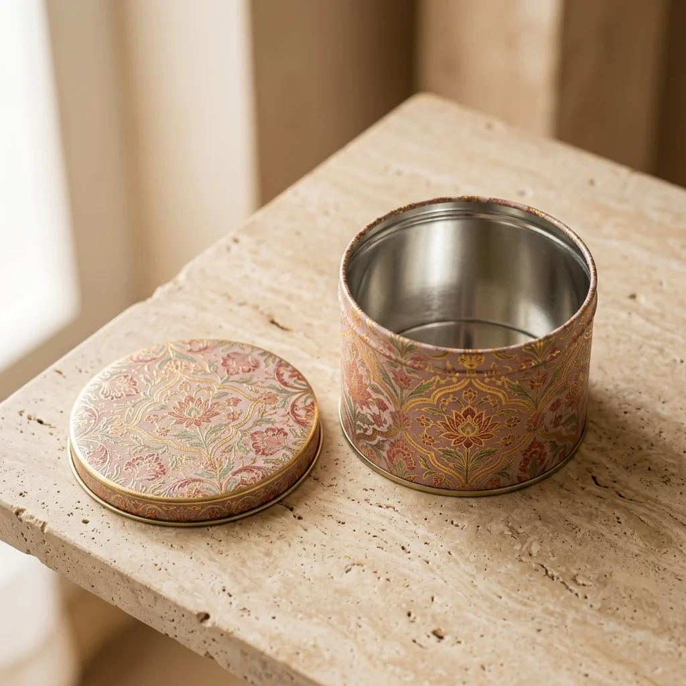
**Customer Copy Summary**: A 3-inch circular keepsake presentation tin wrapped with an ornamental Mughal floral motif, designed for celebratory favor distribution, Nikkah giveaways, and elegant event gifting.

#### `tin-box-004` — Botanical Garden Circular Keepsake Tin
- **Asset Type**: AI-Generated Concept Render (1024×1024, Empty Vessel)
- **Master JPG**: [docs/assets/drafts/draft-tin-box-004.jpg](docs/assets/drafts/draft-tin-box-004.jpg)  
- **Optimized WebP**: [docs/assets/drafts/draft-tin-box-004.webp](docs/assets/drafts/draft-tin-box-004.webp)  
- **Depiction**: Empty circular metal tinplate favor box with botanical garden wrap on warm honed travertine with slip-fit lid beside base.
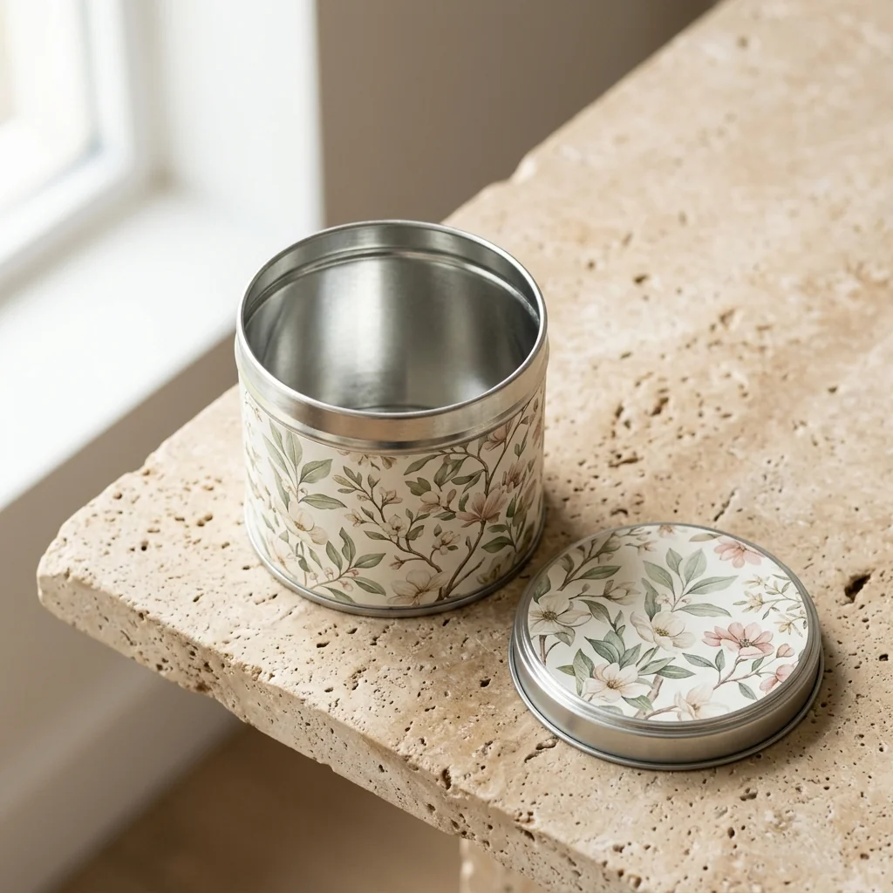
**Customer Copy Summary**: An enchanting botanical garden themed circular metal keepsake tin, crafted for wedding favors, spring gatherings, and celebratory distributions.

#### `tin-box-008` — Special Edition Floral Circular Keepsake Tin
- **Asset Type**: AI-Generated Concept Render (1024×1024, Empty Vessel)
- **Master JPG**: [docs/assets/drafts/draft-tin-box-008.jpg](docs/assets/drafts/draft-tin-box-008.jpg)  
- **Optimized WebP**: [docs/assets/drafts/draft-tin-box-008.webp](docs/assets/drafts/draft-tin-box-008.webp)  
- **Depiction**: Empty special edition floral circular keepsake tin with rolled gold-toned rim on cream limestone, lid beside base.
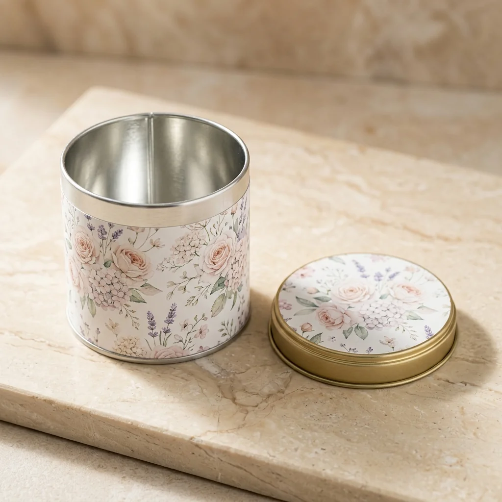
**Customer Copy Summary**: A festive floral circular keepsake tin featuring a distinctive rolled gold-toned rim, designed for celebratory favor distribution and commemorative milestones.

#### `tin-box-green` — Emerald Geometric Patterned Square Tin
- **Asset Type**: AI-Generated Concept Render (1024×1024, Empty Vessel)
- **Master JPG**: [docs/assets/drafts/draft-tin-box-green.jpg](docs/assets/drafts/draft-tin-box-green.jpg)  
- **Optimized WebP**: [docs/assets/drafts/draft-tin-box-green.webp](docs/assets/drafts/draft-tin-box-green.webp)  
- **Depiction**: Empty emerald green geometric patterned square metal tinplate box on textured warm travertine with lid resting flat beside base.
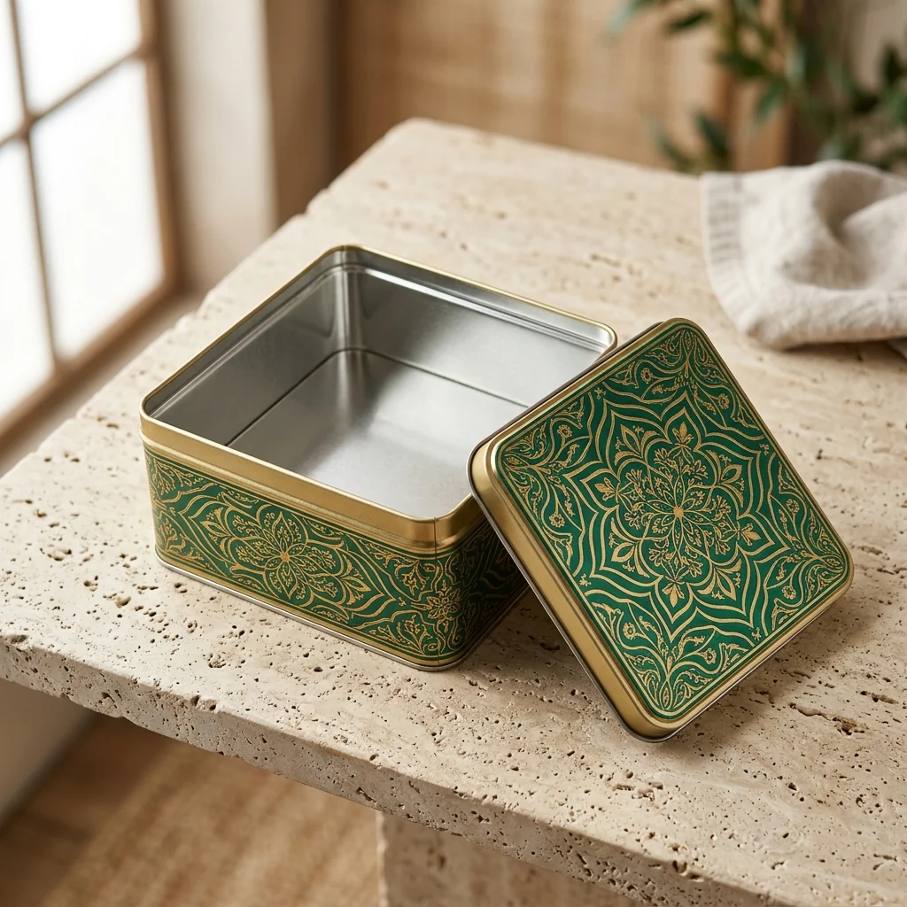
**Customer Copy Summary**: A sophisticated square keepsake tin wrapped in a deep emerald green geometric pattern, offering a structured contemporary alternative to traditional circular favor tins.

#### `tin-box-beige` — Beige Floral Circular Keepsake Tin
- **Asset Type**: AI-Generated Concept Render (1024×1024, Empty Vessel)
- **Master JPG**: [docs/assets/drafts/draft-tin-box-beige.jpg](docs/assets/drafts/draft-tin-box-beige.jpg)  
- **Optimized WebP**: [docs/assets/drafts/draft-tin-box-beige.webp](docs/assets/drafts/draft-tin-box-beige.webp)  
- **Depiction**: Empty circular beige floral keepsake tin on subtle warm natural linen, lid beside base showing empty metallic cavity.
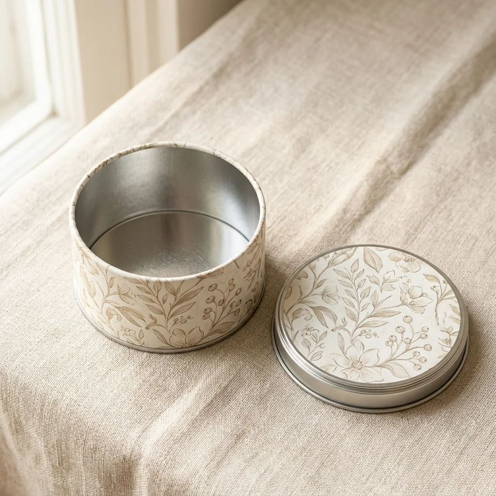
**Customer Copy Summary**: An understated, neutral beige and ivory floral keepsake tin suited for modern pastel wedding aesthetics, Nikkah giveaways, and elegant return favors.

#### `tin-box-baby-boy` — Pastel Blue Square Keepsake Favor Tin
- **Asset Type**: AI-Generated Concept Render (1024×1024, Empty Vessel)
- **Master JPG**: [docs/assets/drafts/draft-tin-box-baby-boy.jpg](docs/assets/drafts/draft-tin-box-baby-boy.jpg)  
- **Optimized WebP**: [docs/assets/drafts/draft-tin-box-baby-boy.webp](docs/assets/drafts/draft-tin-box-baby-boy.webp)  
- **Depiction**: Empty pastel blue square keepsake favor tin decorated with celestial motifs on warm ivory stone, lid beside base.
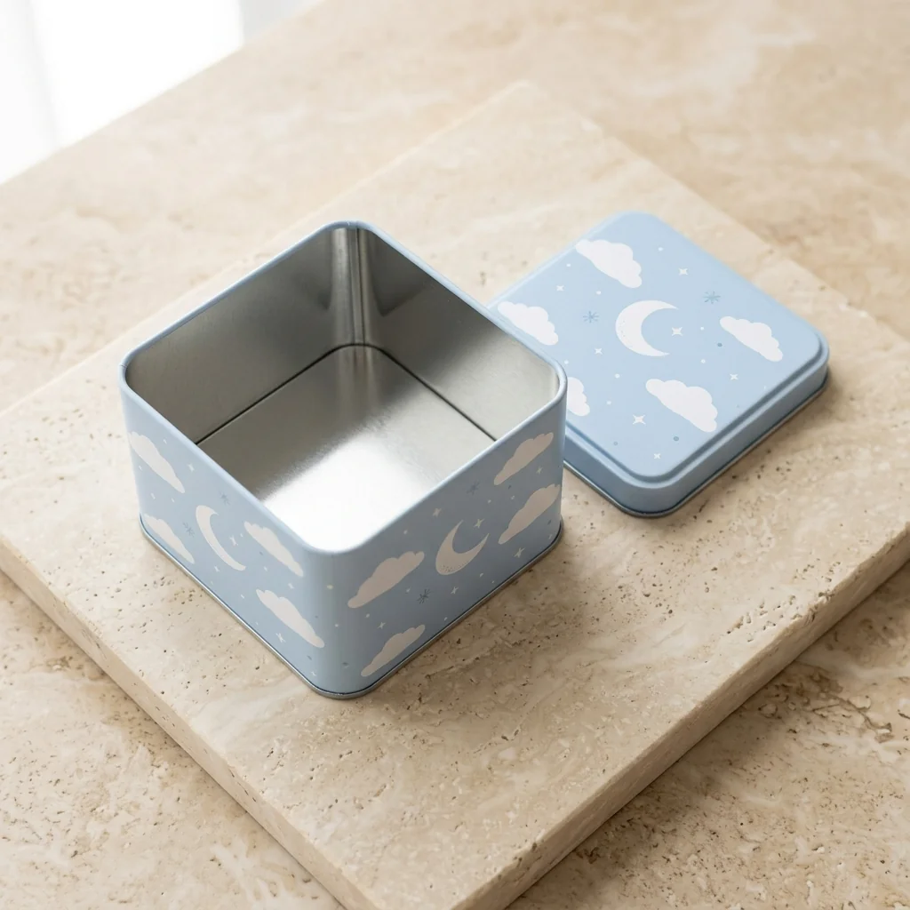
**Customer Copy Summary**: A charming 3×3×2 inch square metal tinplate keepsake box decorated in gentle pastel powder-blue hues, crafted for baby boy birth announcements and Aqeeqah favors.

### Category 2: Hajj & Umrah Tabarruk Sets (4 Renders + 1 Active + 1 Quota-Blocked)

#### `bid-box-umrah-tabarruk` — Umrah & Hajj Tabarruk Box Set
- **Asset Type**: Active Storefront Media (`/images/products/bid-box-umrah-tabarruk-1.webp`)
- **Display Price**: Rs. 200 | **Packaging MOQ**: 25 units
**Customer Copy Summary**: A coordinated three-piece homecoming favor suite designed for returning pilgrims to present blessed tokens with dignity to visiting relatives and loved ones.

#### `tabarruk-set-004` — Rawdah 3-Piece Tabarruk Gift Set
- **Asset Type**: AI-Generated Concept Render (1024×1024, Empty Vessels)
- **Master JPG**: [docs/assets/drafts/pilot-tabarruk-set-004.jpg](docs/assets/drafts/pilot-tabarruk-set-004.jpg)  
- **Optimized WebP**: [docs/assets/drafts/pilot-tabarruk-set-004.webp](docs/assets/drafts/pilot-tabarruk-set-004.webp)  
- **Depiction**: Empty 3-piece pilgrimage favor suite (ivory bag, empty circular tin with lid ajar, visibly empty clear glass Zamzam bottle with gold cap) on warm travertine.
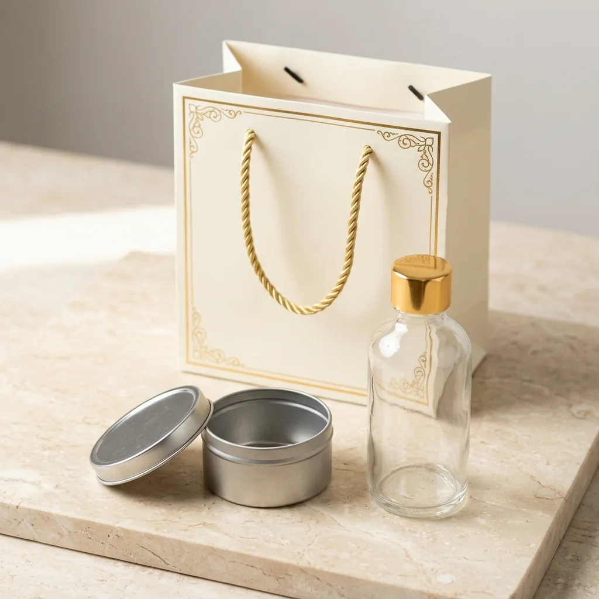
- **Display Price**: Rs. 210 | **Packaging MOQ**: 24 units
**Customer Copy Summary**: A curated three-piece pilgrimage favor suite offering returning Hajj and Umrah pilgrims an elegant, unified presentation for sharing blessed keepsakes.

#### `tabarruk-set-classic` — Haramain Heritage Pilgrimage Favor Set
- **Asset Type**: AI-Generated Concept Render (1024×1024, Empty Vessels)
- **Master JPG**: [docs/assets/drafts/draft-tabarruk-set-classic.jpg](docs/assets/drafts/draft-tabarruk-set-classic.jpg)  
- **Optimized WebP**: [docs/assets/drafts/draft-tabarruk-set-classic.webp](docs/assets/drafts/draft-tabarruk-set-classic.webp)  
- **Depiction**: Empty two-piece rigid presentation gift box in ivory with clear window, holding one visibly empty glass bottle with gold cap and one empty favor tin on warm honed travertine.
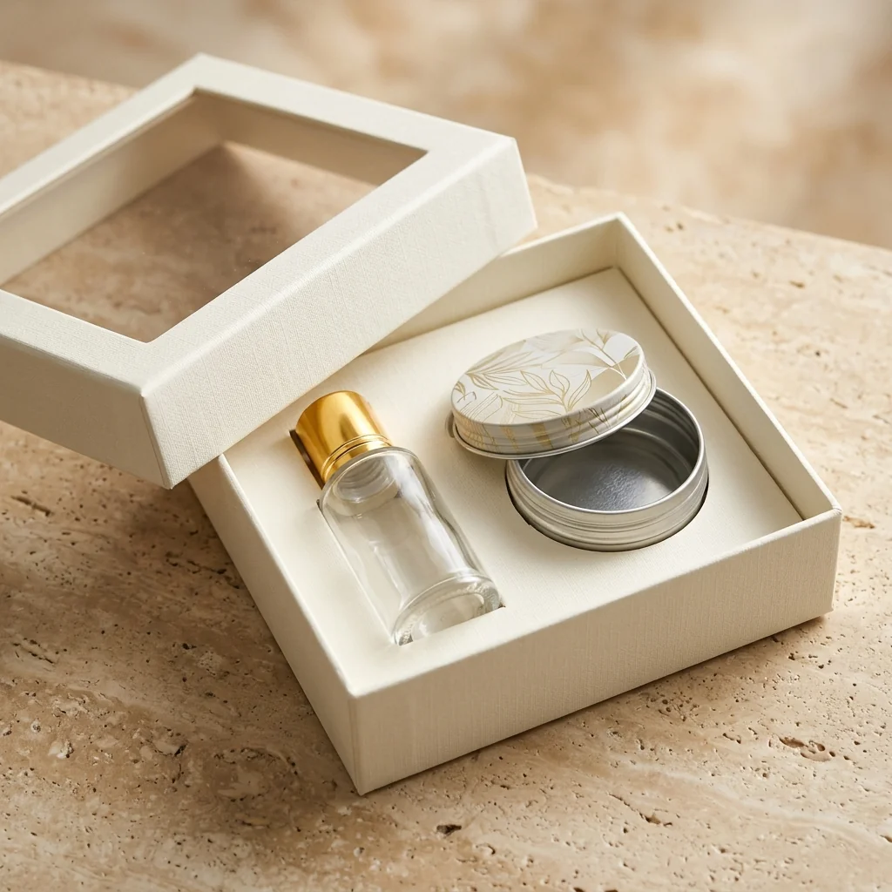
- **Display Price**: Rs. 210 | **Packaging MOQ**: 24 units
**Customer Copy Summary**: A distinguished heritage pilgrimage set combining an ivory window presentation box, an empty clear water flask with gold cap, and an empty circular favor tin.

#### `tabarruk-set-012` — Medina Moon Tabarruk Box & Bag Set
- **Asset Status**: ⚠️ **Generation Blocked by Upstream Quota** (`gemini-3.1-flash-image` quota reset pending)
- **Display Price**: Rs. 210 | **Packaging MOQ**: 24 units
**Customer Copy Summary**: A distinguished pilgrimage favor suite decorated with crescent moon motifs, comprising a matching structured carrier bag, a circular keepsake favor tin, and an empty 120ml bottle with screw cap for customer-provided Zamzam water.

#### `tabarruk-set-tijori` — Tijori Grand Presentation Tabarruk Suite
- **Asset Status**: ⚠️ **Generation Blocked by Upstream Quota** (`gemini-3.1-flash-image` quota reset pending)
- **Display Price**: Rs. 420 | **Packaging MOQ**: 12 units
**Customer Copy Summary**: A festive presentation suite featuring a large structured carrier bag and matching chest-format ('Tijori') presentation box, designed for pilgrimage homecoming favor distribution.

#### `tabarruk-set-no43` — Safaa 3-Piece Pilgrimage Set
- **Asset Status**: ⚠️ **Generation Blocked by Upstream Quota** (`gemini-3.1-flash-image` quota reset pending)
- **Display Price**: Rs. 368 | **Packaging MOQ**: 14 units
**Customer Copy Summary**: A structured three-piece pilgrimage set featuring an elongated 7×12 inch carrier bag, a 3×3×2 inch square metal favor tin, and an empty 120ml clear bottle with gold cap.

### Category 3: Wedding Favor Boxes & Pouches (1 Render + 4 Active + 3 Quota-Blocked)

#### `bid-box-pyramid-favor` — Royal Pyramid Favor Box
- **Asset Type**: Active Storefront Media (`/images/products/bid-box-pyramid-favor-1.webp`)
- **Display Price**: Rs. 60 | **Packaging MOQ**: 25 units
**Customer Copy Summary**: An eye-catching geometric pyramid favor box tied with a satin ribbon at the apex, designed for wedding giveaways, Nikkah distributions, and festive party favors.

#### `bid-box-card-nikkah` — Classic Card Bid Box
- **Asset Type**: Active Storefront Media (`/images/products/bid-box-card-nikkah-1.webp`)
- **Display Price**: Rs. 80 | **Packaging MOQ**: 25 units
**Customer Copy Summary**: A clean, elegant two-piece cardstock favor box engineered for traditional Nikkah and Baat Pakki distributions with classic telescoping closure.

#### `bid-box-jute-pouch` — Artisanal Jute & Jamawar Pouch
- **Asset Type**: Active Storefront Media (`/images/products/bid-box-jute-pouch-1.webp`)
- **Display Price**: Rs. 75 | **Packaging MOQ**: 25 units
**Customer Copy Summary**: A textured drawstring potli pouch combining earthy natural jute with ornate woven Jamawar brocade border accents for traditional Mehndi and Dholki favors.

#### `bid-box-sweet-nikkah` — Heritage Nikkah Sweet & Dry Fruit Box
- **Asset Type**: Active Storefront Media (`/images/products/bid-box-sweet-nikkah-1.webp`)
- **Display Price**: Rs. 180 | **Packaging MOQ**: 25 units
**Customer Copy Summary**: A substantial rigid presentation box fitted with internal compartment dividers, designed for formal Nikkah and Barat distributions requiring structured dual presentation.

#### `wedding-card-box-001` — Floral Cardstock Favor Box (3.5×3.5×2 in)
- **Asset Type**: AI-Generated Concept Render (1024×1024, Empty Vessel)
- **Master JPG**: [docs/assets/drafts/pilot-wedding-card-box-001.jpg](docs/assets/drafts/pilot-wedding-card-box-001.jpg)  
- **Optimized WebP**: [docs/assets/drafts/pilot-wedding-card-box-001.webp](docs/assets/drafts/pilot-wedding-card-box-001.webp)  
- **Depiction**: Empty two-piece rigid cardstock favor box in ivory adorned with handcrafted paper flower embellishment on lid, resting on warm travertine.
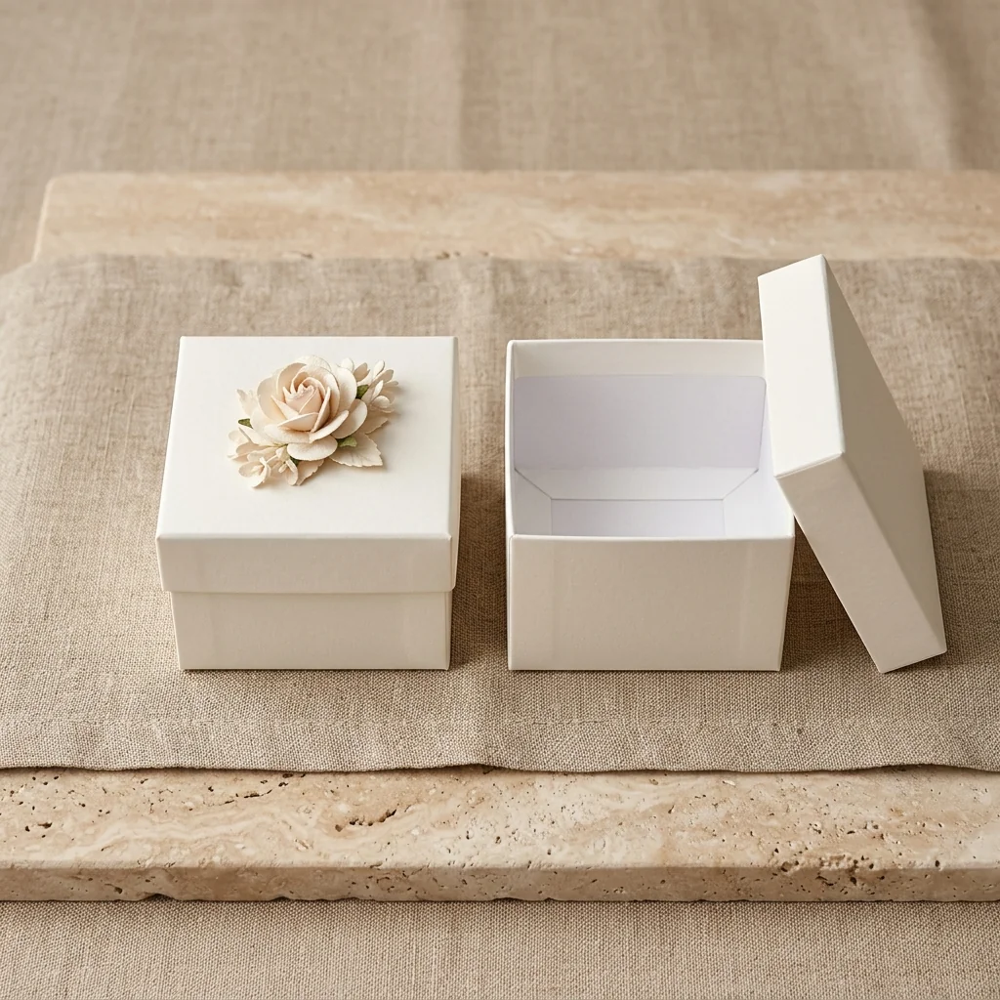
- **Display Price**: Rs. 79 | **Packaging MOQ**: 25 units
**Customer Copy Summary**: A classic 3.5-inch rigid cardstock favor box finished with a handcrafted paper floral accent, crafted for Nikkah, Baat Pakki, engagement favors, and wedding guest gifting.

#### `wedding-pyramid-box` — Floral Cardstock Pyramid Favor Box (3×3×3 in)
- **Asset Status**: ⚠️ **Generation Blocked by Upstream Quota** (`gemini-3.1-flash-image` quota reset pending)
- **Display Price**: Rs. 32 | **Packaging MOQ**: 25 units
**Customer Copy Summary**: An affordable, decorative 3×3×3 inch triangular cardstock favor box featuring delicate floral graphics and an apex ribbon closure, suited for large wedding guest distributions.

#### `wedding-pouch-054` — Traditional Jute Drawstring Favor Pouch (4×5.5 in)
- **Asset Status**: ⚠️ **Generation Blocked by Upstream Quota** (`gemini-3.1-flash-image` quota reset pending)
- **Display Price**: Rs. 63 | **Packaging MOQ**: 25 units
**Customer Copy Summary**: A rustic 4×5.5 inch natural jute drawstring favor pouch, ideal for traditional Mehndi giveaways, Dholki favors, and artisanal event presentation.

#### `wedding-two-piece-box` — Golden & Off-White Two-Piece Card Box (3.2×3.2×2 in)
- **Asset Status**: ⚠️ **Generation Blocked by Upstream Quota** (`gemini-3.1-flash-image` quota reset pending)
- **Display Price**: Rs. 84 | **Packaging MOQ**: 25 units
**Customer Copy Summary**: A refined two-piece favor box combining a metallic gold-sheen telescoping lid with an off-white base, designed for formal wedding and Nikkah guest gifting.

### Category 4: Baby Announcement Boxes (1 Render + 1 Active + 4 Quota-Blocked + 1 Deferred)

#### `bid-box-birth-announcement` — Birth Announcement Favor Box
- **Asset Type**: Active Storefront Media (`/images/products/bid-box-birth-announcement-1.webp`)
- **Display Price**: Rs. 150 | **Packaging MOQ**: 25 units
**Customer Copy Summary**: A joyful pastel birth announcement favor box created to share the arrival of a new family member with visiting relatives, friends, and colleagues.

#### `baby-box-half-kg` — Half Kg Square Baby Announcement Box (6×6×2 in)
- **Asset Type**: AI-Generated Concept Render (1024×1024, Empty Vessel)
- **Master JPG**: [docs/assets/drafts/pilot-baby-box-half-kg.jpg](docs/assets/drafts/pilot-baby-box-half-kg.jpg)  
- **Optimized WebP**: [docs/assets/drafts/pilot-baby-box-half-kg.webp](docs/assets/drafts/pilot-baby-box-half-kg.webp)  
- **Depiction**: Empty square baby announcement sweet box in pastel tones on warm crema limestone with lid resting beside base.
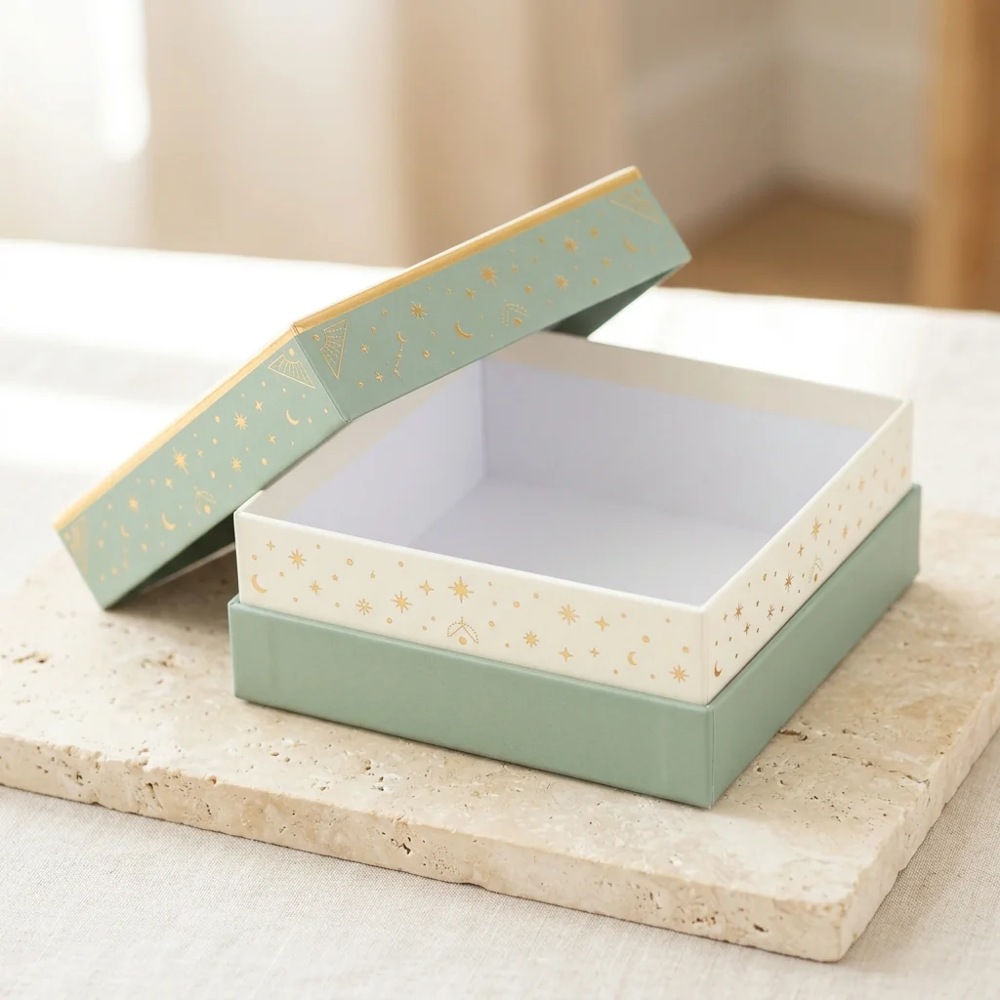
- **Display Price**: Rs. 273 | **Packaging MOQ**: 19 units
**Customer Copy Summary**: A generous 6×6×2 inch square rigid presentation box offering 500g capacity for baby announcements, Aqeeqah celebrations, and family gifting.

#### `baby-box-3in-round` — Cradle Keepsake Circular Favor Box (3 in dia × 2 in depth)
- **Asset Status**: ⚠️ **Generation Blocked by Upstream Quota** (`gemini-3.1-flash-image` quota reset pending)
- **Display Price**: Rs. 105 | **Packaging MOQ**: 25 units
**Customer Copy Summary**: A delicate 3-inch circular cylinder favor box designed for intimate baby arrival announcements, hospital visits, and Aqeeqah favor distributions.

#### `baby-box-250g-part` — Compact 250g Card Baby Announcement Box
- **Asset Status**: ⚠️ **Generation Blocked by Upstream Quota** (`gemini-3.1-flash-image` quota reset pending)
- **Display Price**: Rs. 158 | **Packaging MOQ**: 25 units
**Customer Copy Summary**: A compact rigid announcement box with 250g capacity, suited for individual family and colleague distributions.

#### `baby-box-girl-7x5` — Baby Girl Floral Announcement Sweet Box (7×5×2 in)
- **Asset Status**: ⚠️ **Generation Blocked by Upstream Quota** (`gemini-3.1-flash-image` quota reset pending)
- **Display Price**: Rs. 399 | **Packaging MOQ**: 13 units
**Customer Copy Summary**: An exquisite 7×5×2 inch rectangular presentation box in blush floral styling, designed to celebrate the birth of a baby girl with close family and guests.

#### `baby-box-1kg-boy` — Baby Boy 1kg Announcement Sweet Box (9×7×2 in)
- **Asset Status**: ⚠️ **Generation Blocked by Upstream Quota** (`gemini-3.1-flash-image` quota reset pending)
- **Display Price**: Rs. 462 | **Packaging MOQ**: 11 units
**Customer Copy Summary**: A grand 9×7×2 inch presentation box offering full 1kg capacity for large family baby announcements, Aqeeqah sweets, and celebration gifting.

#### `baby-box-017` — Multi-Size Baby Announcement Box Family (250g / Half kg / 1 kg / 2 kg)
- **Asset Status**: ℹ️ **Generation Deferred** (Multi-size family pending physical sample dimensions per size tier)
- **Display Price**: Rs. 158 | **Packaging MOQ**: 25 units
**Customer Copy Summary**: A tiered baby announcement presentation box family offering four proportional capacities (250g, 500g, 1kg, 2kg) to accommodate both intimate favors and grand family gifting.

### Category 5: Personalized Acrylic Boxes (1 Render + 1 Active; 4 Shortfall)

#### `bid-box-acrylic-royal` — Acrylic & Velvet Royal Bid Box
- **Asset Type**: Active Storefront Media (`/images/products/bid-box-acrylic-royal-1.webp`)
- **Display Price**: Rs. 280 | **Packaging MOQ**: 18 units
**Customer Copy Summary**: A high-clarity transparent acrylic chest anchored with a rich velvet-lined presentation base, engineered for showcase favors, VIP gifting, and heirloom keepsakes.

#### `acrylic-box-cube-3in` — Clear Acrylic Presentation Cube (3×3×3 in)
- **Asset Type**: AI-Generated Concept Render (1024×1024, Empty Vessel)
- **Master JPG**: [docs/assets/drafts/pilot-acrylic-box-cube-3in.jpg](docs/assets/drafts/pilot-acrylic-box-cube-3in.jpg)  
- **Optimized WebP**: [docs/assets/drafts/pilot-acrylic-box-cube-3in.webp](docs/assets/drafts/pilot-acrylic-box-cube-3in.webp)  
- **Depiction**: Empty 3x3x3 inch clear acrylic cube with slip-over lid propped beside base on warm honed travertine, highlighting pristine empty chamber.
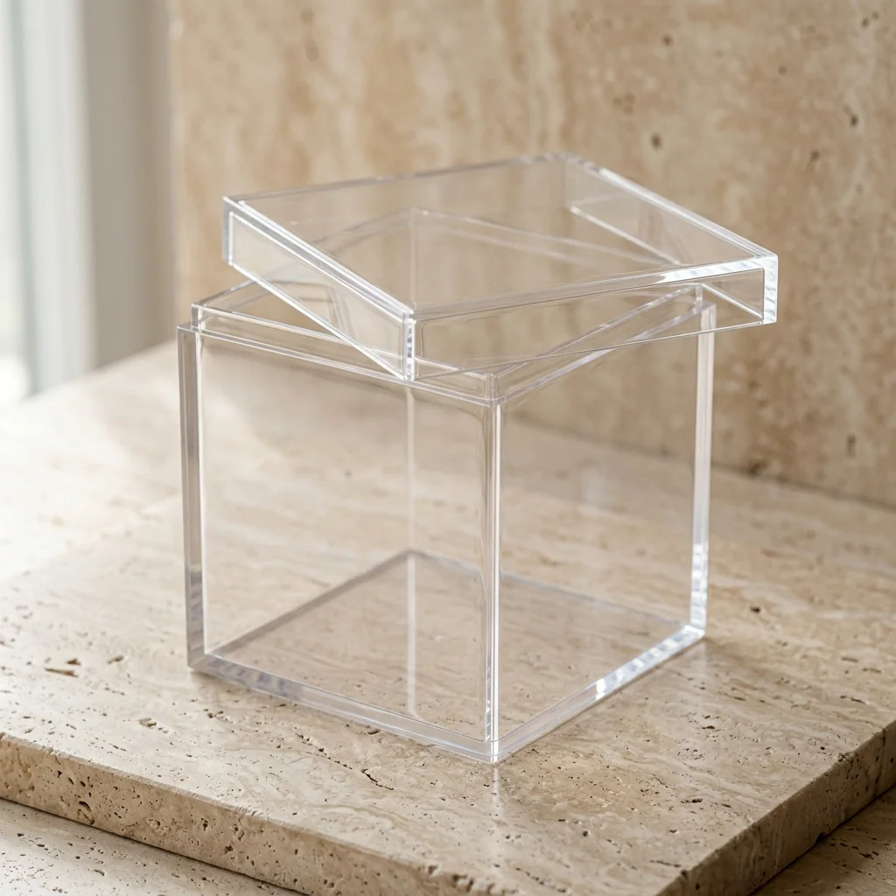
- **Display Price**: Rs. 315 | **Packaging MOQ**: 16 units
**Customer Copy Summary**: A minimalist 3×3×3 inch clear acrylic cube favor box with clean slip-over lid, crafted for modern Nikkah distributions, luxury confectionery, and keepsake favors.

#### Group D: Unverified Acrylic Concepts (Separated from Verified Roster)
The following 3 proposed concepts remain segregated and will not be ingested into the catalog until supplier quotes and physical samples are verified:

- **`acrylic-box-sliding-tray-4in`**: Clear Acrylic Sliding Sleeve Box (4×4×2 in) (4 × 4 × 2 inches) — *Rationale*: Compact 2-piece sliding acrylic tray for single large favors or confection trios; pending local vendor sampling
- **`acrylic-box-partition-4bay-6in`**: 4-Compartment Clear Acrylic Presentation Tray (6×6×2.5 in) (6 × 6 × 2.5 inches) — *Rationale*: Four-bay partition acrylic box for four distinct dry fruit selections; pending local vendor quoting
- **`acrylic-box-grand-trousseau-chest`**: Grand Trousseau Bari Acrylic Chest (12×8×4 in) (12 × 8 × 4 inches) — *Rationale*: Large bridal trousseau / Bari presentation trunk; pending local acrylic fabrication quote

---
## 5. Complete Product Cards (All 30 Products)

### Product 1: `bid-box-luxury-tin` — Luxury Floral Tin Bid Box
- **Category / Subcategory**: Celebration Boxes (`celebration-boxes`) / `signature-tin-boxes` (Storefront filter: `tin`)
- **Evidence Status**: `existing_catalog`
- **Asset Status**: `active_existing_asset`
- **Source Reference**: AllBarka Catalog (Active)
- **Price Basis & Unit**: 1 pc
- **Source Sale Price**: Rs. 140.00
- **Proposed Selling Price**: Rs. 140.00 (Display: **Rs. 140**)
- **Packaging MOQ**: **25 pcs / units**
- **Lead Time**: Minimum 10 calendar days after design approval and advance payment.
- **Pending Technical Fields (Internal)**: sheet_gauge_thickness_mm

**Customer Copy**:
> A timeless 3-inch circular metal tinplate favor container wrapped in an elegant floral motif, ideal for Nikkah favors, celebratory giveaways, and bespoke dry fruit presentation.

**What is Included**:
1 × Circular metal tinplate container with friction slip-fit lid.

**Offering Status & Food Policy**:
Supplied completely empty as standard for DIY event favors. Optional AllBarka dry fruit fillings (such as premium roasted almonds, cashews, or pistachios) are available upon request for an additional filling quotation. Custom confectionery, chocolates, or panjeeri are customer-requested options subject to sourcing confirmation and quote.

**Customization Policy**:
Customizable top label for couple names, event dates, or celebratory greetings (vendor proofing included upon order confirmation).

---

### Product 2: `tin-box-002` — Mughal Floral Circular Keepsake Tin
- **Category / Subcategory**: Celebration Boxes (`celebration-boxes`) / `signature-tin-boxes` (Storefront filter: `tin`)
- **Evidence Status**: `verified_reference`
- **Asset Status**: `draft_concept_render_complete`
- **Source Reference**: https://bidboxesonline.com/bidbox/tin-box-002/
- **Price Basis & Unit**: 1 pc
- **Source Sale Price**: Rs. 100.00
- **Proposed Selling Price**: Rs. 105.00 (Display: **Rs. 105**)
- **Packaging MOQ**: **25 pcs / units**
- **Lead Time**: Minimum 10 calendar days after final design approval and receipt of advance payment.
- **Pending Technical Fields (Internal)**: sheet_gauge_thickness_mm, interior_food_contact_grade

**Customer Copy**:
> A 3-inch circular keepsake presentation tin wrapped with an ornamental Mughal floral motif, designed for celebratory favor distribution, Nikkah giveaways, and elegant event gifting.

**What is Included**:
1 × Circular metal tinplate base container with rolled-rim friction slip-fit lid.

**Offering Status & Food Policy**:
Supplied completely empty as standard for DIY event favor packing. Optional AllBarka dry fruit fillings (such as whole roasted almonds, jumbo cashews, or pistachios) are available upon request for an additional filling quotation. Candies, chocolates, and regional confectionery are customer-requested options subject to team sourcing confirmation and quote.

**Customization Policy**:
Customizable top surface lettering for couple names, event dates, or short celebratory messages.

---

### Product 3: `tin-box-004` — Botanical Garden Circular Keepsake Tin
- **Category / Subcategory**: Celebration Boxes (`celebration-boxes`) / `signature-tin-boxes` (Storefront filter: `tin`)
- **Evidence Status**: `verified_reference`
- **Asset Status**: `draft_concept_render_complete`
- **Source Reference**: https://bidboxesonline.com/bidbox/tin-box-004/
- **Price Basis & Unit**: 1 pc
- **Source Sale Price**: Rs. 100.00
- **Proposed Selling Price**: Rs. 105.00 (Display: **Rs. 105**)
- **Packaging MOQ**: **25 pcs / units**
- **Lead Time**: Minimum 10 calendar days after final design approval and receipt of advance payment.
- **Pending Technical Fields (Internal)**: sheet_gauge_thickness_mm

**Customer Copy**:
> An enchanting botanical garden themed circular metal keepsake tin, crafted for wedding favors, spring gatherings, and celebratory distributions.

**What is Included**:
1 × Circular metal tinplate container with matching slip-fit lid.

**Offering Status & Food Policy**:
Supplied completely empty as standard. Curated AllBarka dry fruit fillings (such as roasted almonds, walnuts, or cashews) may be added upon request for an additional quotation. Confectionery and chocolates are customer-requested options subject to sourcing confirmation.

**Customization Policy**:
Personalized sticker labels for couple names and event dates available upon advance order.

---

### Product 4: `tin-box-008` — Special Edition Floral Circular Keepsake Tin
- **Category / Subcategory**: Celebration Boxes (`celebration-boxes`) / `signature-tin-boxes` (Storefront filter: `tin`)
- **Evidence Status**: `verified_reference`
- **Asset Status**: `draft_concept_render_complete`
- **Source Reference**: https://bidboxesonline.com/bidbox/tin-box-008-special-edition/
- **Price Basis & Unit**: 1 pc
- **Source Sale Price**: Rs. 100.00
- **Proposed Selling Price**: Rs. 105.00 (Display: **Rs. 105**)
- **Packaging MOQ**: **25 pcs / units**
- **Lead Time**: Minimum 10 calendar days after final design approval and receipt of advance payment.
- **Pending Technical Fields (Internal)**: sheet_gauge_thickness_mm

**Customer Copy**:
> A festive floral circular keepsake tin featuring a distinctive rolled gold-toned rim, designed for celebratory favor distribution and commemorative milestones.

**What is Included**:
1 × Circular metal tinplate container with gold-accented slip lid.

**Offering Status & Food Policy**:
Supplied completely empty as standard. Optional dry fruit fillings are quoted separately upon request. Chocolates and sweets are customer-requested options subject to team confirmation and quote.

**Customization Policy**:
Personalized event tags and commemorative label proofing available on qualifying bulk orders.

---

### Product 5: `tin-box-green` — Emerald Geometric Patterned Square Tin
- **Category / Subcategory**: Celebration Boxes (`celebration-boxes`) / `signature-tin-boxes` (Storefront filter: `tin`)
- **Evidence Status**: `verified_reference`
- **Asset Status**: `draft_concept_render_complete`
- **Source Reference**: https://bidboxesonline.com/bidbox/square-tin-box-green-style/
- **Price Basis & Unit**: 1 pc
- **Source Sale Price**: Rs. 100.00
- **Proposed Selling Price**: Rs. 105.00 (Display: **Rs. 105**)
- **Packaging MOQ**: **25 pcs / units**
- **Lead Time**: Minimum 10 calendar days after final design approval and receipt of advance payment.
- **Pending Technical Fields (Internal)**: outer_dimensions_inches, sheet_gauge_thickness_mm

**Customer Copy**:
> A sophisticated square keepsake tin wrapped in a deep emerald green geometric pattern, offering a structured contemporary alternative to traditional circular favor tins.

**What is Included**:
1 × Square metal tinplate container with slip-fit lid.

**Offering Status & Food Policy**:
Supplied completely empty as standard. AllBarka dry fruit fillings are available upon request for an additional quotation. Confectionery items are customer-requested options subject to sourcing confirmation and quote.

**Customization Policy**:
Custom printed belly bands or commemorative lid decals available for bulk event orders.

---

### Product 6: `tin-box-beige` — Beige Floral Circular Keepsake Tin
- **Category / Subcategory**: Celebration Boxes (`celebration-boxes`) / `signature-tin-boxes` (Storefront filter: `tin`)
- **Evidence Status**: `verified_reference`
- **Asset Status**: `draft_concept_render_complete`
- **Source Reference**: https://bidbox.pk/bidbox/beige-floral-tin-box/
- **Price Basis & Unit**: 1 pc
- **Source Sale Price**: Rs. 100.00
- **Proposed Selling Price**: Rs. 105.00 (Display: **Rs. 105**)
- **Packaging MOQ**: **25 pcs / units**
- **Lead Time**: Minimum 10 calendar days after final design approval and receipt of advance payment.
- **Pending Technical Fields (Internal)**: sheet_gauge_thickness_mm

**Customer Copy**:
> An understated, neutral beige and ivory floral keepsake tin suited for modern pastel wedding aesthetics, Nikkah giveaways, and elegant return favors.

**What is Included**:
1 × Circular metal tinplate container with slip-on cover.

**Offering Status & Food Policy**:
Supplied completely empty as standard. Optional premium dry fruit fillings (such as whole roasted almonds, cashews, or pistachios) are quoted separately upon request. Chocolates and sweets are customer-requested options subject to team confirmation.

**Customization Policy**:
Customizable names and dates on lid label upon advance order confirmation.

---

### Product 7: `tin-box-baby-boy` — Pastel Blue Square Keepsake Favor Tin
- **Category / Subcategory**: Celebration Boxes (`celebration-boxes`) / `signature-tin-boxes` (Storefront filter: `tin`)
- **Evidence Status**: `verified_reference`
- **Asset Status**: `draft_concept_render_complete`
- **Source Reference**: https://bidbox.pk/bidbox/baby-boy-sweet-tin-box/
- **Price Basis & Unit**: 1 pc
- **Source Sale Price**: Rs. 120.00
- **Proposed Selling Price**: Rs. 126.00 (Display: **Rs. 126**)
- **Packaging MOQ**: **25 pcs / units**
- **Lead Time**: Minimum 10 calendar days after final design approval and receipt of advance payment.
- **Pending Technical Fields (Internal)**: sheet_gauge_thickness_mm

**Customer Copy**:
> A charming 3×3×2 inch square metal tinplate keepsake box decorated in gentle pastel powder-blue hues, crafted for baby boy birth announcements and Aqeeqah favors.

**What is Included**:
1 × Square metal tinplate container with slip-fit lid.

**Offering Status & Food Policy**:
Supplied completely empty as standard. Curated AllBarka dry fruit fillings are available upon request for an additional quotation. Confections, sweets, or traditional panjeeri are customer-requested options subject to sourcing confirmation and quote.

**Customization Policy**:
Baby name, birth date, and blessing inscriptions customizable on lid graphics.

---

### Product 8: `bid-box-umrah-tabarruk` — Umrah & Hajj Tabarruk Box Set
- **Category / Subcategory**: Celebration Boxes (`celebration-boxes`) / `hajj-umrah-tabarruk-sets` (Storefront filter: `tabarruk`)
- **Evidence Status**: `existing_catalog`
- **Asset Status**: `active_existing_asset`
- **Source Reference**: AllBarka Catalog (Active)
- **Price Basis & Unit**: 1 set
- **Source Sale Price**: Rs. 200.00
- **Proposed Selling Price**: Rs. 200.00 (Display: **Rs. 200**)
- **Packaging MOQ**: **25 pcs / units**
- **Lead Time**: Minimum 10 calendar days after design approval and advance payment.
- **Pending Technical Fields (Internal)**: bottle_material_pet_or_glass

**Customer Copy**:
> A coordinated three-piece homecoming favor suite designed for returning pilgrims to present blessed tokens with dignity to visiting relatives and loved ones.

**What is Included**:
1 × Structured paper gift bag with handles, 1 × Circular keepsake favor tin, 1 × Miniature empty presentation bottle with screw cap.

**Offering Status & Food Policy**:
All components are supplied completely empty. The miniature bottle is an empty presentation container intended for customer-provided Zamzam water; AllBarka does not sell, pre-fill, or supply Zamzam water. The keepsake tin is supplied empty; optional Madina Ajwa dates or dry fruits may be quoted separately upon request. Confectionery is a customer-requested option subject to sourcing confirmation.

**Customization Policy**:
Pilgrim names and homecoming dates can be personalized on matching gift tags.

---

### Product 9: `tabarruk-set-004` — Rawdah 3-Piece Tabarruk Gift Set
- **Category / Subcategory**: Celebration Boxes (`celebration-boxes`) / `hajj-umrah-tabarruk-sets` (Storefront filter: `tabarruk`)
- **Evidence Status**: `verified_reference`
- **Asset Status**: `draft_concept_render_complete`
- **Source Reference**: https://bidboxesonline.com/bidbox/bidbox-bid-boxes-umrah-hajj-set-004/
- **Price Basis & Unit**: 1 set
- **Source Sale Price**: Rs. 200.00
- **Proposed Selling Price**: Rs. 210.00 (Display: **Rs. 210**)
- **Packaging MOQ**: **24 pcs / units**
- **Lead Time**: Minimum 10 calendar days after final design approval and receipt of advance payment.
- **Pending Technical Fields (Internal)**: bottle_material_grade, screw_cap_seal_type

**Customer Copy**:
> A curated three-piece pilgrimage favor suite offering returning Hajj and Umrah pilgrims an elegant, unified presentation for sharing blessed keepsakes.

**What is Included**:
1 × Structured ivory gift bag with carry handles (6 × 8 × 3 in), 1 × Circular metal tinplate keepsake box with slip lid (3 in dia × 2 in height), 1 × Clear presentation bottle with gold-toned screw cap (120ml capacity).

**Offering Status & Food Policy**:
All three items are supplied completely empty. The 120ml clear bottle is an empty presentation container intended for customer-provided Zamzam water; AllBarka does not sell, pre-fill, or supply Zamzam water. The tin box is supplied empty; optional Madina Ajwa date or dry fruit fillings are quoted separately upon request. Sweets and chocolates are customer-requested options subject to sourcing confirmation and quote.

**Customization Policy**:
Pilgrim name and return date personalization on presentation tags upon request.

---

### Product 10: `tabarruk-set-classic` — Haramain Heritage Pilgrimage Favor Set
- **Category / Subcategory**: Celebration Boxes (`celebration-boxes`) / `hajj-umrah-tabarruk-sets` (Storefront filter: `tabarruk`)
- **Evidence Status**: `verified_reference`
- **Asset Status**: `draft_concept_render_complete`
- **Source Reference**: https://bidboxesonline.com/bidbox/hajj-umrah-set/
- **Price Basis & Unit**: 1 set
- **Source Sale Price**: Rs. 200.00
- **Proposed Selling Price**: Rs. 210.00 (Display: **Rs. 210**)
- **Packaging MOQ**: **24 pcs / units**
- **Lead Time**: Minimum 10 calendar days after final design approval and receipt of advance payment.
- **Pending Technical Fields (Internal)**: exact_component_dimensions_inches, bottle_wall_thickness_mm

**Customer Copy**:
> A distinguished heritage pilgrimage set combining an ivory window presentation box, an empty clear water flask with gold cap, and an empty circular favor tin.

**What is Included**:
1 × Matching structured gift bag, 1 × Circular keepsake metal favor tin, 1 × Clear transparent presentation bottle with gold cap.

**Offering Status & Food Policy**:
Supplied completely empty. The bottle is an empty vessel intended exclusively for customer-provided Zamzam water; AllBarka does not sell or supply Zamzam water. The tin box is supplied empty; optional dry fruit or date fillings are available upon request for an additional quote. Sweets and confections are customer-requested options subject to sourcing confirmation.

**Customization Policy**:
Commemorative tags for pilgrim names and return year available on advance bulk orders.

---

### Product 11: `tabarruk-set-012` — Medina Moon Tabarruk Box & Bag Set
- **Category / Subcategory**: Celebration Boxes (`celebration-boxes`) / `hajj-umrah-tabarruk-sets` (Storefront filter: `tabarruk`)
- **Evidence Status**: `verified_reference`
- **Asset Status**: `needs_revision`
- **Source Reference**: https://bidboxesonline.com/bidbox/hajj-set-box-012/
- **Price Basis & Unit**: 1 set
- **Source Sale Price**: Rs. 200.00
- **Proposed Selling Price**: Rs. 210.00 (Display: **Rs. 210**)
- **Packaging MOQ**: **24 pcs / units**
- **Lead Time**: Minimum 10 calendar days after final design approval and receipt of advance payment.
- **Pending Technical Fields (Internal)**: exact_component_dimensions_inches, bottle_wall_thickness_mm

**Customer Copy**:
> A distinguished pilgrimage favor suite decorated with crescent moon motifs, comprising a matching structured carrier bag, a circular keepsake favor tin, and an empty 120ml bottle with screw cap for customer-provided Zamzam water.

**What is Included**:
1 × Matching structured carrier bag, 1 × Circular metal favor tin (3-inch diameter), 1 × Clear presentation bottle (120ml capacity) with screw cap.

**Offering Status & Food Policy**:
Supplied completely empty as standard for DIY packing. The bottle is an empty vessel intended exclusively for customer-provided Zamzam water; AllBarka does not sell or supply Zamzam water. Authentic Ajwa dates or dry fruit fillings are available upon request for an additional quotation. Confectionery is a customer-requested option subject to sourcing confirmation.

**Customization Policy**:
Customized pilgrim homecoming message tags included with advance bulk booking.

---

### Product 12: `tabarruk-set-tijori` — Tijori Grand Presentation Tabarruk Suite
- **Category / Subcategory**: Celebration Boxes (`celebration-boxes`) / `hajj-umrah-tabarruk-sets` (Storefront filter: `tabarruk`)
- **Evidence Status**: `verified_reference`
- **Asset Status**: `needs_revision`
- **Source Reference**: https://bidboxesonline.com/bidbox/tijori-big-bag-set-002/
- **Price Basis & Unit**: 1 set
- **Source Sale Price**: Rs. 400.00
- **Proposed Selling Price**: Rs. 420.00 (Display: **Rs. 420**)
- **Packaging MOQ**: **12 pcs / units**
- **Lead Time**: Minimum 10 calendar days after final design approval and receipt of advance payment.
- **Pending Technical Fields (Internal)**: bag_and_chest_dimensions_inches, board_caliper_pt

**Customer Copy**:
> A festive presentation suite featuring a large structured carrier bag and matching chest-format ('Tijori') presentation box, designed for pilgrimage homecoming favor distribution.

**What is Included**:
1 × Large structured Tijori-pattern carrier bag, 1 × Matching Tijori chest-style presentation box.

**Offering Status & Food Policy**:
Supplied completely empty as standard for DIY favor packing. Optional AllBarka dry fruit fillings or authentic Ajwa dates are quoted separately upon request. Decorative hardware latches, custom velvet linings, or additional vessels are unverified proposed concepts not included in the standard reference suite. Confectionery is a customer-requested option subject to sourcing confirmation and quote.

**Customization Policy**:
Pilgrim family name in calligraphy on outer presentation tag upon request.

---

### Product 13: `tabarruk-set-no43` — Safaa 3-Piece Pilgrimage Set
- **Category / Subcategory**: Celebration Boxes (`celebration-boxes`) / `hajj-umrah-tabarruk-sets` (Storefront filter: `tabarruk`)
- **Evidence Status**: `verified_reference`
- **Asset Status**: `blocked_by_upstream_quota_exhaustion`
- **Source Reference**: https://bidbox.pk/bidbox/umrah-hajj-set-no-43/
- **Price Basis & Unit**: 1 set
- **Source Sale Price**: Rs. 350.00
- **Proposed Selling Price**: Rs. 367.50 (Display: **Rs. 368**)
- **Packaging MOQ**: **14 pcs / units**
- **Lead Time**: Minimum 10 calendar days after final design approval and receipt of advance payment.
- **Pending Technical Fields (Internal)**: bottle_composition_pet_or_glass

**Customer Copy**:
> A structured three-piece pilgrimage set featuring an elongated 7×12 inch carrier bag, a 3×3×2 inch square metal favor tin, and an empty 120ml clear bottle with gold cap.

**What is Included**:
1 × Elongated paper gift bag (7 × 12 in), 1 × Square metal tinplate box (3 × 3 × 2 in), 1 × Clear presentation bottle (120ml capacity).

**Offering Status & Food Policy**:
All components are supplied completely empty. The bottle is an empty vessel intended exclusively for customer-provided Zamzam water; AllBarka does not sell or supply Zamzam water. The square tin is supplied empty; optional Ajwa date or dry fruit fillings are available upon request for an additional quotation. Confectionery is a customer-requested option subject to sourcing confirmation.

**Customization Policy**:
Pilgrim names and event dates can be added to the carrier bag and tin wrapper upon request.

---

### Product 14: `bid-box-pyramid-favor` — Royal Pyramid Favor Box
- **Category / Subcategory**: Celebration Boxes (`celebration-boxes`) / `wedding-favor-boxes-pouches` (Storefront filter: `wedding`)
- **Evidence Status**: `existing_catalog`
- **Asset Status**: `active_existing_asset`
- **Source Reference**: AllBarka Catalog (Active)
- **Price Basis & Unit**: 1 pc
- **Source Sale Price**: Rs. 60.00
- **Proposed Selling Price**: Rs. 60.00 (Display: **Rs. 60**)
- **Packaging MOQ**: **25 pcs / units**
- **Lead Time**: Minimum 10 calendar days after design approval and advance payment.
- **Pending Technical Fields (Internal)**: paperboard_gsm

**Customer Copy**:
> An eye-catching geometric pyramid favor box tied with a satin ribbon at the apex, designed for wedding giveaways, Nikkah distributions, and festive party favors.

**What is Included**:
1 × Triangular pyramid favor box with coordinated ribbon tie.

**Offering Status & Food Policy**:
Supplied completely empty as standard for DIY favor packing. Optional AllBarka dry fruit fillings (such as whole roasted almonds or cashews) are available upon request for an additional quotation. Confectionery, candies, and mints are customer-requested options subject to sourcing confirmation and quote.

**Customization Policy**:
Custom metallic foil monogramming available on qualifying quantities.

---

### Product 15: `bid-box-card-nikkah` — Classic Card Bid Box
- **Category / Subcategory**: Celebration Boxes (`celebration-boxes`) / `wedding-favor-boxes-pouches` (Storefront filter: `wedding`)
- **Evidence Status**: `existing_catalog`
- **Asset Status**: `active_existing_asset`
- **Source Reference**: AllBarka Catalog (Active)
- **Price Basis & Unit**: 1 pc
- **Source Sale Price**: Rs. 80.00
- **Proposed Selling Price**: Rs. 80.00 (Display: **Rs. 80**)
- **Packaging MOQ**: **25 pcs / units**
- **Lead Time**: Minimum 10 calendar days after design approval and advance payment.
- **Pending Technical Fields (Internal)**: paperboard_gsm

**Customer Copy**:
> A clean, elegant two-piece cardstock favor box engineered for traditional Nikkah and Baat Pakki distributions with classic telescoping closure.

**What is Included**:
1 × Two-piece rigid card box (base and telescoping lid).

**Offering Status & Food Policy**:
Supplied completely empty as standard. Optional premium dry fruit fillings are quoted separately upon request. Sweets, chocolates, or panjeeri are customer-requested options subject to team sourcing confirmation and quote.

**Customization Policy**:
Couple initials and event dates hot-stamped upon request.

---

### Product 16: `bid-box-jute-pouch` — Artisanal Jute & Jamawar Pouch
- **Category / Subcategory**: Celebration Boxes (`celebration-boxes`) / `wedding-favor-boxes-pouches` (Storefront filter: `wedding`)
- **Evidence Status**: `existing_catalog`
- **Asset Status**: `active_existing_asset`
- **Source Reference**: AllBarka Catalog (Active)
- **Price Basis & Unit**: 1 pc
- **Source Sale Price**: Rs. 75.00
- **Proposed Selling Price**: Rs. 75.00 (Display: **Rs. 75**)
- **Packaging MOQ**: **25 pcs / units**
- **Lead Time**: Minimum 10 calendar days after design approval and advance payment.
- **Pending Technical Fields (Internal)**: fabric_yarn_count

**Customer Copy**:
> A textured drawstring potli pouch combining earthy natural jute with ornate woven Jamawar brocade border accents for traditional Mehndi and Dholki favors.

**What is Included**:
1 × Artisanal jute and brocade potli pouch with drawstring tassels.

**Offering Status & Food Policy**:
Supplied completely empty as standard. Curated AllBarka dry fruit fillings (such as whole almonds or pistachios) may be added upon request for an additional quotation. Confectionery is a customer-requested option subject to sourcing confirmation.

**Customization Policy**:
Personalized brass-finish charm or printed hangtag available on bulk orders.

---

### Product 17: `bid-box-sweet-nikkah` — Heritage Nikkah Sweet & Dry Fruit Box
- **Category / Subcategory**: Celebration Boxes (`celebration-boxes`) / `wedding-favor-boxes-pouches` (Storefront filter: `wedding`)
- **Evidence Status**: `existing_catalog`
- **Asset Status**: `active_existing_asset`
- **Source Reference**: AllBarka Catalog (Active)
- **Price Basis & Unit**: 1 pc
- **Source Sale Price**: Rs. 180.00
- **Proposed Selling Price**: Rs. 180.00 (Display: **Rs. 180**)
- **Packaging MOQ**: **25 pcs / units**
- **Lead Time**: Minimum 10 calendar days after design approval and advance payment.
- **Pending Technical Fields (Internal)**: board_thickness_mm

**Customer Copy**:
> A substantial rigid presentation box fitted with internal compartment dividers, designed for formal Nikkah and Barat distributions requiring structured dual presentation.

**What is Included**:
1 × Rigid presentation box with fitted partition divider tray.

**Offering Status & Food Policy**:
Supplied completely empty as standard for DIY filling. Paired AllBarka dry fruit fillings (such as premium almonds and cashews) are quoted separately upon request. Confectionery, mithai, and chocolates are customer-requested options subject to sourcing confirmation and quote.

**Customization Policy**:
Full custom lid calligraphy and foil stamping available on qualifying quantities.

---

### Product 18: `wedding-card-box-001` — Floral Cardstock Favor Box (3.5×3.5×2 in)
- **Category / Subcategory**: Celebration Boxes (`celebration-boxes`) / `wedding-favor-boxes-pouches` (Storefront filter: `wedding`)
- **Evidence Status**: `verified_reference`
- **Asset Status**: `draft_concept_render_complete`
- **Source Reference**: https://bidboxesonline.com/bidbox/card-box-001/
- **Price Basis & Unit**: 1 pc
- **Source Sale Price**: Rs. 75.00
- **Proposed Selling Price**: Rs. 78.75 (Display: **Rs. 79**)
- **Packaging MOQ**: **25 pcs / units**
- **Lead Time**: Minimum 10 calendar days after final design approval and receipt of advance payment.
- **Pending Technical Fields (Internal)**: cardboard_gsm, flower_adhesion_durability

**Customer Copy**:
> A classic 3.5-inch rigid cardstock favor box finished with a handcrafted paper floral accent, crafted for Nikkah, Baat Pakki, engagement favors, and wedding guest gifting.

**What is Included**:
1 × Two-piece rigid cardstock box (base and telescoping slip lid) with handcrafted floral adornment.

**Offering Status & Food Policy**:
Supplied completely empty as standard. Curated AllBarka dry fruit fillings (such as whole almonds, cashews, or pistachios) are available upon request as optional quoted add-ons. Confections and chocolates are customer-requested options subject to sourcing confirmation and quote.

**Customization Policy**:
Couple name and event date printed favor tags available on bulk orders.

---

### Product 19: `wedding-pyramid-box` — Floral Cardstock Pyramid Favor Box (3×3×3 in)
- **Category / Subcategory**: Celebration Boxes (`celebration-boxes`) / `wedding-favor-boxes-pouches` (Storefront filter: `wedding`)
- **Evidence Status**: `verified_reference`
- **Asset Status**: `blocked_by_upstream_quota_exhaustion`
- **Source Reference**: https://bidboxesonline.com/bidbox/floral-pyramid-box/
- **Price Basis & Unit**: 1 pc
- **Source Sale Price**: Rs. 30.00
- **Proposed Selling Price**: Rs. 31.50 (Display: **Rs. 32**)
- **Packaging MOQ**: **25 pcs / units**
- **Lead Time**: Minimum 10 calendar days after final design approval and receipt of advance payment.
- **Pending Technical Fields (Internal)**: cardstock_gsm

**Customer Copy**:
> An affordable, decorative 3×3×3 inch triangular cardstock favor box featuring delicate floral graphics and an apex ribbon closure, suited for large wedding guest distributions.

**What is Included**:
1 × Foldable cardstock pyramid box with ribbon tie.

**Offering Status & Food Policy**:
Supplied completely empty as standard. Optional dry fruit fillings are quoted separately upon request. Candies and chocolates are customer-requested options subject to team confirmation and quote.

**Customization Policy**:
Custom ribbon colors to match wedding palette upon advance order.

---

### Product 20: `wedding-pouch-054` — Traditional Jute Drawstring Favor Pouch (4×5.5 in)
- **Category / Subcategory**: Celebration Boxes (`celebration-boxes`) / `wedding-favor-boxes-pouches` (Storefront filter: `wedding`)
- **Evidence Status**: `verified_reference`
- **Asset Status**: `blocked_by_upstream_quota_exhaustion`
- **Source Reference**: https://bidboxesonline.com/bidbox/bid-box-jute-pouches-054/
- **Price Basis & Unit**: 1 pc
- **Source Sale Price**: Rs. 60.00
- **Proposed Selling Price**: Rs. 63.00 (Display: **Rs. 63**)
- **Packaging MOQ**: **25 pcs / units**
- **Lead Time**: Minimum 10 calendar days after final design approval and receipt of advance payment.
- **Pending Technical Fields (Internal)**: interior_lining_spec

**Customer Copy**:
> A rustic 4×5.5 inch natural jute drawstring favor pouch, ideal for traditional Mehndi giveaways, Dholki favors, and artisanal event presentation.

**What is Included**:
1 × Natural jute drawstring pouch with dual pull cords.

**Offering Status & Food Policy**:
Supplied completely empty as standard. Dry fruit pairings are available upon request for an additional quote. Sweets and confections are customer-requested options subject to sourcing confirmation.

**Customization Policy**:
Custom printed hangtags or wooden bead attachments available on bulk orders.

---

### Product 21: `wedding-two-piece-box` — Golden & Off-White Two-Piece Card Box (3.2×3.2×2 in)
- **Category / Subcategory**: Celebration Boxes (`celebration-boxes`) / `wedding-favor-boxes-pouches` (Storefront filter: `wedding`)
- **Evidence Status**: `verified_reference`
- **Asset Status**: `blocked_by_upstream_quota_exhaustion`
- **Source Reference**: https://bidbox.pk/bidbox/two-pieces-box-golden-lid-and-off-white-base/
- **Price Basis & Unit**: 1 pc
- **Source Sale Price**: Rs. 80.00
- **Proposed Selling Price**: Rs. 84.00 (Display: **Rs. 84**)
- **Packaging MOQ**: **25 pcs / units**
- **Lead Time**: Minimum 10 calendar days after final design approval and receipt of advance payment.
- **Pending Technical Fields (Internal)**: cardboard_gsm

**Customer Copy**:
> A refined two-piece favor box combining a metallic gold-sheen telescoping lid with an off-white base, designed for formal wedding and Nikkah guest gifting.

**What is Included**:
1 × Two-piece rigid card box (gold lid and off-white base).

**Offering Status & Food Policy**:
Supplied completely empty as standard. Curated AllBarka dry fruit fillings may be quoted upon request. Confectionery items are customer-requested options subject to sourcing confirmation and quote.

**Customization Policy**:
Personalized monogram stamping available on qualifying orders.

---

### Product 22: `bid-box-birth-announcement` — Birth Announcement Favor Box
- **Category / Subcategory**: Celebration Boxes (`celebration-boxes`) / `baby-announcement-boxes` (Storefront filter: `baby`)
- **Evidence Status**: `existing_catalog`
- **Asset Status**: `active_existing_asset`
- **Source Reference**: AllBarka Catalog (Active)
- **Price Basis & Unit**: 1 pc
- **Source Sale Price**: Rs. 150.00
- **Proposed Selling Price**: Rs. 150.00 (Display: **Rs. 150**)
- **Packaging MOQ**: **25 pcs / units**
- **Lead Time**: Minimum 10 calendar days after design approval and advance payment.
- **Pending Technical Fields (Internal)**: board_gsm

**Customer Copy**:
> A joyful pastel birth announcement favor box created to share the arrival of a new family member with visiting relatives, friends, and colleagues.

**What is Included**:
1 × Rigid printed baby announcement box.

**Offering Status & Food Policy**:
Supplied completely empty as standard. Optional dry fruit fillings are available upon request for an additional quotation. Chocolates, candies, and traditional panjeeri are customer-requested options subject to team sourcing confirmation and quote.

**Customization Policy**:
Newborn name, birth weight, and date customizable on lid graphics.

---

### Product 23: `baby-box-half-kg` — Half Kg Square Baby Announcement Box (6×6×2 in)
- **Category / Subcategory**: Celebration Boxes (`celebration-boxes`) / `baby-announcement-boxes` (Storefront filter: `baby`)
- **Evidence Status**: `verified_reference`
- **Asset Status**: `draft_concept_render_complete`
- **Source Reference**: https://bidbox.pk/bidbox/half-kg-birth-announcement-box/
- **Price Basis & Unit**: 1 pc (half kg / 500g capacity)
- **Source Sale Price**: Rs. 260.00
- **Proposed Selling Price**: Rs. 273.00 (Display: **Rs. 273**)
- **Packaging MOQ**: **19 pcs / units**
- **Lead Time**: Minimum 10 calendar days after final design approval and receipt of advance payment.
- **Pending Technical Fields (Internal)**: board_gsm

**Customer Copy**:
> A generous 6×6×2 inch square rigid presentation box offering 500g capacity for baby announcements, Aqeeqah celebrations, and family gifting.

**What is Included**:
1 × Square rigid presentation box with telescoping lid.

**Offering Status & Food Policy**:
Supplied completely empty as standard. Curated AllBarka dry fruit fillings are available upon request for an additional quotation. Confectionery, sweets, or panjeeri are customer-requested options subject to sourcing confirmation and quote.

**Customization Policy**:
Full baby announcement typography proofing included with advance booking.

---

### Product 24: `baby-box-3in-round` — Cradle Keepsake Circular Favor Box (3 in dia × 2 in depth)
- **Category / Subcategory**: Celebration Boxes (`celebration-boxes`) / `baby-announcement-boxes` (Storefront filter: `baby`)
- **Evidence Status**: `verified_reference`
- **Asset Status**: `blocked_by_upstream_quota_exhaustion`
- **Source Reference**: https://bidboxesonline.com/bidbox/3-inches-baby-bid-boxes/
- **Price Basis & Unit**: 1 pc
- **Source Sale Price**: Rs. 100.00
- **Proposed Selling Price**: Rs. 105.00 (Display: **Rs. 105**)
- **Packaging MOQ**: **25 pcs / units**
- **Lead Time**: Minimum 10 calendar days after final design approval and receipt of advance payment.
- **Pending Technical Fields (Internal)**: core_material_card_vs_tinplate

**Customer Copy**:
> A delicate 3-inch circular cylinder favor box designed for intimate baby arrival announcements, hospital visits, and Aqeeqah favor distributions.

**What is Included**:
1 × Circular favor container with slip-on lid.

**Offering Status & Food Policy**:
Supplied completely empty as standard. Optional dry fruit fillings are quoted separately. Sweets and candies are customer-requested options subject to sourcing confirmation.

**Customization Policy**:
Custom printed baby name lid decal available on qualifying orders.

---

### Product 25: `baby-box-250g-part` — Compact 250g Card Baby Announcement Box
- **Category / Subcategory**: Celebration Boxes (`celebration-boxes`) / `baby-announcement-boxes` (Storefront filter: `baby`)
- **Evidence Status**: `verified_reference`
- **Asset Status**: `blocked_by_upstream_quota_exhaustion`
- **Source Reference**: https://bidboxesonline.com/bidbox/250-gram-baby-boxes/
- **Price Basis & Unit**: 1 pc (250g capacity)
- **Source Sale Price**: Rs. 150.00
- **Proposed Selling Price**: Rs. 157.50 (Display: **Rs. 158**)
- **Packaging MOQ**: **25 pcs / units**
- **Lead Time**: Minimum 10 calendar days after final design approval and receipt of advance payment.
- **Pending Technical Fields (Internal)**: outer_dimensions_inches, partition_grid_specification

**Customer Copy**:
> A compact rigid announcement box with 250g capacity, suited for individual family and colleague distributions.

**What is Included**:
1 × Compact rigid card announcement box.

**Offering Status & Food Policy**:
Supplied completely empty as standard. Dry fruit pairings are available upon request for an additional quote. Sweets, confections, and panjeeri are customer-requested options subject to sourcing confirmation.

**Customization Policy**:
Newborn name and birth announcement tag customization available.

---

### Product 26: `baby-box-girl-7x5` — Baby Girl Floral Announcement Sweet Box (7×5×2 in)
- **Category / Subcategory**: Celebration Boxes (`celebration-boxes`) / `baby-announcement-boxes` (Storefront filter: `baby`)
- **Evidence Status**: `verified_reference`
- **Asset Status**: `blocked_by_upstream_quota_exhaustion`
- **Source Reference**: https://bidbox.pk/bidbox/special-sweet-box-for-baby-girl-announcement/
- **Price Basis & Unit**: 1 pc
- **Source Sale Price**: Rs. 380.00
- **Proposed Selling Price**: Rs. 399.00 (Display: **Rs. 399**)
- **Packaging MOQ**: **13 pcs / units**
- **Lead Time**: Minimum 10 calendar days after final design approval and receipt of advance payment.
- **Pending Technical Fields (Internal)**: board_gsm

**Customer Copy**:
> An exquisite 7×5×2 inch rectangular presentation box in blush floral styling, designed to celebrate the birth of a baby girl with close family and guests.

**What is Included**:
1 × Rectangular rigid announcement box with fitted lid.

**Offering Status & Food Policy**:
Supplied completely empty as standard. Premium dry fruit fillings are quoted upon request. Confectionery and sweets are customer-requested options subject to sourcing confirmation and quote.

**Customization Policy**:
Personalized baby girl name and date calligraphy included on lid.

---

### Product 27: `baby-box-1kg-boy` — Baby Boy 1kg Announcement Sweet Box (9×7×2 in)
- **Category / Subcategory**: Celebration Boxes (`celebration-boxes`) / `baby-announcement-boxes` (Storefront filter: `baby`)
- **Evidence Status**: `verified_reference`
- **Asset Status**: `blocked_by_upstream_quota_exhaustion`
- **Source Reference**: https://bidbox.pk/bidbox/1kg-baby-boy-sweet-box/
- **Price Basis & Unit**: 1 pc (1 kg capacity)
- **Source Sale Price**: Rs. 440.00
- **Proposed Selling Price**: Rs. 462.00 (Display: **Rs. 462**)
- **Packaging MOQ**: **11 pcs / units**
- **Lead Time**: Minimum 10 calendar days after final design approval and receipt of advance payment.
- **Pending Technical Fields (Internal)**: board_gsm

**Customer Copy**:
> A grand 9×7×2 inch presentation box offering full 1kg capacity for large family baby announcements, Aqeeqah sweets, and celebration gifting.

**What is Included**:
1 × Large rigid presentation box with telescoping lid.

**Offering Status & Food Policy**:
Supplied completely empty as standard. Curated AllBarka dry fruit fillings may be added upon request for an additional quotation. Confectionery, mithai, and panjeeri are customer-requested options subject to sourcing confirmation and quote.

**Customization Policy**:
Personalized family announcement inscription on lid graphics.

---

### Product 28: `baby-box-017` — Multi-Size Baby Announcement Box Family (250g / Half kg / 1 kg / 2 kg)
- **Category / Subcategory**: Celebration Boxes (`celebration-boxes`) / `baby-announcement-boxes` (Storefront filter: `baby`)
- **Evidence Status**: `partially_verified_reference`
- **Asset Status**: `deferred_unverified_variable_family`
- **Source Reference**: https://bidboxesonline.com/bidbox/1422/
- **Price Basis & Unit**: Variable multi-size family (4 size tiers)
- **Source Sale Price**: Rs. 150.00
- **Proposed Selling Price**: Rs. 157.50 (Display: **Rs. 158**)
- **Packaging MOQ**: **25 pcs / units**
- **Lead Time**: Minimum 10 calendar days after final design approval and receipt of advance payment.
- **Pending Technical Fields (Internal)**: dimensions_per_size_inches, board_gsm

**Customer Copy**:
> A tiered baby announcement presentation box family offering four proportional capacities (250g, 500g, 1kg, 2kg) to accommodate both intimate favors and grand family gifting.

**What is Included**:
1 × Rigid baby announcement box in selected size tier.

**Offering Status & Food Policy**:
Supplied completely empty as standard for DIY packing. Optional AllBarka dry fruit fillings may be quoted upon request. Confectionery and panjeeri are customer-requested options subject to sourcing confirmation and quote.

**Customization Policy**:
Lid typography proofing available for baby name and birth date.

---

### Product 29: `bid-box-acrylic-royal` — Acrylic & Velvet Royal Bid Box
- **Category / Subcategory**: Celebration Boxes (`celebration-boxes`) / `personalized-acrylic-boxes` (Storefront filter: `acrylic`)
- **Evidence Status**: `existing_catalog`
- **Asset Status**: `active_existing_asset`
- **Source Reference**: AllBarka Catalog (Active)
- **Price Basis & Unit**: 1 pc
- **Source Sale Price**: Rs. 280.00
- **Proposed Selling Price**: Rs. 280.00 (Display: **Rs. 280**)
- **Packaging MOQ**: **18 pcs / units**
- **Lead Time**: Minimum 10 calendar days after design approval and advance payment.
- **Pending Technical Fields (Internal)**: acrylic_sheet_thickness_mm

**Customer Copy**:
> A high-clarity transparent acrylic chest anchored with a rich velvet-lined presentation base, engineered for showcase favors, VIP gifting, and heirloom keepsakes.

**What is Included**:
1 × High-clarity acrylic display chest with velvet-lined interior tray.

**Offering Status & Food Policy**:
Supplied completely empty as standard for showcase favor presentation. Paired AllBarka dry fruit assortments (such as jumbo cashews and green pistachios) are quoted separately upon request. Confectionery is a customer-requested option subject to sourcing confirmation.

**Customization Policy**:
Custom vinyl or metallic foil lettering for names and event dates included.

---

### Product 30: `acrylic-box-cube-3in` — Clear Acrylic Presentation Cube (3×3×3 in)
- **Category / Subcategory**: Celebration Boxes (`celebration-boxes`) / `personalized-acrylic-boxes` (Storefront filter: `acrylic`)
- **Evidence Status**: `verified_reference`
- **Asset Status**: `draft_concept_render_complete`
- **Source Reference**: https://bidboxesonline.com/bidbox/acrylic-special-boxes/
- **Price Basis & Unit**: 1 pc
- **Source Sale Price**: Rs. 300.00
- **Proposed Selling Price**: Rs. 315.00 (Display: **Rs. 315**)
- **Packaging MOQ**: **16 pcs / units**
- **Lead Time**: Minimum 10 calendar days after final design approval and receipt of advance payment.
- **Pending Technical Fields (Internal)**: acrylic_sheet_thickness_mm

**Customer Copy**:
> A minimalist 3×3×3 inch clear acrylic cube favor box with clean slip-over lid, crafted for modern Nikkah distributions, luxury confectionery, and keepsake favors.

**What is Included**:
1 × Clear acrylic cube base with matching slip-over acrylic lid.

**Offering Status & Food Policy**:
Supplied completely empty as standard. Curated AllBarka dry fruit fillings (such as whole roasted almonds, cashews, or pistachios) are available upon request for an additional quotation. Confectionery and chocolates are customer-requested options subject to sourcing confirmation and quote.

**Customization Policy**:
Custom decal lettering with couple names and event dates (WhatsApp proofing included upon order confirmation).

---

